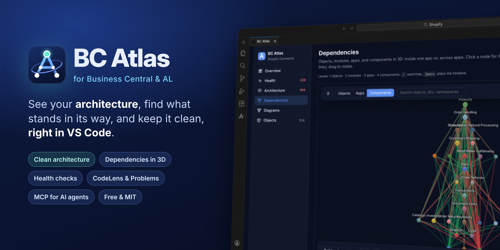
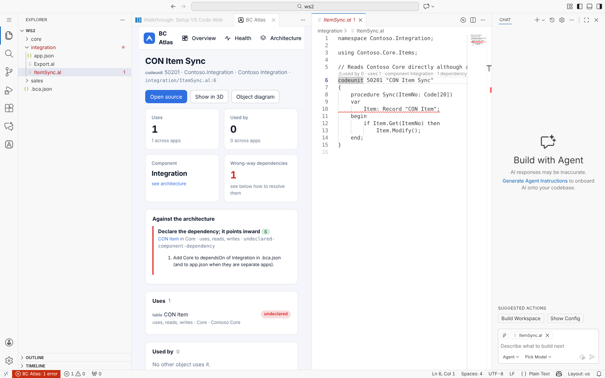
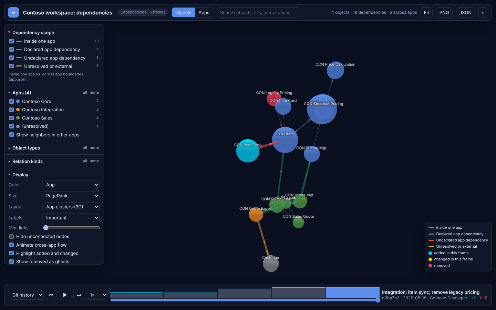
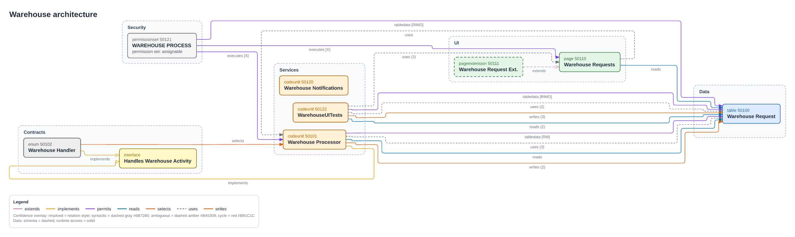
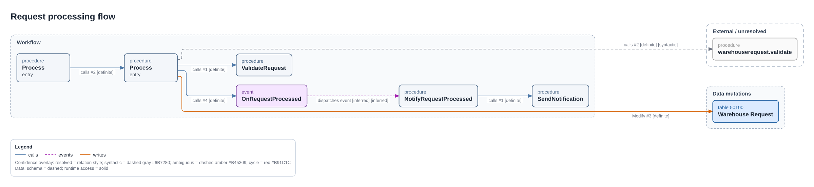
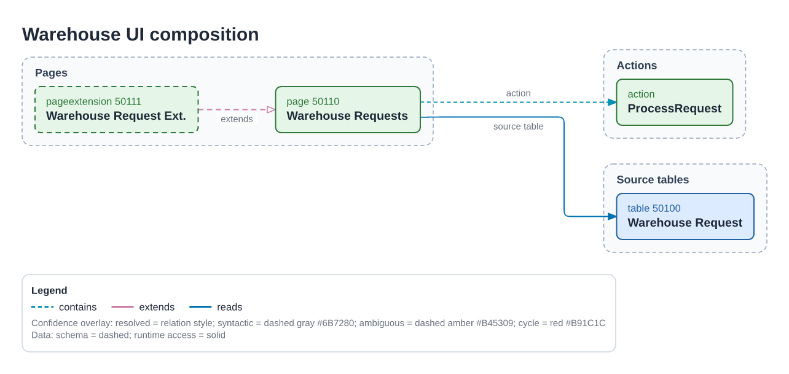

# BC Atlas

[](https://github.com/SchulzOli/BC-Atlas/actions/workflows/ci.yml)
[](./LICENSE)
[](https://nodejs.org/)
[](https://schulzoli.github.io/BC-Atlas/)



**Understand, guard, and document Microsoft Dynamics 365 Business Central AL
projects - straight from source.**

BC Atlas (`bca`) parses AL with
[`tree-sitter-al`](https://github.com/SShadowS/tree-sitter-al), resolves
objects, calls, events, data access, and permissions into an architecture
model, and shows it in one app: overview, health, a target architecture with
the work to reach it, a 3D dependency explorer, diagrams, one page per object,
and documentation from UI tests. The same results are files for Git and CI.
Parser and renderer are WebAssembly: Node.js is the only requirement.

**Documentation: [schulzoli.github.io/BC-Atlas](https://schulzoli.github.io/BC-Atlas/)**

```sh
npm install --global bc-atlas
cd path/to/al-project
bca setup                   # .bca.json, Husky hooks, VS Code tasks, pipeline, schedule (or: bca setup agent)
bca check                   # architecture gate for CI
bca export --view report    # docs/atlas/README.md: overview, diagrams, health
bca update                  # new version? see what changed and update everything in one step
```

In VS Code, install the **BC Atlas** extension and open an AL project:



## Features at a glance

| Area | Command | What you get |
| --- | --- | --- |
| **In VS Code** | BC Atlas extension | Everything below in the editor: a panel with overview, health, architecture, 3D dependencies, diagrams, objects, and docs; findings in the Problems panel; CodeLens above AL objects; the MCP server for agents. [Guide](./docs/vscode.md) |
| **Get started** | `bca setup` | Guided setup in the terminal or through your AI agent (Claude Code, Copilot, Cursor): a starter `.bca.json`, features, Husky or Git hooks, GitHub Actions or Azure Pipelines, cron schedule, and sync. |
| **Analyze** | `bca check` | Health findings - cycles, forbidden dependencies, architecture violations, hot spots, diagnostics, and AL compiler and CodeCop/UICop/AppSourceCop findings - with a CI exit code, also as SARIF for code scanning. |
| | `bca architecture` | Find a target architecture (components, layers), list every dependency that blocks it with how to resolve it, and enforce it with a shrinking baseline. [Guide](./docs/clean-architecture.md) |
| **Export** | `bca export` | Everything the extension shows, as files: the BC Atlas pages as one offline HTML file to share (default), the Markdown report ([example](./examples/report/README.md)), the 3D explorer, one Markdown page per object, any of ten diagram views as D2, SVG, PNG, PDF, or JSON, with `--watch`. |
| | `bca docs` | User guides and test cases from AL UI tests (`[SCENARIO]`, `[GIVEN]`, `[WHEN]`, `[THEN]`) as Markdown, HTML, DITA 1.3, or Azure DevOps CSV, with real captions and translations, a flow diagram per scenario, and BPMN 2.0 processes per use case. [Example](./examples/docs/index.md) |
| **Integrate** | `bca run` | One entry point for Git hooks, schedules, and pipelines; verifies, stages, or publishes generated files. Also available as a [GitHub Action](./docs/automation-and-ci.md#github-actions). |
| | `bca update` | "BC Atlas 0.12.0 is available": release notes, one-step update, and regenerated hooks, tasks, and pipelines. Dependabot pull requests on request. |
| | `bca mcp` | A Model Context Protocol server for AI agents; `bca help --format json` is the versioned command contract. |

Run `bca` for the same overview in your terminal and `bca help <command>` for
options and examples.

## Views

| View | Answers | Example |
| --- | --- | --- |
| `project` | What does the app contain? | `bca export --view project -o project.svg` |
| `module` | How do namespaces or folders depend on each other? | `bca export --view module -o modules.svg` |
| `object` | What surrounds one object? | `bca export --view object --object codeunit:50100 -o object.svg` |
| `data` | Which code reads and writes which tables? | `bca export --view data -o data.svg` |
| `call` | Which procedures call each other? | `bca export --view call --root-procedure Post --call-direction both -o calls.svg` |
| `boundary` | What crosses a namespace, folder, app, or object boundary? | `bca export --view boundary --scope namespace:Contoso.Sales -o boundary.svg` |
| `contracts` | Which types implement an interface? | `bca export --view contracts -o contracts.svg` |
| `events` | Which subscribers react to which publishers? | `bca export --view events --focus OnPosted -o events.svg` |
| `ui` | How do pages, actions, and source tables connect? | `bca export --view ui --focus "Sales Order" -o ui.svg` |
| `workflow` | What happens after an action or entry point? | `bca export --view workflow --entry action:Release -o flow.svg` |

In VS Code, the Diagrams page of the BC Atlas panel renders every view with zoom and pan; click an object to open it.

### Clean architecture

`bca architecture` finds a target architecture for an app or workspace
(components in layers, dependencies pointing inward), lists every dependency
that stands in the way as a work item with a concrete resolution (declare it,
move an extension or subscriber, move a field into a table extension, invert
it with an interface), and shows which components can become apps of their
own. Save it to `.bca.json`, accept today's violations in a baseline, and
`bca check` keeps the architecture from eroding: new violations fail CI,
fixed ones shrink the baseline. In VS Code, the Architecture page shows the
layers and work items and adopts a proposal with one click.

```sh
bca architecture ./app --propose --format markdown -o architecture.md
bca architecture ./app --propose --write --update-baseline
bca check ./app
```

### Interactive dependency explorer

The Dependencies page in VS Code, also written by `bca export --view explorer` as
one offline HTML file, shows a 3D graph of every AL object and app. Dependencies inside one app stay gray; dependencies across apps are
checked against `app.json` and colored as declared, implicit (Microsoft),
undeclared, or unresolved. Filter by app, class, type, or relation kind,
switch to the app level, and press play: with `--history` the timeline replays
how objects and dependencies were added, changed, and removed commit by
commit.

```sh
bca export ./workspace --view explorer --history -o dependencies.html
```



### Screenshots

Generated from the checked-in [warehouse example](./examples/README.md).



| Workflow trace | UI composition |
| --- | --- |
|  |  |

## What BC Atlas understands

- extensions and customization targets, implemented interfaces, and
  enum-mediated implementations;
- dependencies through `Record`, object references, and database types;
- procedure calls, including typed codeunit variables, overloads, chained
  calls, and `EventSubscriber` attributes;
- table reads, writes, schema relations, explicit commits, and safe
  cardinality evidence;
- permission sets: table-data `RIMD` rights, execute rights, and composed sets
  across dependent apps;
- pages, parts, actions, and navigation;
- `app.json` metadata, `.alpackages` symbols and `al.packageCachePath`,
  `.code-workspace` multi-root workspaces, cycles, hubs, orphans, and
  unresolved references.

With Microsoft's AL toolchain installed (the AL Language extension or the AL
Development Tools), the AL compiler resolves every call and reports compiler
and code-analyzer findings; BC Atlas's own analysis is the fallback. See
[AL toolchain](./docs/al-toolchain.md).

Relationship colors are consistent across views, and labels and dash patterns
ensure that color is never the only signal. Every edge keeps its evidence
(operations, source procedures, locations) in JSON and SVG tooltips.

## Guard the architecture

```sh
bca check --fail-on warning
```

```json
{
  "check": { "failOn": "warning", "cycles": "error", "maxFanIn": 25, "maxFanOut": 25 },
  "forbiddenDependencies": [
    { "from": "Contoso.Core:**", "to": "Contoso.UI:**", "severity": "error", "message": "Core must not depend on UI" }
  ]
}
```

`--format markdown` produces a summary for pull requests or job pages; see
[Automation](./docs/automation-and-ci.md).

## Automate it

`bca setup` asks once and wires everything to `bca run`:

| Trigger | Runs | Typical sync |
| --- | --- | --- |
| VS Code task | Health check (findings in the Problems panel), report, docs, live diagram | - |
| `git commit` (Husky) | Fast checks | - |
| `git push` (Husky) | Report and docs | `verify`: stop when generated files are outdated |
| Pull request / `main` | Everything | `verify` or `artifact` |
| Schedule (cron) | Report and docs | `pull-request` with regenerated files |

New BC Atlas versions show up as a notice in the terminal, as `bca update`, and
optionally as Dependabot pull requests. See [Guided setup](./docs/setup.md).

## Documentation

Read the docs at **[schulzoli.github.io/BC-Atlas](https://schulzoli.github.io/BC-Atlas/)**, with
search, or browse them here, starting with the [table of contents](./docs/_TOC_.md):

- [Getting started](./docs/getting-started.md), [BC Atlas for VS Code](./docs/vscode.md), and [guided setup](./docs/setup.md), including [staying up to date](./docs/setup.md#staying-up-to-date)
- [AL toolchain: compiler, analyzers, AL settings](./docs/al-toolchain.md)
- [Automation: hooks, schedules, and pipelines](./docs/automation-and-ci.md)
- [Architecture reports](./docs/reports.md) and [health checks](./docs/health-checks.md)
- [Architecture diagrams and views](./docs/architecture-diagrams.md)
- [Configuration](./docs/configuration.md) and the complete [`.bca.example.json`](./.bca.example.json)
- [Documentation from AL UI tests](./docs/al-ui-test-documentation.md) and [Code Graph](./docs/code-graph-markdown-design.md)
- [Agent integration and MCP](./docs/agent-integration.md)
- [CLI reference](./docs/cli-reference.md) and [troubleshooting](./docs/troubleshooting.md)
- Generated examples: [architecture report](./examples/report/README.md) and [user guides](./examples/docs/index.md)

## AI agents and tools

```sh
bca help --format json   # versioned JSON contract: argv templates, options, enums, exit codes
bca mcp                  # MCP stdio server (also installed as bca-mcp)
```

Agents should read the contract first, pass arguments as arrays, parse stdout
only after a successful exit code, and preview changes with `--dry-run`. The
MCP server exposes inspect, check, report, diagram, documentation, setup, run,
and update-check tools. `bca setup agent --agent claude|copilot|cursor` adds a
`/bca-setup` command that lets your agent guide the setup. See
[agent integration](./docs/agent-integration.md).

## How it works

```text
*.al + app.json + .alpackages + AL settings
  -> tree-sitter AL syntax tree
  -> objects, members, relations          (analyzer)
  -> AL compiler: calls and diagnostics   (src/al, when the toolchain is installed)
  -> resolved model with evidence         (resolver, call analysis, semantics)
  -> view projection and insights         (views, workflow, health)
  -> D2 / SVG / JSON / Markdown / HTML    (renderers)
  -> the pages: one workspace, in VS Code (vscode/) or exported as one file
```

Parsing, resolution, projection, and rendering are separate stages, so new
views and outputs do not touch the parser. The VS Code extension, `bca check`,
`bca architecture`, and `bca export` read the same analysis, so they always
agree; `src/ui/theme.css` gives the pages, the explorer, and the HTML
documentation one look. Every command is defined once in
`src/capabilities.js`; help, argument validation, the JSON contract, and the
generated reference derive from it.

### Current limits

Object references resolve by object type, ID, name, namespace, app
preference, and declared dependencies, including symbol packages. Calls are
exact when the AL compiler is available; without it they resolve by name and
number of arguments, and dynamic calls and unusual subscriber forms stay
syntactic or unresolved when the source does not identify a target. Without
the compiler, conditional compilation is represented as parsed, not
evaluated.

## Development

```sh
git clone https://github.com/SchulzOli/BC-Atlas.git
cd BC-Atlas
npm ci
npm run check      # syntax check and generated-docs check
npm test
npm run examples   # regenerate examples/output, examples/report, and examples/docs
npm run site:dev   # documentation website with live reload
```

The website is built with VitePress from the Markdown in this repository
(`README.md`, `docs/`, `examples/`) and published to GitHub Pages by the `Docs`
workflow on every push to `main`.

Container:

```sh
docker build -t bc-atlas .
docker run --rm --user "$(id -u):$(id -g)" -v "$PWD:/workspace" bc-atlas export /workspace/app --view report -o /workspace/docs/atlas
```

The AL grammar is pinned in `vendor/tree-sitter-al.wasm`; update it with
`npm run update:grammar -- <tree-sitter-al tag>`. The [roadmap](./ROADMAP.md)
lists planned work.

### Publishing

Releases are published manually through the `Publish npm package` workflow.
Update and commit the version in `package.json` and `package-lock.json`, then
enter that exact version in the workflow form. The workflow rejects mismatched
or already published versions, runs all checks, and publishes with the selected
dist-tag. It then tags the commit as `v<version>`, so
`uses: SchulzOli/BC-Atlas@v<version>` resolves, and creates a GitHub release
with the version's `CHANGELOG.md` section. npm authenticates through
[trusted publishing](https://docs.npmjs.com/trusted-publishers): the package's
trusted publisher on npmjs.com is this repository's `publish-npm.yml`
workflow, so no npm token is stored in GitHub.


The VS Code extension in `vscode/` is published by the `Publish VS Code
extension` workflow: set `version` in `vscode/package.json`, then run the
workflow with that version. It tests and packages the extension with the
current engine and publishes it to the Visual Studio Marketplace as the
publisher `SchulzOli`, signed in with Microsoft Entra ID through GitHub's OIDC
token (no Marketplace token is stored; see the
[launch checklist](https://github.com/SchulzOli/BC-Atlas/blob/main/vscode/marketing/README.md#launch-checklist)), and, with
the secret `OVSX_PAT`, to Open VSX. Every CI run uploads the `.vsix` as the
`bc-atlas-vsix` artifact.

## Contributing and support

Contributions are welcome - see [CONTRIBUTING.md](./CONTRIBUTING.md) and the
[Code of Conduct](./CODE_OF_CONDUCT.md). Use [SUPPORT.md](./SUPPORT.md) for
help and [SECURITY.md](./SECURITY.md) for private vulnerability reports.
Release notes are in [CHANGELOG.md](./CHANGELOG.md).

## License

[MIT](./LICENSE). Dependencies retain their own licenses: `tree-sitter-al` and
`web-tree-sitter` are MIT, and D2 is MPL-2.0. See
[THIRD_PARTY_NOTICES.md](./THIRD_PARTY_NOTICES.md).
