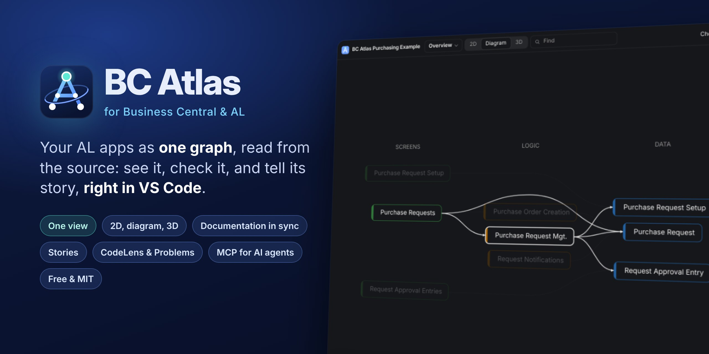
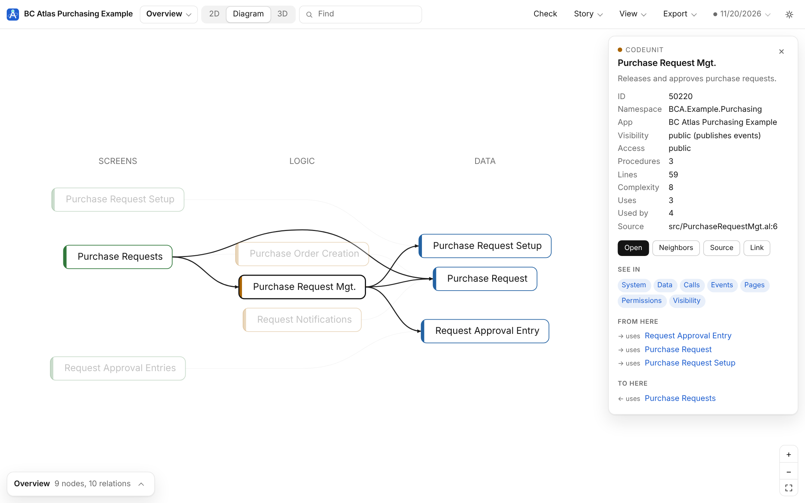
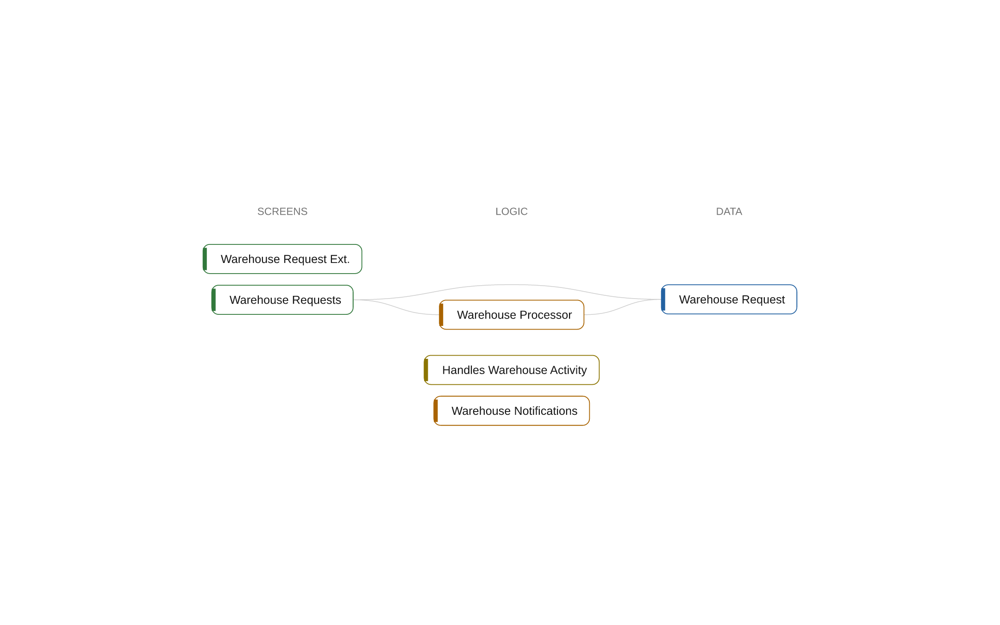
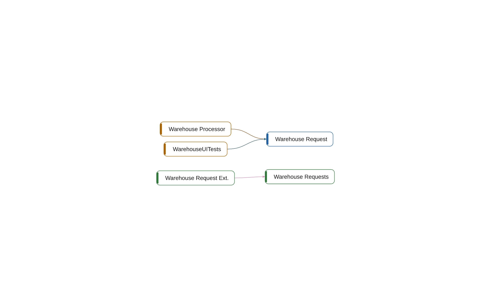
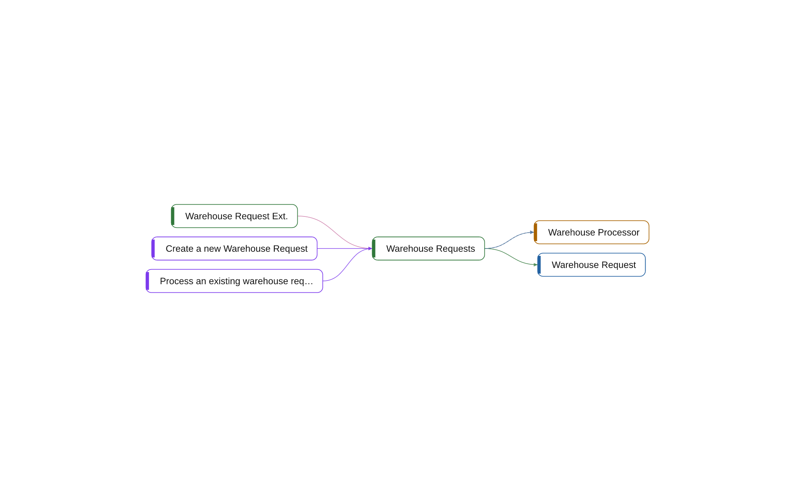

# BC Atlas

[](https://github.com/SchulzOli/BC-Atlas/actions/workflows/ci.yml)
[](./LICENSE)
[](https://nodejs.org/)
[](https://schulzoli.github.io/BC-Atlas/)



**Understand and document Microsoft Dynamics 365 Business Central AL
projects - straight from source.**

BC Atlas (`bca`) parses AL with
[`tree-sitter-al`](https://github.com/SShadowS/tree-sitter-al), resolves
objects, calls, events, data access, and permissions into one graph, and
does two things with it: it **shows** the graph in one view (VS Code, a
browser, the terminal, or a chat), and it **writes** the documentation of the
repository, in sync with the source. A health check guards it in CI.
Parser and renderer are WebAssembly: Node.js is the only requirement.

**Documentation: [schulzoli.github.io/BC-Atlas](https://schulzoli.github.io/BC-Atlas/)**

## Start here

In the folder of your repository, with one app or many:

```sh
npm install --global bc-atlas
cd path/to/repository
bca layers                  # writes docs/layers: the documentation of the repository
```

`docs/layers/README.md` is where to start reading. It leads to:

| Page | Answers |
| --- | --- |
| `README.md` | **How it works**: screens, logic, and data in one picture, and the way down to every app, namespace, object, and procedure. |
| `architecture.md` | **How it is connected**: the apps and what each uses of the others (declared, undeclared, not found), and the namespaces and what depends on what. |
| `findings.md` | **What the health check found**, on which objects. |

The pages are generated from the AL source alone, and the same source gives
the same pages, so they can be kept in sync:

```sh
bca layers --check          # fails when the pages differ from the source: a step for a pipeline
```

The same without files: `bca view` prints what there is to see, `bca export`
writes the view as one file to open in a browser, and in VS Code the
**BC Atlas** extension shows it next to the code. An AI agent gets it through
the MCP tools `bc_atlas_layers` and `bc_atlas_view`.
[Guide](./docs/layers.md), [example](./examples/layers/README.md).

More commands:

```sh
bca check                   # health gate for CI
bca view                    # what there is to see: the lenses and stories of the app, in the terminal
bca export --view report    # docs/atlas/README.md: numbers, a picture of each lens, health
```

In VS Code, install the **BC Atlas** extension and open an AL project:



One view: a toolbar and the graph. A **lens** shows a part of the one graph
BC Atlas reads from the source (overview, system, apps, data, events, health),
in **2D**, as a **diagram**, or in **3D**; **Check** puts
the findings on the nodes; a **story** walks through it step by step, as
documentation, test, and demonstration. [Guide](./docs/vscode.md)

## Features at a glance

| Area | Command | What you get |
| --- | --- | --- |
| **Show** | BC Atlas extension | The view in the editor: a toolbar and the graph. Every object, app, namespace, and finding is a node of one graph; a lens shows a part of it as a 2D graph, a diagram, or a 3D graph; stories walk through it; everything exports. The graph follows the source and the editor; findings in the Problems panel; CodeLens above AL objects; the MCP server for agents. [Guide](./docs/vscode.md) |
| | `bca export` | The same view as one offline HTML file to share (default), the Markdown report ([example](./examples/report/README.md)), or the project as a knowledge graph in RDF with an OWL ontology ([Turtle, RDF/XML, OWL, N-Triples, JSON-LD](./docs/knowledge-graph.md)). |
| | `bca view` | The view without a window, for the terminal, pipelines, and agents: any lens, story, or object of the one graph as text, JSON, CSV, Markdown, SVG, or PNG. `bca view --lens data --form diagram -o data.svg`, `bca view --story fix`, `bca view --inside codeunit:50100`. The same code draws the app and writes these files. [Reference](./docs/cli-reference.md#view) |
| | MCP App (`bc_atlas_app`) | The same view inside the conversation, in every client that renders [MCP Apps](./docs/agent-integration.md#the-view-in-the-chat-mcp-app). Released together with the extension. |
| **Document** | `bca layers` | The documentation of a repository: how it works, how its apps and namespaces are connected (`architecture.md`), and the system explained from the whole down to each procedure, one page per app, namespace, and object, each with a picture. In sync with the source (`--check`). [Guide](./docs/layers.md), [example](./examples/layers/README.md) |
| | `bca docs` | User guides and test cases from AL UI tests (`[SCENARIO]`, `[GIVEN]`, `[WHEN]`, `[THEN]`) as Markdown, HTML, DITA 1.3, or Azure DevOps CSV, with real captions and translations, a flow diagram per scenario, and BPMN 2.0 processes per use case. [Example](./examples/docs/index.md) |
| **Check** | `bca check` | Health findings - dependency cycles, forbidden dependencies, hot spots, undocumented public API, and diagnostics - with a CI exit code, also as SARIF for code scanning. [Rules](./docs/health-checks.md) |
| **Integrate** | `bca mcp` | A Model Context Protocol server for AI agents; `bca help --format json` is the versioned command contract. |

Run `bca` for the same overview in your terminal and `bca help <command>` for
options and examples.

## Lenses

A lens is a part of the one graph. `bca view` lists the lenses a project has;
one with nothing in it is left out.

| Lens | Answers | Example |
| --- | --- | --- |
| `overview` | How does it work, from the screens to the data? | `bca view --lens overview -o overview.svg` |
| `system` | What is there, and what does each object do with the others? | `bca view --lens system` |
| `apps` | Which apps use which, declared or not? | `bca view --lens apps --form diagram -o apps.svg` |
| `modules` | How do the namespaces depend on each other? | `bca view --lens modules` |
| `data` | Which code reads and writes which tables? | `bca view --lens data --form diagram -o data.svg` |
| `calls` | Which objects call which? | `bca view --lens calls` |
| `events` | Which subscribers react to which publishers? | `bca view --lens events` |
| `contracts` | Which types implement an interface? | `bca view --lens contracts` |
| `pages` | How do pages, reports, and their source tables connect? | `bca view --lens pages` |
| `security` | What do the permission sets permit and include? | `bca view --lens security` |
| `visibility` | What is public, internal, or local, and what can it be? | `bca view --lens visibility` |
| `health` | What did the health check find, on what? | `bca view --lens health --check` |

`--inside codeunit:50100` opens one object to its procedures and what each
does; `--focus "table:Sales Header" --depth 2` shows a node and what is near it.

### Pictures

Drawn by `bca view` from the checked-in [warehouse example](./examples/README.md).



| Data | Pages |
| --- | --- |
|  |  |

## What BC Atlas understands

- extensions and customization targets, implemented interfaces, and
  enum-mediated implementations;
- dependencies through `Record`, object references, and database types;
- procedure calls, including typed codeunit variables, overloads, chained
  calls, and `EventSubscriber` attributes;
- table reads, writes, schema relations, explicit commits, and safe
  cardinality evidence;
- permission sets: table-data `RIMD` rights, execute rights, and composed sets
  across dependent apps;
- pages, parts, actions, and navigation;
- what characterizes each object, field, and procedure: captions, `///`
  summaries, access, obsolete state, data classification, page and table
  types, size, and cyclomatic complexity, also for objects in symbol
  packages;
- `app.json` metadata, `.alpackages` symbols and `al.packageCachePath`,
  `.code-workspace` multi-root workspaces, cycles, hubs, orphans, and
  unresolved references.

Calls are resolved from the source, by name and number of arguments. Colors
of relations are the same in every lens, and every relation keeps its evidence
(operations, source procedures, locations) in JSON.

## Guard it in CI

```sh
bca check --fail-on warning
```

```json
{
  "check": { "failOn": "warning", "cycles": "error", "maxFanIn": 25, "maxFanOut": 25 },
  "forbiddenDependencies": [
    { "from": "Contoso.Core:**", "to": "Contoso.UI:**", "severity": "error", "message": "Core must not depend on UI" }
  ]
}
```

`--format markdown` produces a summary for pull requests or job pages, and
`--format sarif` a report for code scanning. Run `bca check` and
`bca layers --check` as steps of your pipeline.

## See how it works

```sh
bca view --lens overview                      # which screens, with which logic, in which data
bca view --lens overview -o overview.svg      # the same as a picture, in three columns
bca export -o atlas.html                      # the view as one file; it opens on the overview
```

The overview is the first thing the view shows: screens, logic, and data
in columns, read from left to right. Lines are quiet; select an object and
its way through the app lights up. See
[the view](./docs/vscode.md#the-overview-how-it-works).

## Documentation

Read the docs at **[schulzoli.github.io/BC-Atlas](https://schulzoli.github.io/BC-Atlas/)**, with
search, or browse them here, starting with the [table of contents](./docs/_TOC_.md):

- [Getting started](./docs/getting-started.md) and [BC Atlas for VS Code](./docs/vscode.md)
- [Layered documentation](./docs/layers.md), [reports](./docs/reports.md), and [documentation from AL UI tests](./docs/al-ui-test-documentation.md)
- [Health checks](./docs/health-checks.md)
- [Configuration](./docs/configuration.md) and the complete [`.bca.example.json`](./.bca.example.json)
- [Knowledge graph](./docs/knowledge-graph.md) and [agent integration and MCP](./docs/agent-integration.md)
- [CLI reference](./docs/cli-reference.md) and [troubleshooting](./docs/troubleshooting.md)
- Generated examples: [report](./examples/report/README.md), [layered documentation](./examples/layers/README.md), and [user guides](./examples/docs/index.md)

## AI agents and tools

```sh
bca help --format json   # versioned JSON contract: argv templates, options, enums, exit codes
bca mcp                  # MCP stdio server (also installed as bca-mcp)
```

Agents should read the contract first, pass arguments as arrays, parse stdout
only after a successful exit code, and preview changes with `--dry-run`. The
MCP server exposes inspect, check, report, view, layers, and documentation
tools, and the view itself as an MCP App. See
[agent integration](./docs/agent-integration.md).

## How it works

```text
*.al + app.json + .alpackages
  -> tree-sitter AL syntax tree
  -> objects, members, relations          (src/analyzer.js)
  -> resolved model with evidence         (src/resolver.js, call analysis, semantics)
  -> one project: selection and insights  (src/project.js)
  -> health findings                      (src/health.js)
  -> the atlas: everything as one graph with lenses, findings, and stories (src/app/atlas.js)
  -> the view: a toolbar and the graph, in VS Code (vscode/), as one file, or as text and pictures (src/app)
  -> the layered documentation            (src/app/layers.js)
```

Every command starts at `src/project.js` and reads the same analysis, so the
VS Code extension, `bca view`, `bca layers`, `bca export`, and `bca check`
always agree. Every command is defined once in `src/capabilities.js`; help,
argument validation, the JSON contract, and the generated reference derive
from it.

### Current limits

Object references resolve by object type, ID, name, namespace, app
preference, and declared dependencies, including symbol packages. Calls
resolve by name and number of arguments; dynamic calls and unusual subscriber
forms stay syntactic or unresolved when the source does not identify a target.
Conditional compilation is represented as parsed, not evaluated: what every
branch of an `#if` declares and refers to is in the
model. A declaration whose header differs by branch while the body is shared
(`#if X` / `table 50100 "A"` / `#else` / `table 50101 "A"` / `#endif` /
`{ ... }`) is there once, with the header of the first branch.

## Development

```sh
git clone https://github.com/SchulzOli/BC-Atlas.git
cd BC-Atlas
npm ci
npm run check      # syntax check and generated-docs check
npm test
npm run examples   # regenerate examples/output, report, layers, docs, and knowledge-graph
npm run site:dev   # documentation website with live reload
```

The website is built with VitePress from the Markdown in this repository
(`README.md`, `docs/`, `examples/`) and published to GitHub Pages by the `Docs`
workflow on every push to `main`.

Container:

```sh
docker build -t bc-atlas .
docker run --rm --user "$(id -u):$(id -g)" -v "$PWD:/workspace" bc-atlas export /workspace/app --view report -o /workspace/docs/atlas
```

The AL grammar is pinned in `vendor/tree-sitter-al.wasm`; update it with
`npm run update:grammar -- <tree-sitter-al tag>`. The [roadmap](./ROADMAP.md)
lists planned work.

### Repository layout

| Folder | What it is |
|---|---|
| `src/`, `vendor/`, `schemas/` | BC Atlas itself: the `bca` CLI and the MCP server (npm package `bc-atlas`) |
| [`vscode/`](./vscode/) | The VS Code extension |

### Publishing

Releases are published manually through the `Release` workflow
(`.github/workflows/publish-npm.yml`). Set the version of both packages with
`npm run version:set -- <version>`, merge it, then run the workflow on `main`
with that exact version. It rejects mismatched, already published, or already
tagged versions, and tests the npm package and the VS Code extension, the
packaged `.vsix` included, before anything is published. Then it publishes the
npm package with the selected dist-tag and, unless switched off, the extension
to the Visual Studio Marketplace and, with the secret `OVSX_PAT`, to Open VSX.
Last, it tags the commit as `v<version>` and creates a GitHub release with
the version's `CHANGELOG.md` section and the `.vsix`.

No token is stored for either registry. npm authenticates through
[trusted publishing](https://docs.npmjs.com/trusted-publishers): the package's
trusted publisher on npmjs.com is this repository's `publish-npm.yml`
workflow. The Marketplace publisher `SchulzOli` is signed in with Microsoft
Entra ID through GitHub's OIDC token in the `marketplace` environment (see the
[launch checklist](https://github.com/SchulzOli/BC-Atlas/blob/main/vscode/marketing/README.md#launch-checklist)).
Every CI run uploads the `.vsix` as the `bc-atlas-vsix` artifact.

## Contributing and support

Contributions are welcome - see [CONTRIBUTING.md](./CONTRIBUTING.md) and the
[Code of Conduct](./CODE_OF_CONDUCT.md). Use [SUPPORT.md](./SUPPORT.md) for
help and [SECURITY.md](./SECURITY.md) for private vulnerability reports.
Release notes are in [CHANGELOG.md](./CHANGELOG.md).

## License

[MIT](./LICENSE). Dependencies retain their own licenses: `tree-sitter-al` and
`web-tree-sitter` are MIT, elkjs is EPL-2.0, resvg is MPL-2.0, and the
Liberation Sans font is OFL-1.1. See
[THIRD_PARTY_NOTICES.md](./THIRD_PARTY_NOTICES.md).
