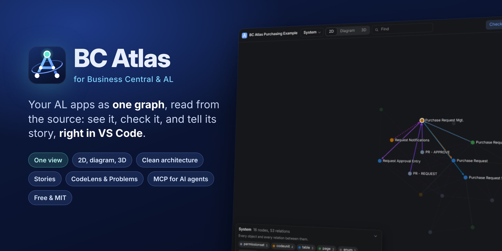
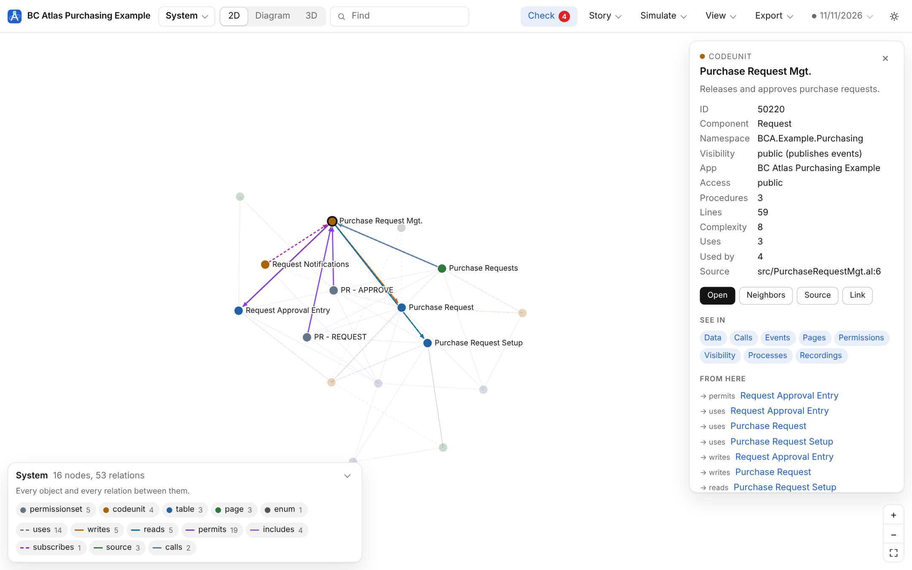
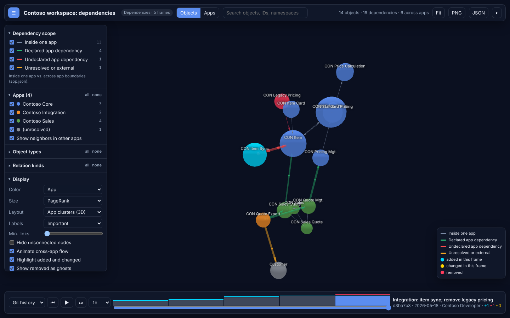
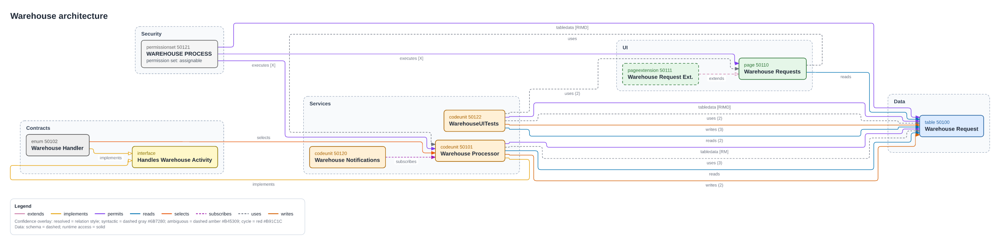
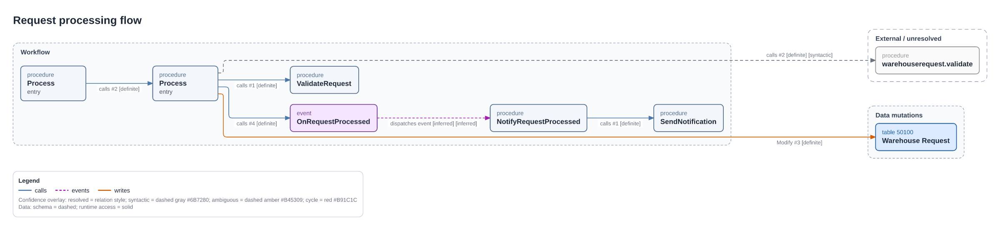
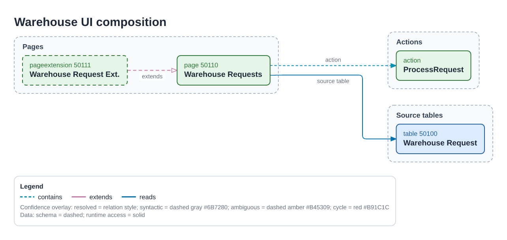

# BC Atlas

[](https://github.com/SchulzOli/BC-Atlas/actions/workflows/ci.yml)
[](./LICENSE)
[](https://nodejs.org/)
[](https://schulzoli.github.io/BC-Atlas/)



**Understand, guard, and document Microsoft Dynamics 365 Business Central AL
projects - straight from source.**

BC Atlas (`bca`) parses AL with
[`tree-sitter-al`](https://github.com/SShadowS/tree-sitter-al), resolves
objects, calls, events, data access, and permissions into an architecture
model, and shows it in one app: overview, health, a target architecture with
the work to reach it, a 3D dependency explorer, diagrams, one page per object,
a system handbook, and documentation from UI tests. The same results are
files for Git and CI.
Parser and renderer are WebAssembly: Node.js is the only requirement.

**Documentation: [schulzoli.github.io/BC-Atlas](https://schulzoli.github.io/BC-Atlas/)**

## Start here

In the folder of your repository, with one app or many:

```sh
npm install --global bc-atlas
cd path/to/repository
bca layers                  # writes docs/layers: the documentation of the repository
```

`docs/layers/README.md` is where to start reading. It leads to three things:

| Page | Answers |
| --- | --- |
| `README.md` | **How it works**: people, processes, screens, logic, and data in one picture, and the way down to every app, component, namespace, object, and procedure. |
| `architecture.md` | **How it is connected**: the apps and what each uses of the others (declared, undeclared, not found), the components in their layers, cycles, and tables written from outside their component. |
| `changes.md` | **What to change, and how**: every change to the architecture the analysis finds, the most important first, each with why, the steps, the effort, and where. |

The pages are generated from the AL source alone, and the same source gives
the same pages, so they can be kept in sync:

```sh
bca layers --check          # fails when the pages differ from the source: a step for a pipeline
bca setup                   # or let a Git hook, a pipeline, or a schedule write them
```

The same without files: `bca view --story architecture` prints what to
change and how, `bca export` writes the view as one file to open in a
browser, and in VS Code the **BC Atlas** extension shows it next to the
code. An AI agent gets it through the MCP tools `bc_atlas_layers` and
`bc_atlas_view`. [Guide](./docs/layers.md), [example](./examples/layers/README.md).

More commands:

```sh
bca setup                   # .bca.json, Husky hooks, VS Code tasks, pipeline, schedule (or: bca setup agent)
bca check                   # architecture gate for CI
bca simulate                # battle test: your roles and permission sets against the process tests
bca view                    # what there is to see: the lenses and stories of the app, in the terminal
bca export --view report    # docs/atlas/README.md: overview, diagrams, health
bca export --view handbook  # docs/handbook: events, data, permissions, UI, code health
bca update                  # new version? see what changed and update everything in one step
```

In VS Code, install the **BC Atlas** extension and open an AL project:



One view: a toolbar and the graph. A **lens** shows a part of the one graph
BC Atlas reads from the source (system, components, data, events, findings,
processes, people), in **2D**, as a **diagram**, or in **3D**; **Check** puts
the findings on the nodes; a **story** walks through it step by step, as
documentation, test, and demonstration. [Guide](./docs/vscode.md)

## Features at a glance

| Area | Command | What you get |
| --- | --- | --- |
| **In VS Code** | BC Atlas extension | Everything below in the editor, as one view: a toolbar and the graph. Every object, app, component, finding, process test, and person is a node of one graph; a lens shows a part of it as a 2D graph, a diagram, or a 3D graph; stories walk through it; everything exports. The graph follows the source and the editor; findings in the Problems panel; CodeLens above AL objects; the MCP server for agents. [Guide](./docs/vscode.md) |
| **Get started** | `bca setup` | Guided setup in the terminal or through your AI agent (Claude Code, Copilot, Cursor): a starter `.bca.json`, features, Husky or Git hooks, GitHub Actions or Azure Pipelines, cron schedule, and sync. |
| **Analyze** | `bca check` | Health findings - cycles, forbidden dependencies, architecture violations, hot spots, undocumented public API, diagnostics, and AL compiler and CodeCop/UICop/AppSourceCop findings - with a CI exit code, also as SARIF for code scanning. [Rules](./docs/health-checks.md) |
| | `bca simulate` | The battle test: simulate the use in your company. Agents with your roles, permission sets, and task groups perform the process tests (AL UI tests) step by step. It fails CI when a role is blocked or can do what it must not, explains every permission a step needs, and writes the fit-gap analysis against your requirements. [Guide](./docs/battle-test.md), [example](./examples/simulation/README.md) |
| | `bca architecture` | Find a target architecture (components, layers), list every dependency that blocks it with how to resolve it, and enforce it with a shrinking baseline. You decide what the proposal considers (`architecture.proposal`: relation kinds, starting structures, granularity, components you keep, objects you exclude), it says how it was made, and `--explain` says why an object is where it is. [Guide](./docs/clean-architecture.md) |
| | `bca graph query` | Reuse a saved graph for impact analysis or message migrations without re-analyzing AL; keep IDs, directions, evidence, and metadata. [Guide](./docs/dependency-explorer.md#query-and-render-saved-graphs) |
| **Export** | `bca export` | Everything the extension shows, as files: the BC Atlas view (a toolbar and the graph, with every lens, finding, and story) as one offline HTML file to share (default), the Markdown report ([example](./examples/report/README.md)), the 3D explorer, one Markdown page per object, any of eleven diagram views as D2, SVG, PNG, PDF, or JSON, with `--watch`, and the project as a knowledge graph in RDF with an OWL ontology ([Turtle, RDF/XML, OWL, N-Triples, JSON-LD](./docs/knowledge-graph.md)). |
| | `bca view` | The view of the app without a window, for the terminal, pipelines, and agents: any lens, story, or object of the one graph as text, JSON, CSV, Markdown, SVG, or PNG. `bca view --lens data --form diagram -o data.svg`, `bca view --story fix`, `bca view --inside codeunit:50100`. The same code draws the app and writes these files. [Reference](./docs/cli-reference.md#view) |
| | `bca layers` | The documentation of a repository: how it works, how its apps and components are connected (`architecture.md`), what to change in the architecture and how (`changes.md`), and the system explained from the whole down to each procedure, one page per app, component, namespace, and object, each with a picture. In sync with the source (`--check`, or the `layers` task of `bca run`), for the source as it is now and as it was at any commit, tag, or release (`--at v1.4.0`, `--releases`), with what changed between them. [Guide](./docs/layers.md), [example](./examples/layers/README.md) |
| | `bca bundle` | Everything as one artifact: validation, the simulation with a snapshot of every process test, the layered documentation with the view, narrative pages, and the test results and build outputs you give it. One folder, one ZIP file, one manifest with the commit and every step. [Guide](./docs/bundle.md) |
| | `bca export --view handbook` | The system handbook: what the app consists of, its events, data (who inserts, modifies, deletes, reads each table), permissions, interfaces, user interface, and code health, across all objects, in English or German, linked to the object catalog. [Guide](./docs/handbook.md), [example](./examples/handbook/README.md) |
| | `bca docs` | User guides and test cases from AL UI tests (`[SCENARIO]`, `[GIVEN]`, `[WHEN]`, `[THEN]`) as Markdown, HTML, DITA 1.3, or Azure DevOps CSV, with real captions and translations, a flow diagram per scenario, and BPMN 2.0 processes per use case. [Example](./examples/docs/index.md) |
| | `bca graph render` | Render saved graph selections as SVG, static HTML, DOT, or JSON through the CLI or MCP, locally and without Graphviz. |
| **Integrate** | `bca run` | One entry point for Git hooks, schedules, and pipelines; verifies, stages, or publishes generated files. Also available as a [GitHub Action](./docs/automation-and-ci.md#github-actions). |
| | `bca update` | "BC Atlas 0.22.0 is available": release notes, one-step update, and regenerated hooks, tasks, and pipelines. Dependabot pull requests on request. |
| | `bca mcp` | A Model Context Protocol server for AI agents; `bca help --format json` is the versioned command contract. |

Run `bca` for the same overview in your terminal and `bca help <command>` for
options and examples.

## Views

| View | Answers | Example |
| --- | --- | --- |
| `project` | What does the app contain? | `bca export --view project -o project.svg` |
| `module` | How do namespaces or folders depend on each other? | `bca export --view module -o modules.svg` |
| `object` | What surrounds one object? | `bca export --view object --object codeunit:50100 -o object.svg` |
| `data` | Which code reads and writes which tables? | `bca export --view data -o data.svg` |
| `call` | Which procedures call each other? | `bca export --view call --root-procedure Post --call-direction both -o calls.svg` |
| `boundary` | What crosses a namespace, folder, app, or object boundary? | `bca export --view boundary --scope namespace:Contoso.Sales -o boundary.svg` |
| `contracts` | Which types implement an interface? | `bca export --view contracts -o contracts.svg` |
| `events` | Which subscribers react to which publishers? | `bca export --view events --focus OnPosted -o events.svg` |
| `ui` | How do pages, actions, and source tables connect? | `bca export --view ui --focus "Sales Order" -o ui.svg` |
| `workflow` | What happens after an action or entry point? | `bca export --view workflow --entry action:Release -o flow.svg` |
| `visibility` | What is public, internal, or local, and what can it be? | `bca export --view visibility -o visibility.svg` |

In VS Code, the BC Atlas view shows the same as lenses of one graph, as a 2D graph, a diagram, or a 3D graph; click an object to select it, double-click it to open it.

### Clean architecture

`bca architecture` finds a target architecture for an app or workspace
(components in layers, dependencies pointing inward), lists every dependency
that stands in the way as a work item with a concrete resolution (declare it,
move an extension or subscriber, move a field into a table extension, invert
it with an interface), and shows which components can become apps of their
own. Save it to `.bca.json`, accept today's violations in a baseline, and
`bca check` keeps the architecture from eroding: new violations fail CI,
fixed ones shrink the baseline. In VS Code, the Components lens shows the
components in their layers, the story "Dependencies the wrong way" walks
through the work items, and the view saves a proposal.

```sh
bca architecture ./app --propose --format markdown -o architecture.md
bca architecture ./app --propose --write --update-baseline
bca check ./app
```

### Interactive dependency explorer

`bca export --view explorer` writes one offline HTML file with a 3D graph of
every AL object and app and a timeline. Dependencies inside one app stay gray; dependencies across apps are
checked against `app.json` and colored as declared, implicit (Microsoft),
undeclared, or unresolved. Filter by app, class, type, or relation kind,
switch to the app level, and press play: with `--history` the timeline replays
how objects and dependencies were added, changed, and removed commit by
commit.

```sh
bca export ./workspace --view explorer --history -o dependencies.html
```



### Screenshots

Generated from the checked-in [warehouse example](./examples/README.md).



| Workflow trace | UI composition |
| --- | --- |
|  |  |

## What BC Atlas understands

- extensions and customization targets, implemented interfaces, and
  enum-mediated implementations;
- dependencies through `Record`, object references, and database types;
- procedure calls, including typed codeunit variables, overloads, chained
  calls, and `EventSubscriber` attributes;
- table reads, writes, schema relations, explicit commits, and safe
  cardinality evidence;
- permission sets: table-data `RIMD` rights, execute rights, and composed sets
  across dependent apps;
- pages, parts, actions, and navigation;
- what characterizes each object, field, and procedure: captions, `///`
  summaries, access, obsolete state, data classification, page and table
  types, size, and cyclomatic complexity, also for objects in symbol
  packages;
- `app.json` metadata, `.alpackages` symbols and `al.packageCachePath`,
  `.code-workspace` multi-root workspaces, cycles, hubs, orphans, and
  unresolved references.

With Microsoft's AL toolchain installed (the AL Language extension or the AL
Development Tools), the AL compiler resolves every call and reports compiler
and code-analyzer findings; BC Atlas's own analysis is the fallback. See
[AL toolchain](./docs/al-toolchain.md).

Relationship colors are consistent across views, and labels and dash patterns
ensure that color is never the only signal. Every edge keeps its evidence
(operations, source procedures, locations) in JSON and SVG tooltips.

## Guard the architecture

```sh
bca check --fail-on warning
```

```json
{
  "check": { "failOn": "warning", "cycles": "error", "maxFanIn": 25, "maxFanOut": 25 },
  "forbiddenDependencies": [
    { "from": "Contoso.Core:**", "to": "Contoso.UI:**", "severity": "error", "message": "Core must not depend on UI" }
  ]
}
```

`--format markdown` produces a summary for pull requests or job pages; see
[Automation](./docs/automation-and-ci.md).

## See how it works

```sh
bca view --lens overview                      # who does what, on which screens, with which logic, in which data
bca view --lens overview -o overview.svg      # the same as a picture, in five columns
bca export -o atlas.html                      # the view as one file; it opens on the overview
```

The overview is the first thing the view shows: people, processes,
screens, logic, and data in columns, read from left to right. Lines are
quiet; select a process test or an object and its way through the app
lights up. See [the view](./docs/vscode.md#the-overview-how-it-works).

## Battle-test it: simulate the use in your company

```sh
bca simulate                                  # who can do what; exit code 1 when a role is blocked
bca simulate -o docs/simulation/README.md     # the report as documentation, with the fit-gap analysis
```

Describe the company under `simulation` in `.bca.json`: roles with permission
sets and task groups, the agents who hold them, what a role must not be able
to do, and the requirements. The agents then perform the process tests (your
AL UI tests) step by step, and every step is checked against what the code
behind it needs, down to the subscriber of an event three calls deep.

```text
Who can do what             Anna     Ben      Carla    Dana
  purchase-request-create   ok       ok       -        (can)
  purchase-request-approve  denied   BLOCKED  denied   CAN
  purchase-request-order    denied   denied   ok       (can)

ERROR   Ben (Team lead) cannot complete "Approve a released purchase request": step 3
        (Choose the Approve action) needs Execute on codeunit 50222 Request Notifications.
        -> Add to a permission set of the agent: codeunit "Request Notifications" = X
ERROR   Dana (Administrator) can complete "Approve a released purchase request" but must not be able to.
```

Without a `simulation` section, the `[PERMISSIONS]` of the tests are the
roles. See [Battle test](./docs/battle-test.md) and the
[example report](./examples/simulation/README.md).

A run shows how the result came about: `bca view --story run:Ben` (or
**Simulate › Run, step by step** in the view) follows one person through
the assigned process tests, and the picture is built step by step
([example](./examples/simulation/run-ben.md)).

## Automate it

`bca setup` asks once and wires everything to `bca run`:

| Trigger | Runs | Typical sync |
| --- | --- | --- |
| VS Code task | Health check (findings in the Problems panel), report, docs, live diagram | - |
| `git commit` (Husky) | Fast checks | - |
| `git push` (Husky) | Report and docs | `verify`: stop when generated files are outdated |
| Pull request / `main` | Everything, with the battle test when you add `simulate` | `verify` or `artifact` |
| Schedule (cron) | Report and docs | `pull-request` with regenerated files |

New BC Atlas versions show up as a notice in the terminal, as `bca update`, and
optionally as Dependabot pull requests. See [Guided setup](./docs/setup.md).

## Documentation

Read the docs at **[schulzoli.github.io/BC-Atlas](https://schulzoli.github.io/BC-Atlas/)**, with
search, or browse them here, starting with the [table of contents](./docs/_TOC_.md):

- [Getting started](./docs/getting-started.md), [BC Atlas for VS Code](./docs/vscode.md), and [guided setup](./docs/setup.md), including [staying up to date](./docs/setup.md#staying-up-to-date)
- [AL toolchain: compiler, analyzers, AL settings](./docs/al-toolchain.md)
- [Automation: hooks, schedules, and pipelines](./docs/automation-and-ci.md)
- [Architecture reports](./docs/reports.md), [health checks](./docs/health-checks.md), and the [battle test](./docs/battle-test.md)
- [Architecture diagrams and views](./docs/architecture-diagrams.md)
- [Configuration](./docs/configuration.md) and the complete [`.bca.example.json`](./.bca.example.json)
- [System handbook](./docs/handbook.md), [documentation from AL UI tests](./docs/al-ui-test-documentation.md), and [Code Graph](./docs/code-graph-markdown-design.md)
- [Agent integration and MCP](./docs/agent-integration.md)
- [CLI reference](./docs/cli-reference.md) and [troubleshooting](./docs/troubleshooting.md)
- Generated examples: [architecture report](./examples/report/README.md), [system handbook](./examples/handbook/README.md), [user guides](./examples/docs/index.md), and [battle test](./examples/simulation/README.md)

## AI agents and tools

```sh
bca help --format json   # versioned JSON contract: argv templates, options, enums, exit codes
bca mcp                  # MCP stdio server (also installed as bca-mcp)
```

Agents should read the contract first, pass arguments as arrays, parse stdout
only after a successful exit code, and preview changes with `--dry-run`. The
MCP server exposes inspect, check, simulate, architecture, report, handbook, diagram,
documentation, setup, run, and update-check tools. `bca setup agent --agent claude|copilot|cursor` adds a
`/bca-setup` command that lets your agent guide the setup. See
[agent integration](./docs/agent-integration.md).

## How it works

```text
*.al + app.json + .alpackages + AL settings
  -> tree-sitter AL syntax tree
  -> objects, members, relations          (analyzer)
  -> AL compiler: calls and diagnostics   (src/al, when the toolchain is installed)
  -> resolved model with evidence         (resolver, call analysis, semantics)
  -> view projection and insights         (views, workflow, health)
  -> SVG / PNG / PDF / D2 / JSON / Markdown / HTML    (renderers)
  -> the atlas: everything as one graph with lenses, findings, and stories (src/app/atlas.js)
  -> the view: a toolbar and the graph, in VS Code (vscode/) or exported as one file (src/app/ui)
```

Parsing, resolution, projection, and rendering are separate stages, so new
views and outputs do not touch the parser. The VS Code extension, `bca check`,
`bca architecture`, and `bca export` read the same analysis, so they always
agree; `src/ui/theme.css` gives the view, the explorer, and the HTML
documentation one look. Every command is defined once in
`src/capabilities.js`; help, argument validation, the JSON contract, and the
generated reference derive from it.

### Current limits

Object references resolve by object type, ID, name, namespace, app
preference, and declared dependencies, including symbol packages. Calls are
exact when the AL compiler is available; without it they resolve by name and
number of arguments, and dynamic calls and unusual subscriber forms stay
syntactic or unresolved when the source does not identify a target. Without
the compiler, conditional compilation is represented as parsed, not
evaluated: what every branch of an `#if` declares and refers to is in the
model. A declaration whose header differs by branch while the body is shared
(`#if X` / `table 50100 "A"` / `#else` / `table 50101 "A"` / `#endif` /
`{ ... }`) is there once, with the header of the first branch.

## Development

```sh
git clone https://github.com/SchulzOli/BC-Atlas.git
cd BC-Atlas
npm ci
npm run check      # syntax check and generated-docs check
npm test
npm run examples   # regenerate examples/output, examples/report, and examples/docs
npm run site:dev   # documentation website with live reload
```

The website is built with VitePress from the Markdown in this repository
(`README.md`, `docs/`, `examples/`) and published to GitHub Pages by the `Docs`
workflow on every push to `main`.

Container:

```sh
docker build -t bc-atlas .
docker run --rm --user "$(id -u):$(id -g)" -v "$PWD:/workspace" bc-atlas export /workspace/app --view report -o /workspace/docs/atlas
```

The AL grammar is pinned in `vendor/tree-sitter-al.wasm`; update it with
`npm run update:grammar -- <tree-sitter-al tag>`. The [roadmap](./ROADMAP.md)
lists planned work.

### Repository layout

This repository is a monorepo:

| Folder | What it is |
|---|---|
| `src/`, `vendor/`, `schemas/` | BC Atlas itself: the `bca` CLI and the MCP server (npm package `bc-atlas`) |
| [`plugins/sync/`](./plugins/sync/) | The sync layer and the Business Central side that records processes (formerly the repository `bc-atlas-sync`) |
| [`plugins/ai/`](./plugins/ai/) | The AI plugin |
| [`vscode/`](./vscode/) | The VS Code extension |
| [`openbridge/`](./openbridge/) | BC OpenBridge: the gateway (`bc-openbridge/`) and the MCP server for operating Business Central (`bc-mcp/`), formerly the repository `bc-openbridge` |

`openbridge/` has its own packages, lockfiles, and Node version (24). It is
not part of the npm package or the container image of BC Atlas, and the
`OpenBridge` workflow tests it when something below it changes:

```sh
cd openbridge/bc-openbridge && npm ci && npm run check
cd ../bc-mcp && npm ci && npm run check
```

### Publishing

Releases are published manually through the `Release` workflow
(`.github/workflows/publish-npm.yml`). Set the version of both packages with
`npm run version:set -- <version>`, merge it, then run the workflow on `main`
with that exact version. It rejects mismatched, already published, or already
tagged versions, and tests the npm package and the VS Code extension, the
packaged `.vsix` included, before anything is published. Then it publishes the
npm package with the selected dist-tag and, unless switched off, the extension
to the Visual Studio Marketplace and, with the secret `OVSX_PAT`, to Open VSX.
Last, it tags the commit as `v<version>`, so
`uses: SchulzOli/BC-Atlas@v<version>` resolves, and creates a GitHub release
with the version's `CHANGELOG.md` section and the `.vsix`.

No token is stored for either registry. npm authenticates through
[trusted publishing](https://docs.npmjs.com/trusted-publishers): the package's
trusted publisher on npmjs.com is this repository's `publish-npm.yml`
workflow. The Marketplace publisher `SchulzOli` is signed in with Microsoft
Entra ID through GitHub's OIDC token in the `marketplace` environment (see the
[launch checklist](https://github.com/SchulzOli/BC-Atlas/blob/main/vscode/marketing/README.md#launch-checklist)).
Every CI run uploads the `.vsix` as the `bc-atlas-vsix` artifact.

## Contributing and support

Contributions are welcome - see [CONTRIBUTING.md](./CONTRIBUTING.md) and the
[Code of Conduct](./CODE_OF_CONDUCT.md). Use [SUPPORT.md](./SUPPORT.md) for
help and [SECURITY.md](./SECURITY.md) for private vulnerability reports.
Release notes are in [CHANGELOG.md](./CHANGELOG.md).

## License

[MIT](./LICENSE). Dependencies retain their own licenses: `tree-sitter-al` and
`web-tree-sitter` are MIT, elkjs is EPL-2.0, resvg is MPL-2.0, and the
Liberation Sans font is OFL-1.1. See
[THIRD_PARTY_NOTICES.md](./THIRD_PARTY_NOTICES.md).
