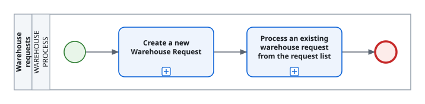

# Generate documentation from AL UI tests

BC Atlas converts AL `[Test]` procedures directly into Markdown. AL UI-test
files are the only persisted source for scenarios and documentation metadata.
The CLI and the MCP server use the same JavaScript application functions.

```text
AL TestPage test -> BC Atlas -> Markdown
```

No browser automation, generated JavaScript test, AI agent, or YAML scenario is
involved.

## Source convention

The selected procedure must have `[Test]` and a `[SCENARIO]` comment. The
standard test comments provide the documentation:

```al
[Test]
procedure EDIPartnersList_NewPartner_PersistsGeneralFields()
var
    EDIPartner: Record EDIPartner;
    EDIPartnersList: TestPage EDIPartners;
begin
    // [DOC-ID] edi-partner-create
    // [FEATURE] edi-partner
    // [SCENARIO] Creating a new partner from the EDI Partners list persists the general fields.
    // [PERMISSIONS] EDI Partner, Edit

    // [GIVEN] No partner exists yet.
    PartnerFactory.CleanupPartnerData();

    // [WHEN] A user creates a new partner from the list page.
    EDIPartnersList.OpenNew();
    EDIPartnersList.PartnerCode.SetValue('P-UI-LIST');
    EDIPartnersList.Name.SetValue('UI List Partner');
    EDIPartnersList.Close();

    // [THEN] The partner persisted with the values entered in the list.
    EDIPartner.Get('P-UI-LIST');
    Assert.AreEqual(
        'UI List Partner',
        EDIPartner.Name,
        'Partner name should have been saved from the list.');
end;
```

The tags stay exactly as they are in your tests. BC Atlas arranges them in the
structure of an [OASIS DITA 1.3 task topic](https://docs.oasis-open.org/dita/dita/v1.3/dita-v1.3-part0-overview.html),
the open standard for step-by-step procedures:

| AL source | Generated output | DITA task element |
| --- | --- | --- |
| `[DOC-ID]` | Stable identity and output filename | `task/@id` |
| `[SCENARIO]` | Title and summary | `title`, `shortdesc` |
| `[FEATURE]` | Use case that groups scenarios | `keywords`, map `topichead` |
| `[JOURNEY]` | End-to-end journey across several scenarios | map `topichead` |
| `[ROLE]` | “Performed by” and the index by role | `keywords` |
| `[PERMISSIONS]`, `[GIVEN]`, `[REQUIRES]` | “Before you start” | `prereq` |
| `[WHEN]` | Numbered user phase | `step` |
| `TestPage` calls | Page, field, action, and save instructions | `cmd` / `substep` |
| Field and action `ToolTip` (with `--app`) | Explanation below the instruction | `info` |
| `[THEN]` between two `[WHEN]` phases | Result of that phase | `stepresult` |
| `[THEN]` after the last `[WHEN]` | “What should happen” | `result` |
| `[NEXT]`, `[RELATED]`, `[ALTERNATIVE]` | Links to other guides | `related-links` |
| `[TROUBLESHOOT]`, `[RECOVERY]` | “Support” section and the support runbook | `tasktroubleshooting` |
| `[MONITOR]` | “Support” section and the support runbook | `postreq` |
| `[TEARDOWN]` | Recognized test cleanup; omitted from the user guide | - |

When `[THEN]` has no text, the `[SCENARIO]` sentence is used as the expected
result. Explicit `[THEN]` text is preferred.

### Microsoft's test convention

Test codeunits written the way Microsoft writes the Business Central tests work
without changes:

```al
trigger OnRun()
begin
    // [FEATURE] [Bank Deposit] [UI]
end;

[Test]
[HandlerFunctions('GeneralJournalBatchesPageHandler,ConfirmHandler')]
procedure PostBankDepositOpensPostedDeposit()
begin
    // [SCENARIO 218101] Posting a bank deposit opens the posted deposit
    // [SCENARIO 218101] with its lines
    ...
    // [VERIFY] The posted deposit shows the lines
```

| Source | Read as |
| --- | --- |
| `[FEATURE]` in the `OnRun` trigger | Features of every test in the codeunit, before the test's own. `[JOURNEY]` and `[ROLE]` work the same way. |
| `[FEATURE] [Sales] [Invoice]` | One feature per bracket; `[UI]` and `[UT]` mark the kind of test and are left out. |
| `[SCENARIO 218101] Text` | The work item number is kept as a reference (`references` in JSON); repeated `[SCENARIO]` lines form one sentence. |
| `[VERIFY]` | Same as `[THEN]`. |
| A statement as the scenario ("Users can post ...") | Shown as it is; "Use this guide to ..." is used only for instructions ("Post a ..."). |

A directory run documents only tests that have UI steps (or an explicit
`[DOC-ID]`); `bca docs list` and `bca docs validate` report how many
`[SCENARIO]` tests without UI steps they left out. A test ends where its
procedure ends: tags and TestPage calls in helper procedures after it never
leak into it.

Each `[WHEN]` comment becomes a numbered phase. A scenario with only one
`[WHEN]` phase lists its instructions directly as numbered steps. Supported `TestPage` operations
following that comment are rendered as detailed steps beneath the phase.
BC Atlas also follows reachable local procedure calls when a helper contains
`TestPage` work. Setup-only helpers are not expanded.

Within expanded UI helpers, `repeat` blocks are summarized as “for each record”
instructions and UI operations guarded by `if` are described as conditional.
Expansion is cycle-safe and limited to eight helper levels.

| TestPage code | Step |
| --- | --- |
| `OpenNew()`, `OpenEdit()`, `OpenView()` | Open the page (and create a record) |
| `Field.SetValue(x)`, `Field.Value := x` | Enter a value; `''` clears the field |
| `Action.Invoke()` | Choose the action |
| `OK().Invoke()`, `Cancel()`, `Yes()`, `No()`, `LookupOK()` | Choose the button |
| `Filter.SetFilter(Field, x)` | Filter the list |
| `GoToRecord(...)`, `GoToKey(...)`, `First()`, `Last()`, `Next()`, `Previous()` | Select a record or line |
| `Field.Lookup()`, `Field.Drilldown()`, `Field.AssistEdit()` | Look up, drill down, or open the field's assist edit |
| `Lines.New()` | Add a line |
| `Close()` | Close the page |
| `Page.Trap()` before an action | The action's result: “The ... page opens.” |
| `Page.Trap()` before code that opens the page (`Page.Run`) | A step “The ... page opens.” |
| `asserterror` before a statement | The step is followed by “Business Central shows an error message.” |
| `[ModalPageHandler]`, `[PageHandler]`, `[RequestPageHandler]` in `HandlerFunctions` | “If the ... page opens, do the following:” with the handler's steps |
| `[ConfirmHandler]` with `Reply := true` or `false` | “If Business Central asks you to confirm, choose Yes/No.” |

Calls may span several lines. Handler steps are placed after the action that
opens a page (or before a page that code opens), otherwise after the first
action of the phase (or the first value entered, or the first page opened);
the “If ...” wording keeps them correct wherever the dialog appears.

`[PERMISSIONS]` is optional and may be repeated for multiple permission sets.
`[PERMISSION]` is accepted as an alias. When neither tag is present, no
permission entry is generated and documentation generation continues normally.

## Metadata tags

| Tag | Value | Purpose |
| --- | --- | --- |
| `[DOC-ID]` | lowercase hyphenated ID | Stable scenario identity, independent of procedure renames. |
| `[FEATURE]` | text | Feature or domain classification. |
| `[JOURNEY]` | text | End-to-end business process the scenario is a stage of. |
| `[ROLE]` | text | Business role that performs the scenario, such as Warehouse Worker. |
| `[SCENARIO]` | sentence | Scenario title and goal. |
| `[PERMISSIONS]` | text | Required permission set. `[PERMISSION]` is an alias. |
| `[GIVEN]` | sentence | General prerequisite. |
| `[GIVEN] [SETUP]` | sentence | Required application setup. |
| `[GIVEN] [MASTER-DATA]` | sentence | Required master data. |
| `[GIVEN] [ENVIRONMENT]` | sentence | Required environment condition. |
| `[GIVEN] [FEATURE-FLAG]` | sentence | Required feature state. |
| `[GIVEN] [STATE]` | sentence | Required business state. |
| `[WHEN]` | sentence | User phase or action. |
| `[THEN]` | sentence | Expected result. |
| `[TEARDOWN]` | sentence | Test cleanup that is excluded from the generated workflow. |
| `[REQUIRES]` | document ID | Hard prerequisite guide. Cycles are invalid. |
| `[NEXT]` | document ID | Recommended next guide. |
| `[RELATED]` | document ID | Related guide. |
| `[ALTERNATIVE]` | document ID | Alternative path. |
| `[MONITOR]` | sentence | What support watches to see that the process runs. |
| `[RECOVERY]` | sentence | How support recovers when the process fails. |
| `[TROUBLESHOOT]` | sentence | A symptom and its cause or fix. `[TROUBLESHOOTING]` is an alias. |

### End-to-end journeys

A business process often spans several UI tests: one person creates a
request, another processes it. Give each of them the same `[JOURNEY]`, and
link them with `[REQUIRES]` or `[NEXT]` for the order:

```al
// [DOC-ID] warehouse-request-process
// [JOURNEY] Inbound warehouse request
// [ROLE] Warehouse Worker
// [REQUIRES] warehouse-request-create
```

Every journey becomes one page, `journey-<name>.md`: its process (one lane per
permission set), the stages with who performs them, and then every stage with
its prerequisites, steps, and result, so the whole process reads from start to
end. A scenario can be a stage of several journeys.

### Support runbooks

`[MONITOR]`, `[RECOVERY]`, and `[TROUBLESHOOT]` are for the people who support
the process, not for the user who runs it:

```al
// [MONITOR] Requests that stay unprocessed for more than a day.
// [RECOVERY] Open the request again and choose Process; processing twice changes nothing.
// [TROUBLESHOOT] Process is not available: the user lacks the WAREHOUSE PROCESS permission set.
```

A guide with any of them gets a “Support” section after its result, and
`runbook.md` collects them, scenario by scenario, with a link to each guide.

Use one fact per comment. Use exact document IDs for relationships. Do not
invent a target ID: `bca docs list <root>` shows available IDs, and
`bca docs validate <root>` reports duplicate IDs, invalid IDs, broken or
self-referencing links, and `[REQUIRES]` cycles.

## Generate Markdown

```powershell
$uiTest = "C:\Repos\App-Test\src\Partner\UITest\EDIPartnerCardUITest.Codeunit.al"

bca docs generate $uiTest `
  --procedure EDIPartnersList_NewPartner_PersistsGeneralFields
```

An AL file containing exactly one `[Test]` procedure does not require
`--procedure`. A procedure can also be selected with:

```text
path/to/UITest.Codeunit.al#ProcedureName
```

The default output directory is `docs/generated`. Override it with:

```powershell
bca docs generate $uiTest `
  --procedure EDIPartnersList_NewPartner_PersistsGeneralFields `
  --output-dir artifacts/docs
```

Generated Markdown contains only the AL file name, procedure name, and SHA-256
fingerprint; it does not expose a local repository path. It is deterministic:
generating from unchanged AL produces the same file. Literal test values are
presented as examples so readers know to choose values appropriate for their
environment.

For a directory, BC Atlas generates every documented scenario plus
`index.md`:

```powershell
bca docs validate test/UITest
bca docs generate test/UITest --output-dir docs/generated
```

## Presentation and export

One run produces any combination of formats from the same AL source:

```powershell
bca docs generate test/UITest --app app --export markdown,html,dita,ado-csv,bpmn
```

| `--export` | Files | Use it for |
| --- | --- | --- |
| `markdown` (default) | `<id>.md`, `use-case-<feature>.md`, `journey-<name>.md`, `runbook.md`, `index.md`, `link-map.svg`, `diagrams/*.svg` | Repository docs, GitHub/Azure DevOps wikis, DocFX |
| `html` | `index.html` (one self-contained file) | Sharing, printing to PDF, pipeline artifacts |
| `dita` | `<id>.dita`, `documentation.ditamap` | DITA Open Toolkit, CCMS and help-authoring tools |
| `ado-csv` | `test-cases.csv` | Azure DevOps Test Plans: grid view → Import test cases |
| `bpmn` | `use-case-<feature>.bpmn`, `journey-<name>.bpmn` | Camunda Modeler, bpmn.io, Signavio, and other BPMN 2.0 tools |

### User guide or test case

`--as guide` (default) writes task-oriented instructions. `--as testcase`
writes the same scenario as a test case specification: ID, objective,
preconditions, a numbered table with action, expected result, pass/fail, and
actual result, and a sign-off block for UAT. Steps without an explicit
`[THEN]` get a neutral expected result such as “The page opens”.

```powershell
bca docs generate test/UITest --app app --as testcase --export markdown,html,ado-csv
```

### Real captions with `--app`

Without `--app`, BC Atlas derives labels from control names (`PartnerCode`
becomes “Partner Code”). With `--app <app-root>`, it reads the app's AL source
and uses what the user actually sees:

- page captions, field captions (falling back to the source table field), and
  action captions, with access-key markers such as `&Post` removed;
- part captions for nested controls such as `Lines.Quantity`;
- field and action tooltips as explanations below each step;
- page and action coverage in the index: which app pages and actions no
  documented scenario touches.

### Languages

`--language de-DE` translates the generated wording (headings, instructions,
test-case columns) and takes captions and tooltips from the app's XLIFF file
for that language (for example `Translations/MyApp.de-DE.xlf`). Built-in
wording exists for English and German; other languages use English wording with
translated captions, and BC Atlas prints a warning. Texts you wrote in the tags
(`[SCENARIO]`, `[GIVEN]`, `[THEN]`) appear as written.

### Flow diagrams and BPMN

Markdown and HTML include three diagrams, all derived from the same tags:

| Diagram | Where | Shows |
| --- | --- | --- |
| Scenario flow | “At a glance” on every guide or test case | Each click as a step, from start to the `[THEN]` result. A `[THEN]` between two `[WHEN]` phases is a milestone; a repeated block has a loop marker. Long flows wrap into rows. |
| Use-case process | Top of every use-case page | One lane per permission set, one box per scenario in `[NEXT]`/`[REQUIRES]` order, and a decision where `[ALTERNATIVE]` paths branch. In HTML, a box links to its guide. |
| End-to-end journey | Top of every journey page | The use-case process for the scenarios of one `[JOURNEY]`. |
| Link map | `index.md` (`link-map.svg`) | All linked scenarios grouped by use case, with permission set and number of steps; `[RELATED]` and `[ALTERNATIVE]` as dashed lines. |

The scenario flow and the use-case process use BPMN 2.0 notation: a thin
circle starts, a bold circle ends, a double circle marks a reached state, a
diamond is a decision, and a box with `+` is a scenario that contains steps.

`--export bpmn` writes the use-case process as a standard BPMN 2.0 file with
diagram layout. Open it in Camunda Modeler, bpmn.io, Signavio, or any BPMN 2.0
tool: the pool is the use case, the lanes are permission sets, and each
scenario is a collapsed sub-process. Double-click a scenario to see its clicks
as user tasks, with the full instruction in the documentation field. The file
is generated: change the AL tags and regenerate rather than editing it.



### Index, use cases, and journeys

`index.md` (and the overview of `index.html`) contains:

- one use case per `[FEATURE]`, listing its main scenarios in prerequisite
  order and the `[ALTERNATIVE]` scenarios separately, with its process
  diagram;
- the end-to-end journeys, one per `[JOURNEY]`;
- a link map of `[REQUIRES]`, `[NEXT]`, `[RELATED]`, and
  `[ALTERNATIVE]` links;
- scenarios by feature, by role, by page, and by permission set;
- a link to the support runbook, when a scenario has one;
- coverage: the UI tests without documentation (tests that drive a
  `TestPage` but have no `[SCENARIO]`), and, with `--app`, the pages without a
  guide and the actions no scenario uses.

`bca docs validate` lists the UI tests without documentation too, without
failing. To make them a finding of `bca check` (and of the Problems panel and
**Check** in the view), set `check.documentation` in `.bca.json` to `info`,
`warning`, or `error`: it reports every UI test without `[SCENARIO]`
(`undocumented-ui-test`) and every page a user opens that no guide shows
(`page-without-guide`).

### In the view and the layers

The guides are part of the BC Atlas view: every scenario is a node of the
Pages lens that `documents` the pages its steps use, and every `[JOURNEY]` is
a story through its stages. The page of a page in `bca layers` lists its
guides, and with `--layers <folder>` (default `docs/layers`) every guide gets
an **In the system** section with links to the pages of the system it uses.

## Inspect and edit metadata

All metadata operations work in a terminal and support machine-readable output:

```powershell
bca docs list test/UITest --format json
bca docs show test/UITest --id edi-partner-create --format json
bca docs glossary --format json
bca docs automation test/UITest --provider github --format json
bca docs set test/UITest --id edi-partner-create --tag RELATED --value edi-partner-edit
bca docs unset test/UITest --id edi-partner-create --tag RELATED --value edi-partner-edit
```

Add `--dry-run` to preview a mutation without writing AL. Mutations only alter
documentation comments inside the selected test procedure. The writer reparses
and validates the result before atomically replacing the source file.

## Verification and CI

Run the AL UI test with the normal Business Central test framework. Then
generate its documentation and check that the repository remains clean:

```yaml
- name: Generate AL UI-test documentation
  run: >
    node src/cli.js docs generate
    ../App-Test/src/Partner/UITest/EDIPartnerCardUITest.Codeunit.al
    --procedure EDIPartnersList_NewPartner_PersistsGeneralFields

- name: Verify generated documentation is current
  run: git diff --exit-code -- docs/generated
```

The test repository should be checked out at the revision corresponding to the
application being documented.

`bca docs automation <root>` produces the same three-step workflow for GitHub
Actions or Azure Pipelines. It checks the live corpus before presenting the
pipeline and does not maintain a separate automation configuration.

## Screenshots

Screenshot generation is intentionally not part of the current workflow. A
future, opt-in capture feature is recorded in the [roadmap](../ROADMAP.md). It must
consume the AL-derived contract without becoming a second authoritative test.
