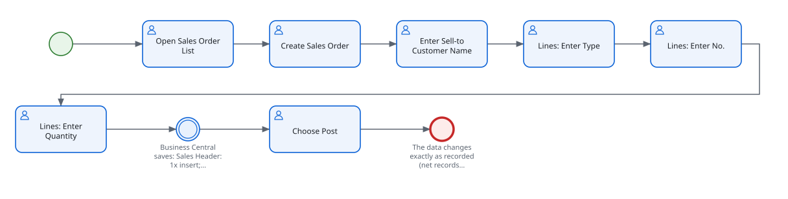

<!-- Generated by BC Atlas docs from BASUITestDemoPostSalesOrder.Codeunit.al#DemoPostSalesOrder_AsRecorded. Do not edit this file. -->
<!-- Source SHA-256: eb5462a9f941f89baa9a40775933adf9f4d340741977f7af5662764cacc24b28 -->

# Create a new Sales Order

Use this guide to create a new Sales Order.

## At a glance

## Before you start

- Required state: Data comparable to the recording in company CRONUS International Ltd. (recorded 2026-11-10).

## Steps

> The values below are examples from the automated UI test. Use values appropriate for your environment.

1. Enter the data on the Sales Order page
   - Choose the 🔍 icon, enter **Sales Order List**, and then choose the related link.
   - Choose the 🔍 icon, enter **Sales Order**, and then choose the related link. Choose **New** to create a record.
   - In the **Sell-to Customer Name** field, enter a value, for example **Adatum Corporation**.
   - In the **Lines** section, in the **Type** field, enter a value, for example **Item**.
   - In the **Lines** section, in the **No.** field, enter a value, for example **1896-S**.
   - In the **Lines** section, in the **Quantity** field, enter a value, for example **1**.

   Result: Business Central saves: Sales Header: 1x insert; Sales Header: 1x modify; Sales Line: 1x insert; Sales Line: 1x modify; Sales Line: 1x modify; Sales Line: 1x modify

2. On the Sales Order page, choose Post
   - Choose the **Post** action.

## What should happen

- The data changes exactly as recorded (net records per table).

Source and verification

- File: `BASUITestDemoPostSalesOrder.Codeunit.al`
- Function: `DemoPostSalesOrder_AsRecorded`
- Source SHA-256: `eb5462a9f941f89baa9a40775933adf9f4d340741977f7af5662764cacc24b28`

