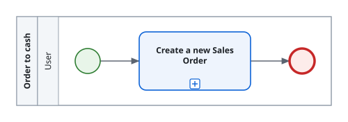

<!-- Generated by BC Atlas docs. Do not edit this file. -->

# Use case: Order to cash

## Process

Open [use-case-order-to-cash.bpmn](./use-case-order-to-cash.bpmn) in a BPMN modeler such as Camunda Modeler or bpmn.io to edit the process; double-click a scenario to see its steps.

## Main scenario

1. [Create a new Sales Order](./demo-post-sales-order.md)
