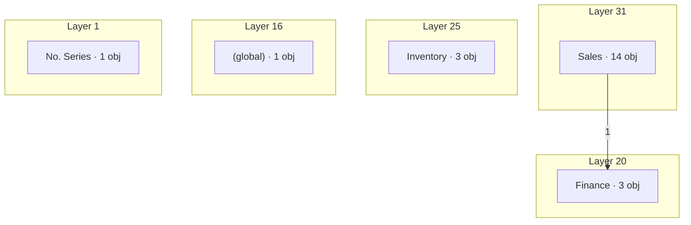

# Demo: Post sales order - Architecture layer (BC Atlas)

> Fact snapshot 1 (fingerprint `demo-hand-de`) laid over BC Atlas "Base Application" (9502 objects, 182 components).
> The layer above L0 of the layered documentation: where in the architecture the process runs.

## A0 · Architecture footprint

- **Use case:** Order to cash
- **Components crossed:** 5 of 182
- **Layers:** 31, 25, 20, 16, 1
- **Recorded calls against the layer rules:** none

## Components

| Layer | Component | Objects in process | Objects in Atlas | Instability | Atlas violations | Hits |
|---:|---|---:|---:|---:|---:|---:|
| 31 | Sales | 14 | 558 | 0.298 | 75 | 113 |
| 25 | Inventory | 3 | 1030 | 0.326 | 1264 | 6 |
| 20 | Finance | 3 | 859 | 0.207 | 1296 | 16 |
| 16 | (global) | 1 | 154 | 0.272 | 371 | 1 |
| 1 | No. Series | 1 | 33 | 0.006 | 0 | 1 |

## Phases through the architecture

| Phase | Components in call order |
|---|---|
| 1 · Enter the data on the Sales Order page | Sales |
| 2 · On the Sales Order page, choose Post | Sales → Finance |

## Technical steps through the architecture

- **T2** Validate field "Sell-to Customer Name" on Page 42 "Sales Order": Sales
- **T4** Validate field "Type" on Page 46 "Sales Order Subform": Sales
- **T5** Validate field "No." on Page 46 "Sales Order Subform": Sales
- **T6** Validate field "Quantity" on Page 46 "Sales Order Subform": Sales
- **T7** Action "Post" on Page 42 "Sales Order": Sales → Finance

## Recorded calls between components

Checked with the BC Atlas layer rules (allowSameLayer: false).

| From | To | Calls | Rule | Example |
|---|---|---:|---|---|
| Sales | Finance | 1 | ok | T7: Page 42 Sales Order.Post - OnAction → Codeunit 12 Gen. Jnl.-Post Line.RunWithCheck |
