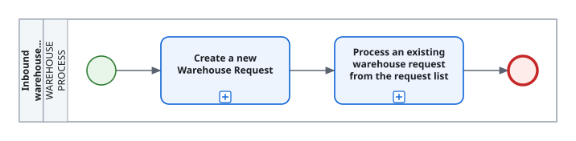

<!-- Generated by BC Atlas docs. Do not edit this file. -->

# End-to-end journey: Inbound warehouse request

## Process

## Stages

1. [Create a new Warehouse Request](./warehouse-request-create.md) (Purchasing Agent, WAREHOUSE PROCESS)
2. [Process an existing warehouse request from the request list](./warehouse-request-process.md) (Warehouse Worker, WAREHOUSE PROCESS)

## 1. Create a new Warehouse Request

Performed by: Purchasing Agent

### Before you start

- Required permission: **WAREHOUSE PROCESS**
- Required state: No warehouse request exists for entry number 10000.

### Steps

1. Choose the 🔍 icon, enter **Warehouse Requests**, and then choose the related link. Choose **New** to create a record.
2. In the **Entry No.** field, enter a value, for example **10000**. _Specifies the number that identifies the warehouse request._
3. In the **Description** field, enter a value, for example **Receive summer stock**. _Specifies what the warehouse needs to do._
4. Close the **Warehouse Requests** page. Business Central saves your changes.

### What should happen

- The warehouse request is saved with the entered description.

Guide: [Create a new Warehouse Request](./warehouse-request-create.md)

## 2. Process an existing warehouse request from the request list

Performed by: Warehouse Worker

### Before you start

- Required permission: **WAREHOUSE PROCESS**
- Master data: A warehouse request exists and is not processed.

### Steps

1. Choose the 🔍 icon, enter **Warehouse Requests**, and then choose the related link.
2. Select the record you want to work with.
3. Choose the **Process** action. _Process the selected warehouse request and mark it as processed._
4. Close the **Warehouse Requests** page. Business Central saves your changes.

### What should happen

- The warehouse request is marked as processed.

Guide: [Process an existing warehouse request from the request list](./warehouse-request-process.md)
