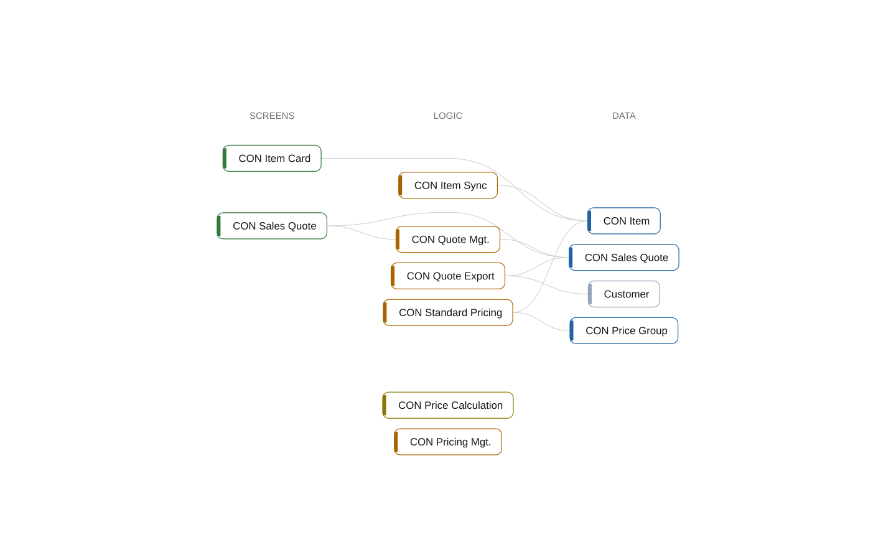

# multi-app

12 objects in 3 apps, 26 relations. Health passed: 0 errors, 0 warnings, 7 info.

## Start here

1. **How it works**: the picture above, and [what is in it](lenses/overview.md).
2. **[How it is connected](architecture.md)**: 3 apps, 4 namespaces, and what depends on what.
3. **Down the layers**: from the apps to each procedure, below.

## Layers

The system from the whole down to each procedure. Every page links one layer up and one layer down.

| Layer | What | Count | Where |
| --- | --- | ---: | --- |
| 0 | System | 1 | this page |
| 1 | Apps | 3 | [below](#apps) |
| 2 | Namespaces | 4 | [below](#namespaces) |
| 3 | Objects | 12 | from the pages of layers 1 and 2 |
| 4 | Procedures, triggers, and events |  | inside the page of each object |

## Apps

| App | Version | Objects | Depends on | Findings |
| --- | --- | ---: | --- | --- |
| [Contoso Core](apps/contoso-core.md) | 1.0.0.0 | 6 |  | 3 (info) |
| [Contoso Integration](apps/contoso-integration.md) | 1.0.0.0 | 2 | declared [Contoso Sales](apps/contoso-sales.md), unresolved (unresolved), undeclared [Contoso Core](apps/contoso-core.md) | 2 (info) |
| [Contoso Sales](apps/contoso-sales.md) | 1.0.0.0 | 4 | declared [Contoso Core](apps/contoso-core.md) | 1 (info) |

## Namespaces

| Namespace | App | Objects | Depends on | Findings |
| --- | --- | ---: | --- | --- |
| [Contoso.Core.Items](namespaces/contoso-core-items.md) | Contoso Core | 3 |  |  |
| [Contoso.Core.Pricing](namespaces/contoso-core-pricing.md) | Contoso Core | 3 | depends on [Contoso.Core.Items](namespaces/contoso-core-items.md) | 3 (info) |
| [Contoso.Integration](namespaces/contoso-integration.md) | Contoso Integration | 2 | depends on [Contoso.Sales.Quotes](namespaces/contoso-sales-quotes.md), depends on [Contoso.Core.Items](namespaces/contoso-core-items.md) | 2 (info) |
| [Contoso.Sales.Quotes](namespaces/contoso-sales-quotes.md) | Contoso Sales | 4 | depends on [Contoso.Core.Items](namespaces/contoso-core-items.md), depends on [Contoso.Core.Pricing](namespaces/contoso-core-pricing.md) | 1 (info) |

## Lenses

The other sides of the same system: each lens is a part of the one graph.

| Lens | Nodes | Relations | Shows |
| --- | ---: | ---: | --- |
| [Overview](lenses/overview.md) | 12 | 9 | How it works, from left to right: the screens, the logic behind them, and the data. |
| [System](lenses/system.md) | 13 | 30 | Every object and every relation between them. |
| [Apps](lenses/apps.md) | 4 | 4 | The apps of the workspace, the apps they depend on, and what they use of each other. |
| [Modules](lenses/modules.md) | 4 | 5 | Namespaces and what they use of each other. |
| [Data](lenses/data.md) | 8 | 9 | Tables and the code that reads, writes, relates, and extends them. |
| [Calls](lenses/calls.md) | 5 | 4 | Which objects call and run which. |
| [Events](lenses/events.md) | 2 | 1 | Event publishers and their subscribers. |
| [Contracts](lenses/contracts.md) | 2 | 1 | Interfaces and what implements them. |
| [Pages](lenses/pages.md) | 5 | 4 | Pages and reports, and what they show, run, and contain. |
| [Permissions](lenses/security.md) | 4 | 3 | Permission sets and what they permit and include. |
| [Visibility](lenses/visibility.md) | 13 | 30 | What is public, internal, or local, and what could be narrower. |
| [Findings](lenses/health.md) | 8 | 6 | The rules of the health check and the objects they found. |

## Stories

Walks through the system, step by step.

- [What multi-app is](stories/system.md): The system from the outside in: how it works, then its apps, hubs, data, events, the user interface, and its health.
- [What to fix](stories/fix.md): 7 findings, the most severe first, each on the nodes it is about.

## Findings

[0 errors, 0 warnings, 7 info](findings.md).

## Read from

| Source | What |
| --- | --- |
| AL source | 5 files with 12 objects |
| app.json | Contoso Core 1.0.0.0, Contoso Integration 1.0.0.0, Contoso Sales 1.0.0.0 |
| Symbol packages | none |
| Settings | no .bca.json; defaults |

The graph itself is in [atlas.json](atlas.json); [layers.json](layers.json) lists what this folder holds.

_Generated by BC Atlas from the AL source. Do not edit; run `bca layers` again._
