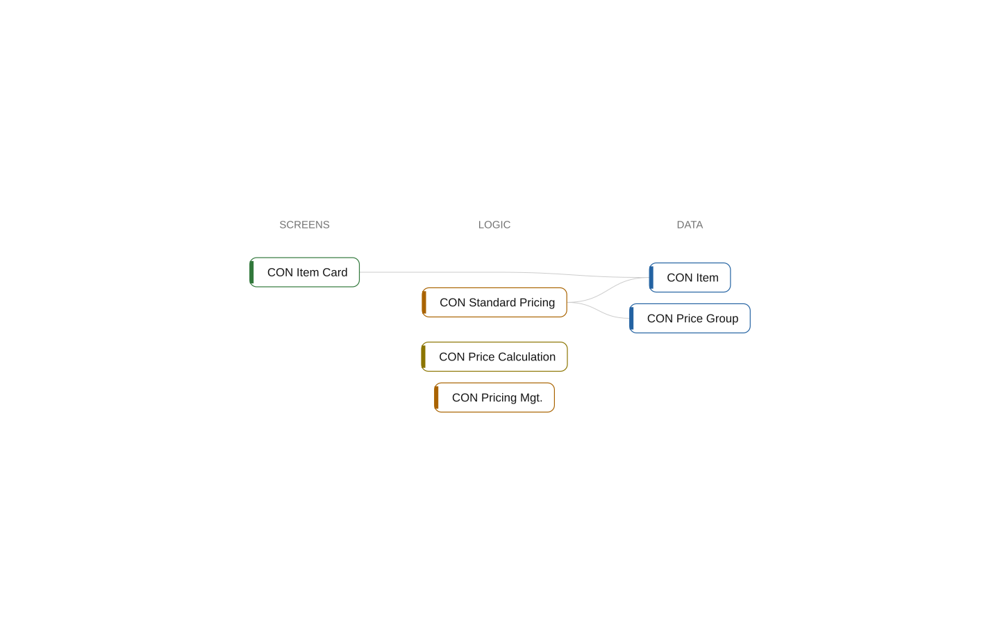

# App Contoso Core

[System](../README.md) › Layer 1: apps

The app Contoso Core holds 6 objects (2 codeunits, 2 tables, 1 interface, 1 page). It depends on no other app, and 2 other apps depend on it.

| Fact | Value |
| --- | --- |
| Publisher | BC Atlas contributors |
| Version | 1.0.0.0 |
| Objects | 6 |

## Components

[Core](../components/core.md)

## Namespaces

[Contoso.Core.Items](../namespaces/contoso-core-items.md), [Contoso.Core.Pricing](../namespaces/contoso-core-pricing.md)

## Used by

- declared [Contoso Sales](contoso-sales.md)
- undeclared [Contoso Integration](contoso-integration.md)

## Objects

| Object | Type | ID | Namespace | Lines | Uses | Used by | Findings |
| --- | --- | --- | --- | ---: | ---: | ---: | --- |
| [CON Standard Pricing](../objects/codeunit-50010-con-standard-pricing.md) | codeunit | 50010 | Contoso.Core.Pricing | 13 | 3 | 1 | 1 (info) |
| [CON Pricing Mgt.](../objects/codeunit-50011-con-pricing-mgt.md) | codeunit | 50011 | Contoso.Core.Pricing | 17 | 1 | 1 | 1 (info) |
| [CON Price Calculation](../objects/interface-con-price-calculation.md) | interface |  | Contoso.Core.Pricing | 4 | 0 | 1 | 1 (info) |
| [CON Item Card](../objects/page-50000-con-item-card.md) | page | 50000 | Contoso.Core.Items | 14 | 1 | 0 |  |
| [CON Item](../objects/table-50000-con-item.md) | table | 50000 | Contoso.Core.Items | 17 | 1 | 4 | 1 (info) |
| [CON Price Group](../objects/table-50001-con-price-group.md) | table | 50001 | Contoso.Core.Items | 15 | 0 | 2 |  |

## Findings

- **info** `foreign-table-write`: table 50000 CON Item of Core is written by Integration (1 object); let Core own the writes behind a codeunit, or move the table
  - On: [CON Item](../objects/table-50000-con-item.md)
  - Source: `core/Items.al:3`
- **info** `undocumented-public-api`: codeunit 50010 CON Standard Pricing: 1 public procedure(s) without a /// summary: UnitPrice
  - On: [CON Standard Pricing](../objects/codeunit-50010-con-standard-pricing.md)
  - Source: `core/Pricing.al:12`
- **info** `undocumented-public-api`: codeunit 50011 CON Pricing Mgt.: 1 public procedure(s) without a /// summary: Calculate
  - On: [CON Pricing Mgt.](../objects/codeunit-50011-con-pricing-mgt.md)
  - Source: `core/Pricing.al:26`
- **info** `undocumented-public-api`: interface CON Price Calculation: 1 public procedure(s) without a /// summary: UnitPrice
  - On: [CON Price Calculation](../objects/interface-con-price-calculation.md)
  - Source: `core/Pricing.al:7`

_Generated by BC Atlas from the AL source. Do not edit; run `bca layers` again._
