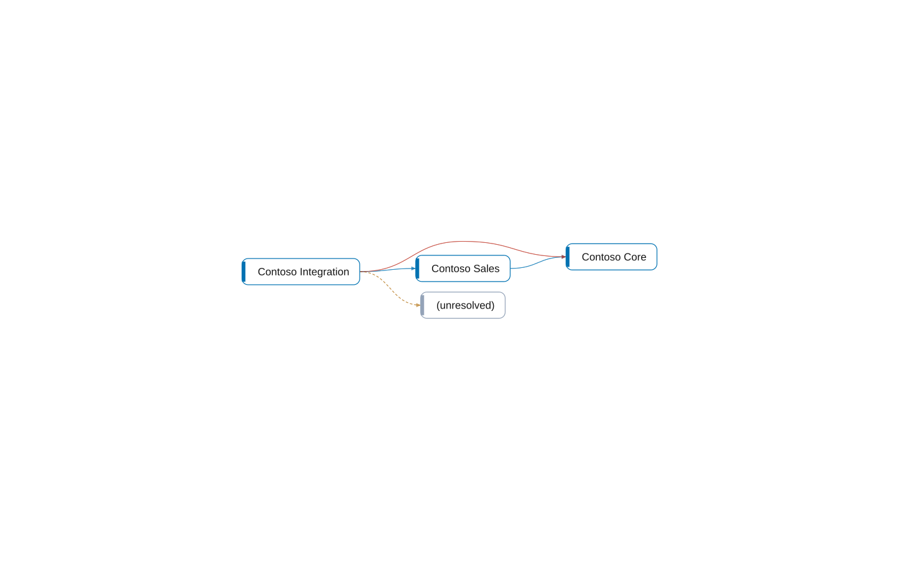
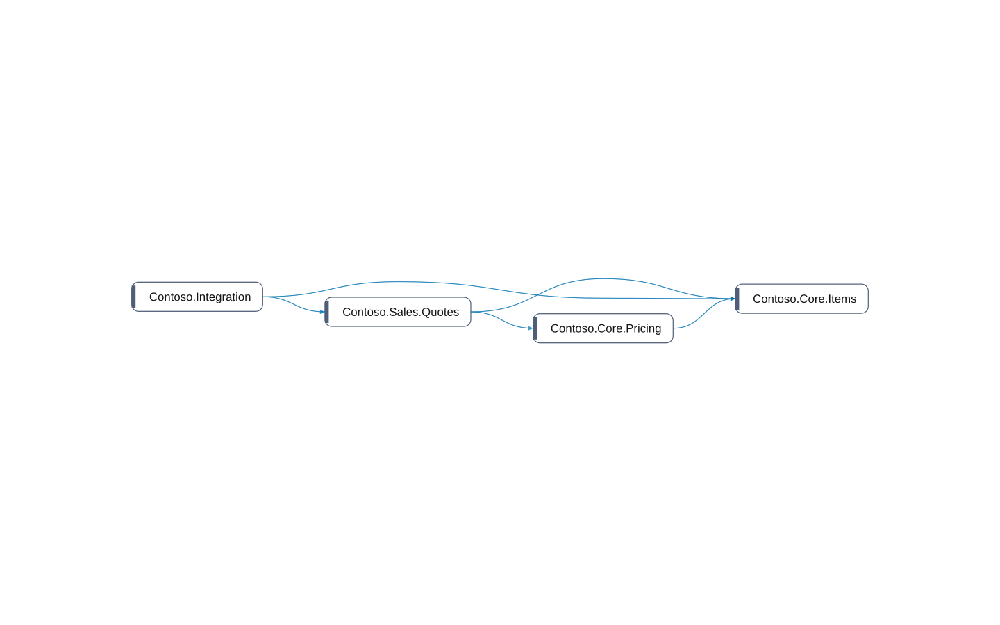

# How it is connected

[System](README.md) › How it is connected

3 apps, 4 namespaces.

## Apps

An app is what is built and installed as one. A line is what one app uses of another: declared in app.json, undeclared (used, but not named there), or unresolved (not found anywhere).

| App | Objects | Depends on | Used by |
| --- | ---: | --- | --- |
| [Contoso Core](apps/contoso-core.md) | 6 |  | [Contoso Sales](apps/contoso-sales.md) (declared, 5 relations), [Contoso Integration](apps/contoso-integration.md) (undeclared, 3 relations) |
| [Contoso Integration](apps/contoso-integration.md) | 2 | [Contoso Sales](apps/contoso-sales.md) (declared, 4 relations), objects that are not found (2 relations), [Contoso Core](apps/contoso-core.md) (undeclared, 3 relations) |  |
| [Contoso Sales](apps/contoso-sales.md) | 4 | [Contoso Core](apps/contoso-core.md) (declared, 5 relations) | [Contoso Integration](apps/contoso-integration.md) (declared, 4 relations) |

## Namespaces

A namespace is how the source itself groups its objects. A line is what the objects of one namespace use of another.

| Namespace | App | Objects | Depends on | Used by |
| --- | --- | ---: | --- | --- |
| [Contoso.Core.Items](namespaces/contoso-core-items.md) | Contoso Core | 3 |  | [Contoso.Core.Pricing](namespaces/contoso-core-pricing.md) (depends on, 4 relations), [Contoso.Integration](namespaces/contoso-integration.md) (depends on, 3 relations), [Contoso.Sales.Quotes](namespaces/contoso-sales-quotes.md) (depends on) |
| [Contoso.Core.Pricing](namespaces/contoso-core-pricing.md) | Contoso Core | 3 | [Contoso.Core.Items](namespaces/contoso-core-items.md) (depends on, 4 relations) | [Contoso.Sales.Quotes](namespaces/contoso-sales-quotes.md) (depends on, 4 relations) |
| [Contoso.Integration](namespaces/contoso-integration.md) | Contoso Integration | 2 | [Contoso.Sales.Quotes](namespaces/contoso-sales-quotes.md) (depends on, 4 relations), [Contoso.Core.Items](namespaces/contoso-core-items.md) (depends on, 3 relations) |  |
| [Contoso.Sales.Quotes](namespaces/contoso-sales-quotes.md) | Contoso Sales | 4 | [Contoso.Core.Items](namespaces/contoso-core-items.md) (depends on), [Contoso.Core.Pricing](namespaces/contoso-core-pricing.md) (depends on, 4 relations) | [Contoso.Integration](namespaces/contoso-integration.md) (depends on, 4 relations) |

_Generated by BC Atlas from the AL source. Do not edit; run `bca layers` again._
