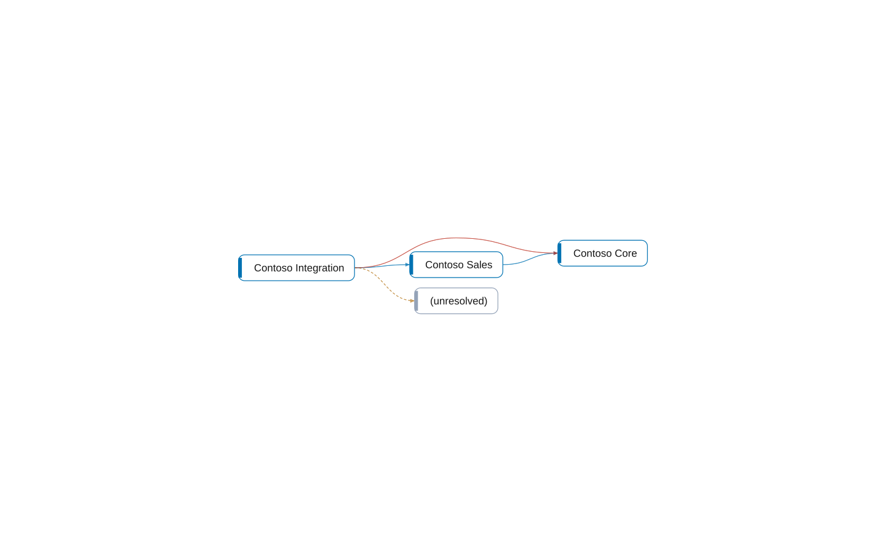
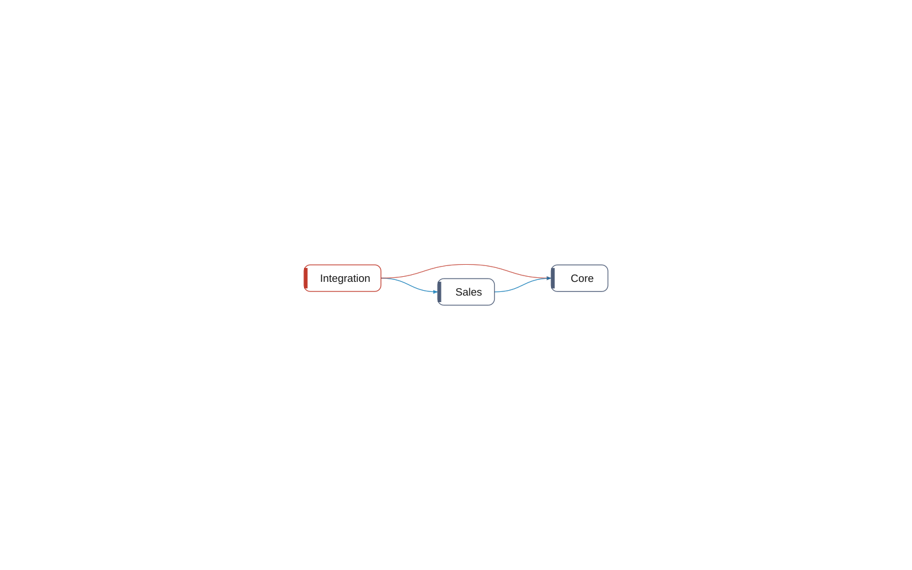

# How it is connected

[System](README.md) › How it is connected

3 apps, 3 components in 3 layers (configured in .bca.json). 57% of the coupling stays inside the components. 1 dependency the wrong way, 0 cycles.

## Apps

An app is what is built and installed as one. A line is what one app uses of another: declared in app.json, undeclared (used, but not named there), or unresolved (not found anywhere).

| App | Objects | Depends on | Used by |
| --- | ---: | --- | --- |
| [Contoso Core](apps/contoso-core.md) | 6 |  | [Contoso Sales](apps/contoso-sales.md) (declared, 5 relations), [Contoso Integration](apps/contoso-integration.md) (undeclared, 3 relations) |
| [Contoso Integration](apps/contoso-integration.md) | 2 | [Contoso Sales](apps/contoso-sales.md) (declared, 4 relations), objects that are not found (2 relations), [Contoso Core](apps/contoso-core.md) (undeclared, 3 relations) |  |
| [Contoso Sales](apps/contoso-sales.md) | 4 | [Contoso Core](apps/contoso-core.md) (declared, 5 relations) | [Contoso Integration](apps/contoso-integration.md) (declared, 4 relations) |

## Components

A component is a part of the system that belongs together; a layer says what may depend on what: a component depends only on components below it. These are the components of `architecture` in .bca.json; `bca check` fails on a dependency they do not allow.

| Component | Layer | Objects | Depends on | Used by | Inside | Instability | In a cycle | Can be an app |
| --- | --- | ---: | --- | --- | ---: | ---: | --- | --- |
| [Core](components/core.md) | Layer 0 | 6 |  | [Integration](components/integration.md) (wrong way), [Sales](components/sales.md) (depends on, 2 relations) | 55% | 0 | no | yes |
| [Sales](components/sales.md) | Layer 1 | 4 | [Core](components/core.md) (depends on, 2 relations) | [Integration](components/integration.md) (depends on, 2 relations) | 45% | 0.667 | no | yes |
| [Integration](components/integration.md) | Layer 2 | 2 | [Sales](components/sales.md) (depends on, 2 relations), [Core](components/core.md) (wrong way) |  | 0% | 1 | no | no |

Inside: how much of its coupling stays inside the component; the higher, the more it is a part of its own. Instability: 0 when others depend on it and it on nothing, 1 when it depends on others and nothing on it; what is stable should not depend on what is not.

## Shared data

Tables that are written from outside the component they belong to.

- [CON Item](objects/table-50000-con-item.md) of Core, also written by Integration (codeunit 50201 CON Item Sync).
- [CON Sales Quote](objects/table-50100-con-sales-quote.md) of Sales, also written by Integration (codeunit 50200 CON Quote Export).

## What to change

[7 changes, the most important first](changes.md).

_Generated by BC Atlas from the AL source. Do not edit; run `bca layers` again._
