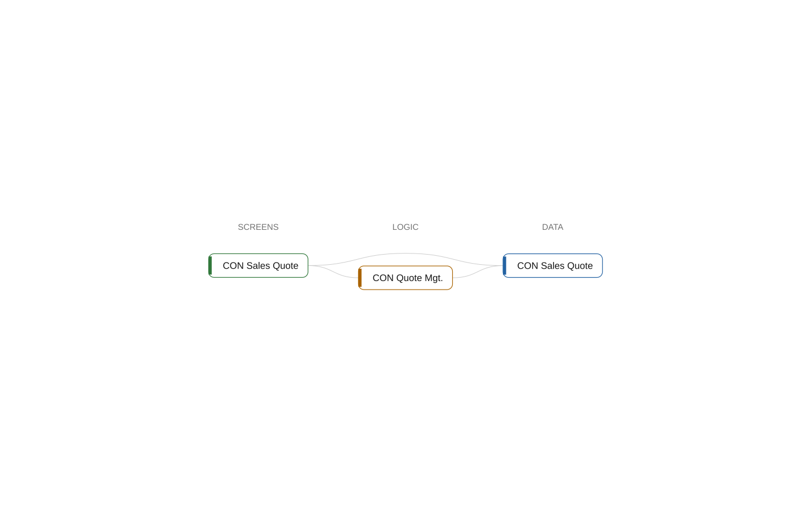

# Component Sales

[System](../README.md) › Layer 2: components

The component Sales holds 4 objects (1 codeunit, 1 page, 1 permissionset, 1 table) in layer 1. It depends on 1 other component, and 1 other component depends on it.

| Fact | Value |
| --- | --- |
| Layer | Layer 1 |
| Objects | 4 |
| Instability | 0.667 |
| Can be an app | yes |

## Depends on

- depends on [Core](core.md)

## Used by

- depends on [Integration](integration.md)

## What to change here

- 5. Let Sales own the writes to table 50100 CON Sales Quote (medium)

Why and how: [What to change, and how](../changes.md).

## Objects

| Object | Type | ID | Namespace | Lines | Uses | Used by | Findings |
| --- | --- | --- | --- | ---: | ---: | ---: | --- |
| [CON Quote Mgt.](../objects/codeunit-50100-con-quote-mgt.md) | codeunit | 50100 | Contoso.Sales.Quotes | 16 | 2 | 3 | 1 (info) |
| [CON Sales Quote](../objects/page-50100-con-sales-quote.md) | page | 50100 | Contoso.Sales.Quotes | 32 | 2 | 1 |  |
| [CON Sales](../objects/permissionset-50100-con-sales.md) | permissionset | 50100 | Contoso.Sales.Quotes | 7 | 3 | 0 |  |
| [CON Sales Quote](../objects/table-50100-con-sales-quote.md) | table | 50100 | Contoso.Sales.Quotes | 17 | 1 | 4 | 1 (info) |

## Findings

- **info** `foreign-table-write`: table 50100 CON Sales Quote of Sales is written by Integration (1 object); let Sales own the writes behind a codeunit, or move the table
  - On: [CON Sales Quote](../objects/table-50100-con-sales-quote.md)
  - Source: `sales/Quotes.al:6`
- **info** `undocumented-public-api`: codeunit 50100 CON Quote Mgt.: 1 public procedure(s) without a /// summary: Recalculate
  - On: [CON Quote Mgt.](../objects/codeunit-50100-con-quote-mgt.md)
  - Source: `sales/Quotes.al:26`

_Generated by BC Atlas from the AL source. Do not edit; run `bca layers` again._
