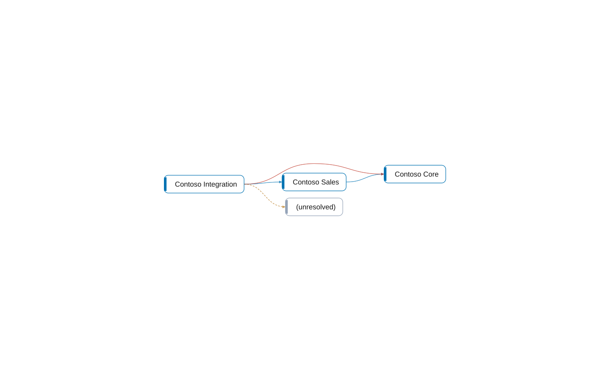

# multi-app: Apps

[System](../README.md) › Lenses

The apps of the workspace, the apps they depend on, and what they use of each other.

Read from `app.json` of every app, its `dependencies`, and the relations between objects of different apps.

| Node | Kind | Group | Relations |
| --- | --- | --- | ---: |
| Contoso Core | app | This workspace | 2 |
| Contoso Integration | app | This workspace | 3 |
| Contoso Sales | app | This workspace | 2 |
| (unresolved) | app | Dependencies | 1 |

_Generated by BC Atlas from the AL source. Do not edit; run `bca layers` again._
