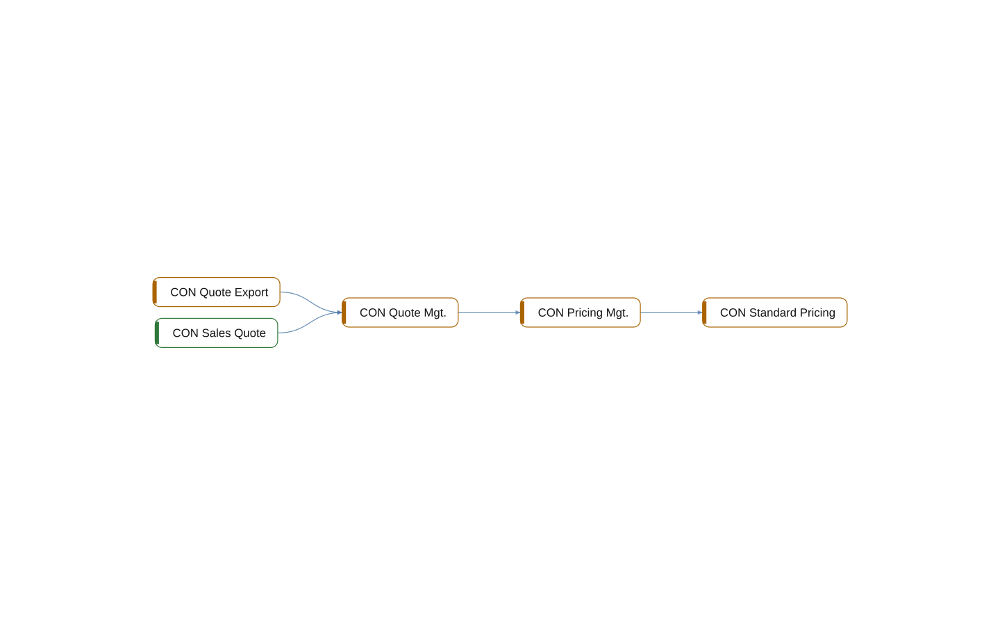

# multi-app: Calls

[System](../README.md) › Lenses

Which objects call and run which.

Read from the procedure calls and `Run` statements in the code.

| Node | Kind | Group | Relations |
| --- | --- | --- | ---: |
| CON Standard Pricing | codeunit | Core | 1 |
| CON Pricing Mgt. | codeunit | Core | 2 |
| CON Quote Export | codeunit | Integration | 1 |
| CON Quote Mgt. | codeunit | Sales | 3 |
| CON Sales Quote | page | Sales | 1 |

## Findings

- **info** `undocumented-public-api`: codeunit 50010 CON Standard Pricing: 1 public procedure(s) without a /// summary: UnitPrice
- **info** `undocumented-public-api`: codeunit 50011 CON Pricing Mgt.: 1 public procedure(s) without a /// summary: Calculate
- **info** `undocumented-public-api`: codeunit 50200 CON Quote Export: 1 public procedure(s) without a /// summary: Export
- **info** `undocumented-public-api`: codeunit 50100 CON Quote Mgt.: 1 public procedure(s) without a /// summary: Recalculate

_Generated by BC Atlas from the AL source. Do not edit; run `bca layers` again._
