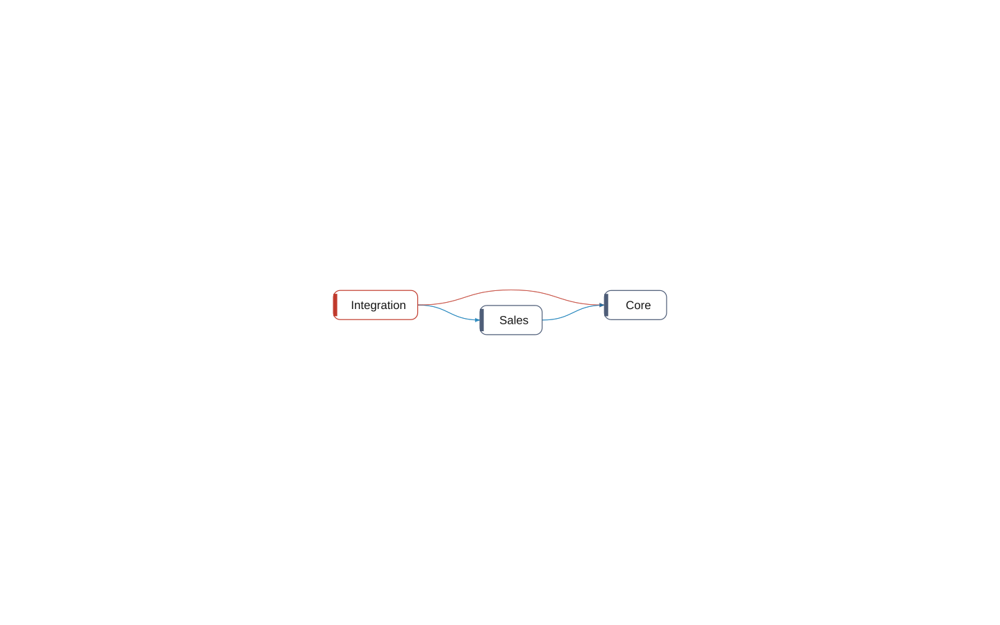

# multi-app: Components

[System](../README.md) › Lenses

The components in their layers and the dependencies between them, allowed or the wrong way.

Read from the components of `architecture` in .bca.json (or the proposal), and the relations between the objects assigned to them.

| Node | Kind | Group | Relations |
| --- | --- | --- | ---: |
| Core | component | Layer 0 | 2 |
| Sales | component | Layer 1 | 2 |
| Integration | component | Layer 2 | 2 |

_Generated by BC Atlas from the AL source. Do not edit; run `bca layers` again._
