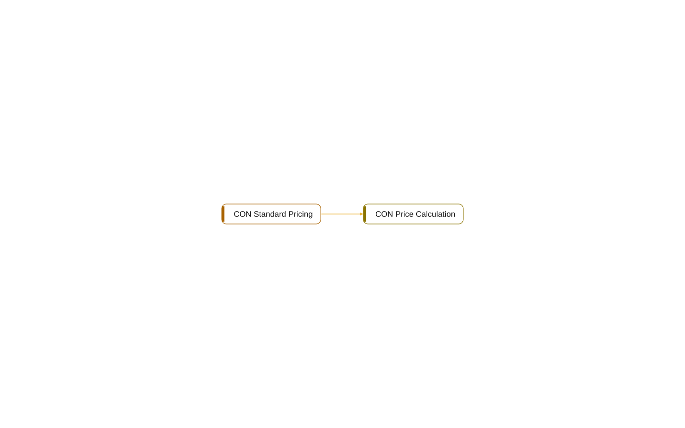

# multi-app: Contracts

[System](../README.md) › Lenses

Interfaces and what implements them.

Read from `interface` objects, `implements`, and the `Implementation` of enum values.

| Node | Kind | Relations |
| --- | --- | ---: |
| CON Price Calculation | interface | 1 |
| CON Standard Pricing | codeunit | 1 |

## Findings

- **info** `undocumented-public-api`: interface CON Price Calculation: 1 public procedure(s) without a /// summary: UnitPrice
- **info** `undocumented-public-api`: codeunit 50010 CON Standard Pricing: 1 public procedure(s) without a /// summary: UnitPrice

_Generated by BC Atlas from the AL source. Do not edit; run `bca layers` again._
