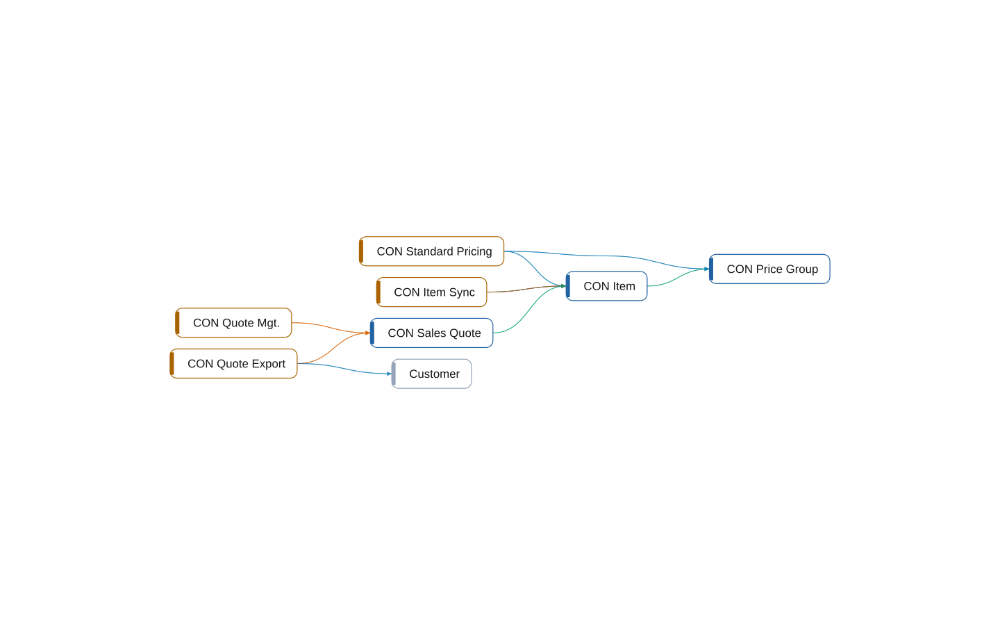

# multi-app: Data

[System](../README.md) › Lenses

Tables and the code that reads, writes, relates, and extends them.

Read from tables and the `reads`, `writes`, `relates`, and `extends` relations.

| Node | Kind | Group | Relations |
| --- | --- | --- | ---: |
| CON Item | table | Contoso.Core.Items | 5 |
| CON Price Group | table | Contoso.Core.Items | 2 |
| CON Standard Pricing | codeunit | Contoso.Core.Pricing | 2 |
| CON Quote Export | codeunit | Contoso.Integration | 2 |
| CON Item Sync | codeunit | Contoso.Integration | 2 |
| CON Sales Quote | table | Contoso.Sales.Quotes | 3 |
| CON Quote Mgt. | codeunit | Contoso.Sales.Quotes | 1 |
| Customer | table | Other apps | 1 |

## Findings

- **warning** `undeclared-app-dependency`: Contoso Integration uses Contoso Core (3 relations) without naming it in the dependencies of its app.json Fix: Add Contoso Core to "dependencies" in integration/app.json, or remove the use.
- **info** `undocumented-public-api`: codeunit 50010 CON Standard Pricing: 1 public procedure(s) without a /// summary: UnitPrice
- **info** `undocumented-public-api`: codeunit 50200 CON Quote Export: 1 public procedure(s) without a /// summary: Export
- **info** `undocumented-public-api`: codeunit 50201 CON Item Sync: 1 public procedure(s) without a /// summary: Sync
- **info** `undocumented-public-api`: codeunit 50100 CON Quote Mgt.: 1 public procedure(s) without a /// summary: Recalculate

_Generated by BC Atlas from the AL source. Do not edit; run `bca layers` again._
