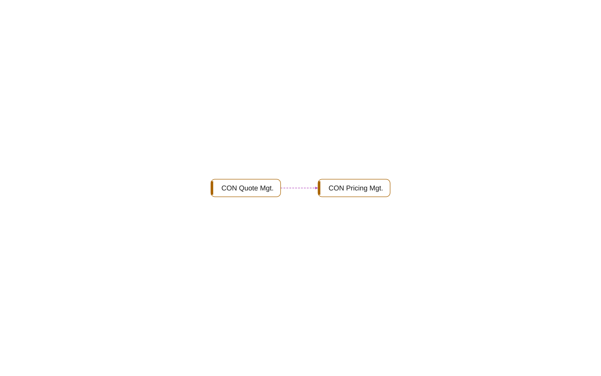

# multi-app: Events

[System](../README.md) › Lenses

Event publishers and their subscribers.

Read from `[IntegrationEvent]`, `[BusinessEvent]`, and `[EventSubscriber]` procedures.

| Node | Kind | Group | Relations |
| --- | --- | --- | ---: |
| CON Pricing Mgt. | codeunit | Core | 1 |
| CON Quote Mgt. | codeunit | Sales | 1 |

## Findings

- **info** `undocumented-public-api`: codeunit 50011 CON Pricing Mgt.: 1 public procedure(s) without a /// summary: Calculate
- **info** `undocumented-public-api`: codeunit 50100 CON Quote Mgt.: 1 public procedure(s) without a /// summary: Recalculate

_Generated by BC Atlas from the AL source. Do not edit; run `bca layers` again._
