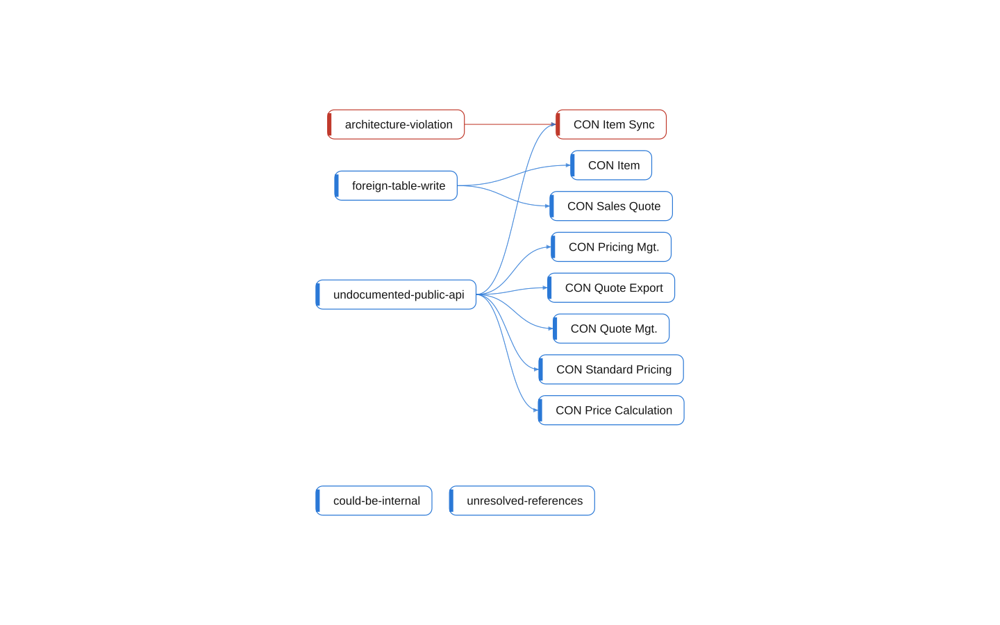

# multi-app: Findings

[System](../README.md) › Lenses

The rules of the health check and the objects they found.

Read from the findings of `bca check` (rules, AL compiler, analyzers) and the objects they are on.

| Node | Kind | Group | Relations |
| --- | --- | --- | ---: |
| CON Item | table | table | 1 |
| CON Price Calculation | interface | interface | 1 |
| CON Standard Pricing | codeunit | codeunit | 1 |
| CON Pricing Mgt. | codeunit | codeunit | 1 |
| CON Quote Export | codeunit | codeunit | 1 |
| CON Item Sync | codeunit | codeunit | 2 |
| CON Sales Quote | table | table | 1 |
| CON Quote Mgt. | codeunit | codeunit | 1 |
| architecture-violation | rule | rule | 1 |
| could-be-internal | rule | rule | 0 |
| foreign-table-write | rule | rule | 2 |
| undocumented-public-api | rule | rule | 6 |
| unresolved-references | rule | rule | 0 |

## Findings

- **error** `architecture-violation`: codeunit CON Item Sync (Integration) depends on 1 object(s) in Core; declare the dependency; it points inward (declare-dependency)
- **info** `foreign-table-write`: table 50000 CON Item of Core is written by Integration (1 object); let Core own the writes behind a codeunit, or move the table
- **info** `undocumented-public-api`: interface CON Price Calculation: 1 public procedure(s) without a /// summary: UnitPrice
- **info** `undocumented-public-api`: codeunit 50010 CON Standard Pricing: 1 public procedure(s) without a /// summary: UnitPrice
- **info** `undocumented-public-api`: codeunit 50011 CON Pricing Mgt.: 1 public procedure(s) without a /// summary: Calculate
- **info** `undocumented-public-api`: codeunit 50200 CON Quote Export: 1 public procedure(s) without a /// summary: Export
- **info** `undocumented-public-api`: codeunit 50201 CON Item Sync: 1 public procedure(s) without a /// summary: Sync
- **info** `foreign-table-write`: table 50100 CON Sales Quote of Sales is written by Integration (1 object); let Sales own the writes behind a codeunit, or move the table
- **info** `undocumented-public-api`: codeunit 50100 CON Quote Mgt.: 1 public procedure(s) without a /// summary: Recalculate
- **info** `could-be-internal`: 1 object(s) of Core are used by no other component and could be Access = Internal: codeunit 50010 CON Standard Pricing (bca refactor surface --component "Core")
- **info** `could-be-internal`: 2 object(s) of Integration are used by no other component and could be Access = Internal: codeunit 50200 CON Quote Export, codeunit 50201 CON Item Sync (bca refactor surface --component "Integration")
- **info** `unresolved-references`: 2 reference(s) to 1 external or unresolved target(s); add .alpackages symbols to resolve them

_Generated by BC Atlas from the AL source. Do not edit; run `bca layers` again._
