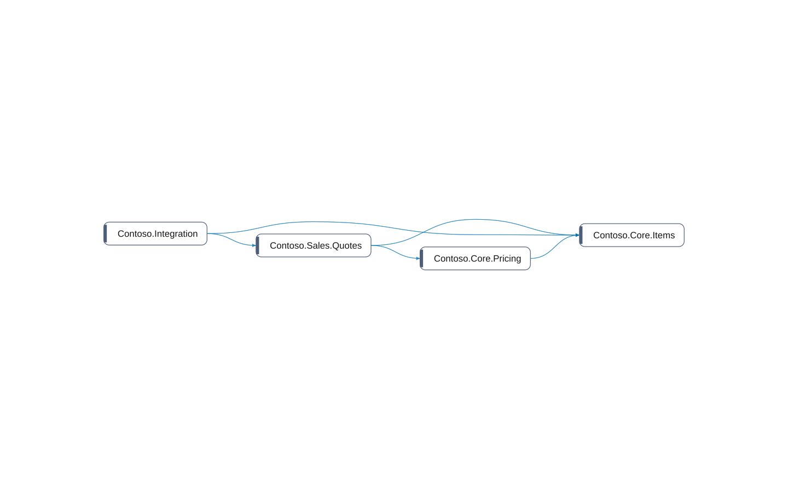

# multi-app: Modules

[System](../README.md) › Lenses

Namespaces and what they use of each other.

Read from the namespaces of the objects and the relations that cross them.

| Node | Kind | Group | Relations |
| --- | --- | --- | ---: |
| Contoso.Core.Items | module | Contoso Core | 3 |
| Contoso.Core.Pricing | module | Contoso Core | 2 |
| Contoso.Integration | module | Contoso Integration | 2 |
| Contoso.Sales.Quotes | module | Contoso Sales | 3 |

_Generated by BC Atlas from the AL source. Do not edit; run `bca layers` again._
