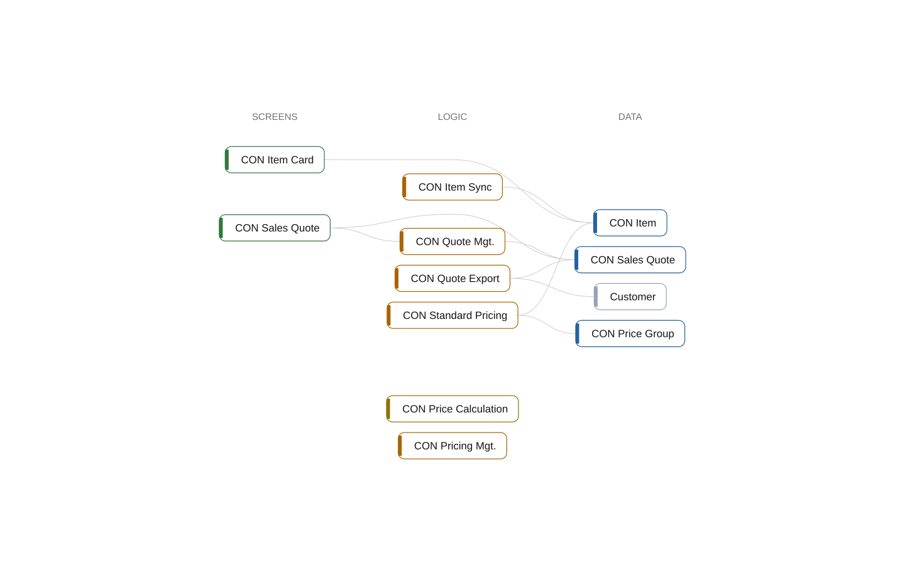

# multi-app: Overview

[System](../README.md) › Lenses

How it works, from left to right: who uses it, what they do, on which screens, with which logic, in which data.

Read from the objects of the AL source and what they do with each other, the process tests, and the people of `simulation` in .bca.json.

| Node | Kind | Group | Relations |
| --- | --- | --- | ---: |
| CON Item | table | Data | 3 |
| CON Price Group | table | Data | 1 |
| CON Item Card | page | Screens | 1 |
| CON Price Calculation | interface | Logic | 0 |
| CON Standard Pricing | codeunit | Logic | 2 |
| CON Pricing Mgt. | codeunit | Logic | 0 |
| CON Quote Export | codeunit | Logic | 2 |
| CON Item Sync | codeunit | Logic | 1 |
| CON Sales Quote | table | Data | 3 |
| CON Quote Mgt. | codeunit | Logic | 2 |
| CON Sales Quote | page | Screens | 2 |
| Customer | table | Data | 1 |

## Findings

- **error** `architecture-violation`: codeunit CON Item Sync (Integration) depends on 1 object(s) in Core; declare the dependency; it points inward (declare-dependency)
- **info** `foreign-table-write`: table 50000 CON Item of Core is written by Integration (1 object); let Core own the writes behind a codeunit, or move the table
- **info** `undocumented-public-api`: interface CON Price Calculation: 1 public procedure(s) without a /// summary: UnitPrice
- **info** `undocumented-public-api`: codeunit 50010 CON Standard Pricing: 1 public procedure(s) without a /// summary: UnitPrice
- **info** `undocumented-public-api`: codeunit 50011 CON Pricing Mgt.: 1 public procedure(s) without a /// summary: Calculate
- **info** `undocumented-public-api`: codeunit 50200 CON Quote Export: 1 public procedure(s) without a /// summary: Export
- **info** `undocumented-public-api`: codeunit 50201 CON Item Sync: 1 public procedure(s) without a /// summary: Sync
- **info** `foreign-table-write`: table 50100 CON Sales Quote of Sales is written by Integration (1 object); let Sales own the writes behind a codeunit, or move the table
- **info** `undocumented-public-api`: codeunit 50100 CON Quote Mgt.: 1 public procedure(s) without a /// summary: Recalculate

_Generated by BC Atlas from the AL source. Do not edit; run `bca layers` again._
