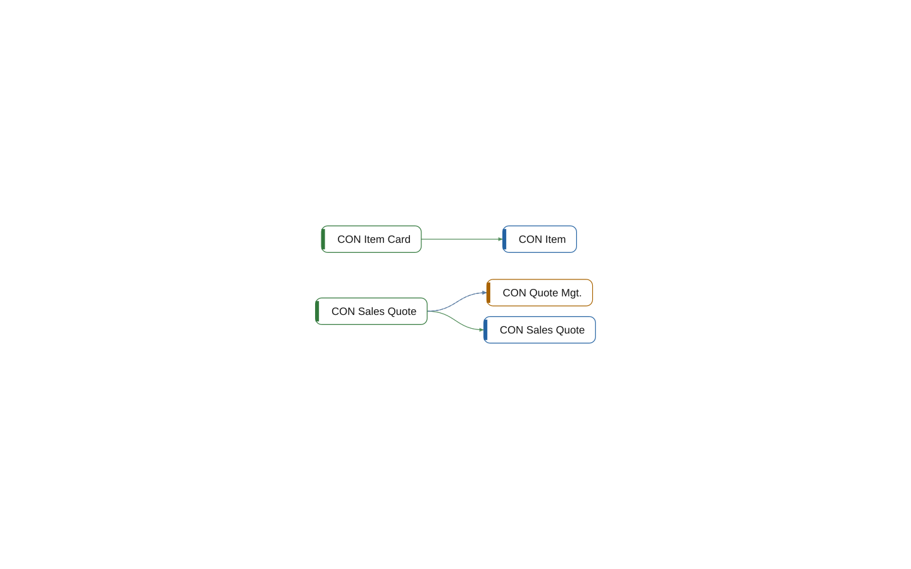

# multi-app: Pages

[System](../README.md) › Lenses

Pages and reports, and what they show, run, and contain.

Read from pages, page extensions, reports, their source tables, parts, and actions.

| Node | Kind | Group | Relations |
| --- | --- | --- | ---: |
| CON Item | table | Core | 1 |
| CON Item Card | page | Core | 1 |
| CON Sales Quote | table | Sales | 1 |
| CON Quote Mgt. | codeunit | Sales | 2 |
| CON Sales Quote | page | Sales | 3 |

## Findings

- **info** `foreign-table-write`: table 50000 CON Item of Core is written by Integration (1 object); let Core own the writes behind a codeunit, or move the table
- **info** `foreign-table-write`: table 50100 CON Sales Quote of Sales is written by Integration (1 object); let Sales own the writes behind a codeunit, or move the table
- **info** `undocumented-public-api`: codeunit 50100 CON Quote Mgt.: 1 public procedure(s) without a /// summary: Recalculate

_Generated by BC Atlas from the AL source. Do not edit; run `bca layers` again._
