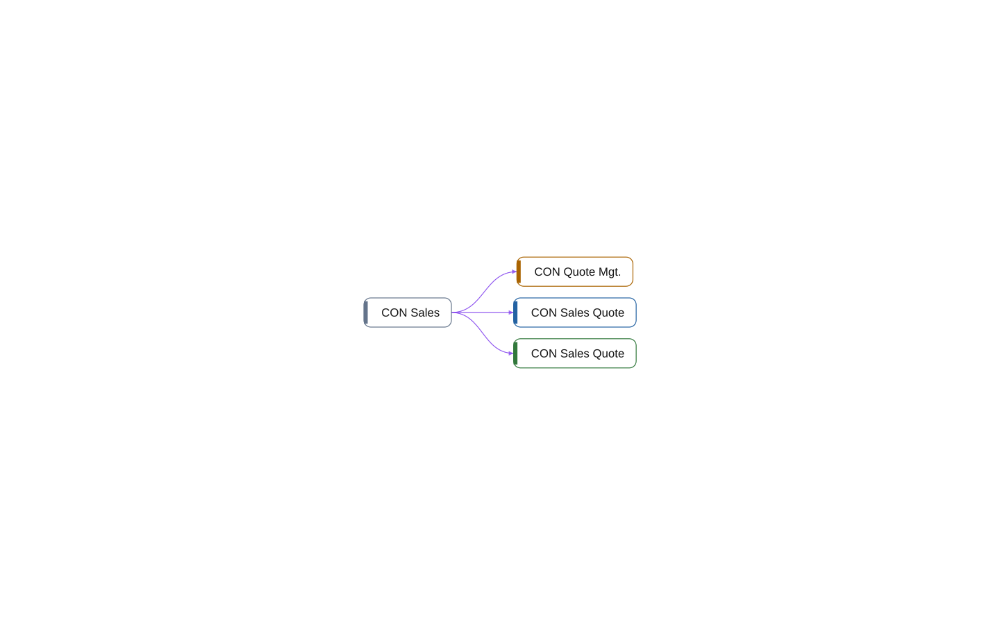

# multi-app: Permissions

[System](../README.md) › Lenses

Permission sets and what they permit and include.

Read from `permissionset` objects, their `Permissions`, and `IncludedPermissionSets`.

| Node | Kind | Relations |
| --- | --- | ---: |
| CON Sales Quote | table | 1 |
| CON Quote Mgt. | codeunit | 1 |
| CON Sales Quote | page | 1 |
| CON Sales | permissionset | 3 |

## Findings

- **info** `foreign-table-write`: table 50100 CON Sales Quote of Sales is written by Integration (1 object); let Sales own the writes behind a codeunit, or move the table
- **info** `undocumented-public-api`: codeunit 50100 CON Quote Mgt.: 1 public procedure(s) without a /// summary: Recalculate

_Generated by BC Atlas from the AL source. Do not edit; run `bca layers` again._
