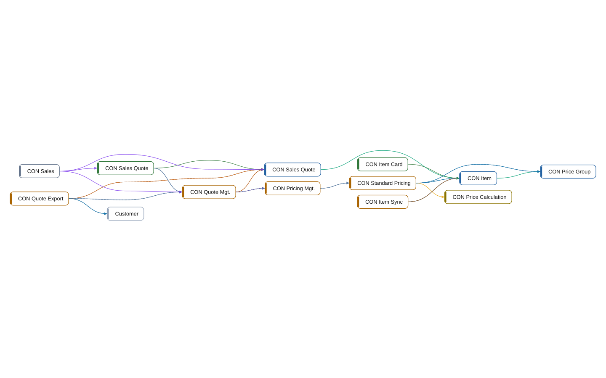

# multi-app: System

[System](../README.md) › Lenses

Every object and every relation between them.

Read from the objects of the AL source and all their relations: calls, data access, events, extensions, permissions.

| Node | Kind | Group | Relations |
| --- | --- | --- | ---: |
| CON Item | table | Core | 8 |
| CON Price Group | table | Core | 3 |
| CON Item Card | page | Core | 1 |
| CON Price Calculation | interface | Core | 1 |
| CON Standard Pricing | codeunit | Core | 7 |
| CON Pricing Mgt. | codeunit | Core | 5 |
| CON Quote Export | codeunit | Integration | 6 |
| CON Item Sync | codeunit | Integration | 3 |
| CON Sales Quote | table | Sales | 7 |
| CON Quote Mgt. | codeunit | Sales | 10 |
| CON Sales Quote | page | Sales | 4 |
| CON Sales | permissionset | Sales | 3 |
| Customer | table | Other apps | 2 |

## Findings

- **error** `architecture-violation`: codeunit CON Item Sync (Integration) depends on 1 object(s) in Core; declare the dependency; it points inward (declare-dependency)
- **info** `foreign-table-write`: table 50000 CON Item of Core is written by Integration (1 object); let Core own the writes behind a codeunit, or move the table
- **info** `undocumented-public-api`: interface CON Price Calculation: 1 public procedure(s) without a /// summary: UnitPrice
- **info** `undocumented-public-api`: codeunit 50010 CON Standard Pricing: 1 public procedure(s) without a /// summary: UnitPrice
- **info** `undocumented-public-api`: codeunit 50011 CON Pricing Mgt.: 1 public procedure(s) without a /// summary: Calculate
- **info** `undocumented-public-api`: codeunit 50200 CON Quote Export: 1 public procedure(s) without a /// summary: Export
- **info** `undocumented-public-api`: codeunit 50201 CON Item Sync: 1 public procedure(s) without a /// summary: Sync
- **info** `foreign-table-write`: table 50100 CON Sales Quote of Sales is written by Integration (1 object); let Sales own the writes behind a codeunit, or move the table
- **info** `undocumented-public-api`: codeunit 50100 CON Quote Mgt.: 1 public procedure(s) without a /// summary: Recalculate

_Generated by BC Atlas from the AL source. Do not edit; run `bca layers` again._
