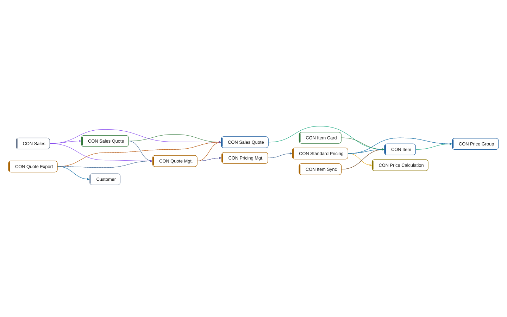

# multi-app: System

[System](../README.md) › Lenses

Every object and every relation between them.

Read from the objects of the AL source and all their relations: calls, data access, events, extensions, permissions.

| Node | Kind | Group | Relations |
| --- | --- | --- | ---: |
| CON Item | table | Contoso.Core.Items | 8 |
| CON Price Group | table | Contoso.Core.Items | 3 |
| CON Item Card | page | Contoso.Core.Items | 1 |
| CON Price Calculation | interface | Contoso.Core.Pricing | 1 |
| CON Standard Pricing | codeunit | Contoso.Core.Pricing | 7 |
| CON Pricing Mgt. | codeunit | Contoso.Core.Pricing | 5 |
| CON Quote Export | codeunit | Contoso.Integration | 6 |
| CON Item Sync | codeunit | Contoso.Integration | 3 |
| CON Sales Quote | table | Contoso.Sales.Quotes | 7 |
| CON Quote Mgt. | codeunit | Contoso.Sales.Quotes | 10 |
| CON Sales Quote | page | Contoso.Sales.Quotes | 4 |
| CON Sales | permissionset | Contoso.Sales.Quotes | 3 |
| Customer | table | Other apps | 2 |

## Findings

- **info** `undocumented-public-api`: interface CON Price Calculation: 1 public procedure(s) without a /// summary: UnitPrice
- **info** `undocumented-public-api`: codeunit 50010 CON Standard Pricing: 1 public procedure(s) without a /// summary: UnitPrice
- **info** `undocumented-public-api`: codeunit 50011 CON Pricing Mgt.: 1 public procedure(s) without a /// summary: Calculate
- **info** `undocumented-public-api`: codeunit 50200 CON Quote Export: 1 public procedure(s) without a /// summary: Export
- **info** `undocumented-public-api`: codeunit 50201 CON Item Sync: 1 public procedure(s) without a /// summary: Sync
- **info** `undocumented-public-api`: codeunit 50100 CON Quote Mgt.: 1 public procedure(s) without a /// summary: Recalculate

_Generated by BC Atlas from the AL source. Do not edit; run `bca layers` again._
