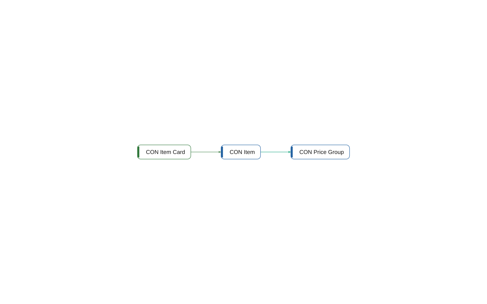

# Namespace Contoso.Core.Items

[System](../README.md) › Layer 3: namespaces

The namespace Contoso.Core.Items holds 3 objects (2 tables, 1 page). It depends on no other namespace, and 3 other namespaces depend on it.

| Fact | Value |
| --- | --- |
| App | Contoso Core |
| Objects | 3 |

## Used by

- depends on [Contoso.Core.Pricing](contoso-core-pricing.md)
- depends on [Contoso.Integration](contoso-integration.md)
- depends on [Contoso.Sales.Quotes](contoso-sales-quotes.md)

## Objects

| Object | Type | ID | Component | Lines | Uses | Used by | Findings |
| --- | --- | --- | --- | ---: | ---: | ---: | --- |
| [CON Item Card](../objects/page-50000-con-item-card.md) | page | 50000 | Core | 14 | 1 | 0 |  |
| [CON Item](../objects/table-50000-con-item.md) | table | 50000 | Core | 17 | 1 | 4 | 1 (info) |
| [CON Price Group](../objects/table-50001-con-price-group.md) | table | 50001 | Core | 15 | 0 | 2 |  |

## Findings

- **info** `foreign-table-write`: table 50000 CON Item of Core is written by Integration (1 object); let Core own the writes behind a codeunit, or move the table
  - On: [CON Item](../objects/table-50000-con-item.md)
  - Source: `core/Items.al:3`

_Generated by BC Atlas from the AL source. Do not edit; run `bca layers` again._
