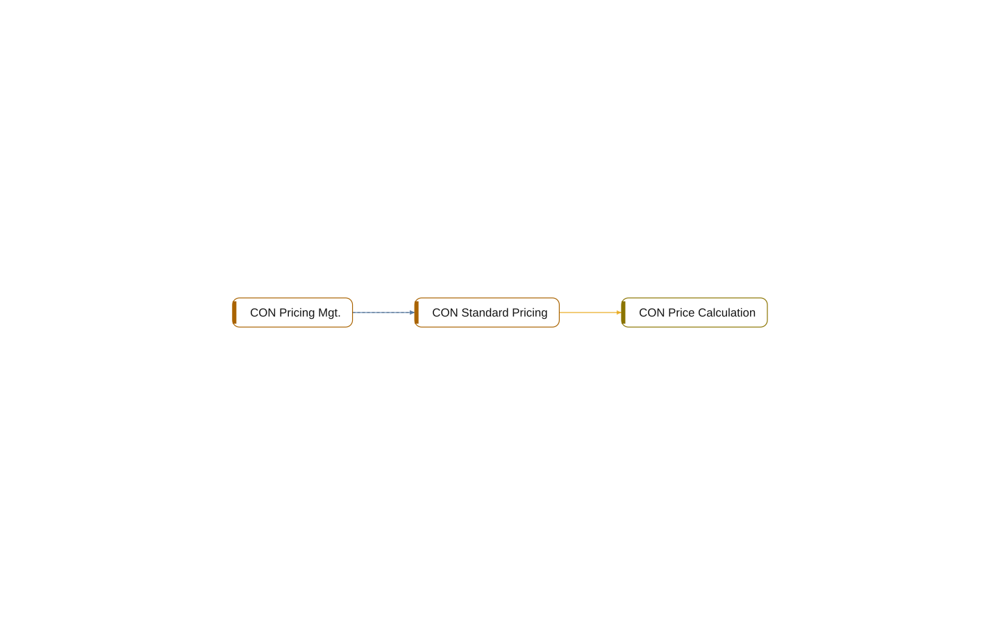

# Namespace Contoso.Core.Pricing

[System](../README.md) › Layer 3: namespaces

The namespace Contoso.Core.Pricing holds 3 objects (2 codeunits, 1 interface). It depends on 1 other namespace, and 1 other namespace depends on it.

| Fact | Value |
| --- | --- |
| App | Contoso Core |
| Objects | 3 |

## Depends on

- depends on [Contoso.Core.Items](contoso-core-items.md)

## Used by

- depends on [Contoso.Sales.Quotes](contoso-sales-quotes.md)

## What to change here

- 6. Make 1 object of Core internal (small)

Why and how: [What to change, and how](../changes.md).

## Objects

| Object | Type | ID | Component | Lines | Uses | Used by | Findings |
| --- | --- | --- | --- | ---: | ---: | ---: | --- |
| [CON Standard Pricing](../objects/codeunit-50010-con-standard-pricing.md) | codeunit | 50010 | Core | 13 | 3 | 1 | 1 (info) |
| [CON Pricing Mgt.](../objects/codeunit-50011-con-pricing-mgt.md) | codeunit | 50011 | Core | 17 | 1 | 1 | 1 (info) |
| [CON Price Calculation](../objects/interface-con-price-calculation.md) | interface |  | Core | 4 | 0 | 1 | 1 (info) |

## Findings

- **info** `undocumented-public-api`: codeunit 50010 CON Standard Pricing: 1 public procedure(s) without a /// summary: UnitPrice
  - On: [CON Standard Pricing](../objects/codeunit-50010-con-standard-pricing.md)
  - Source: `core/Pricing.al:12`
- **info** `undocumented-public-api`: codeunit 50011 CON Pricing Mgt.: 1 public procedure(s) without a /// summary: Calculate
  - On: [CON Pricing Mgt.](../objects/codeunit-50011-con-pricing-mgt.md)
  - Source: `core/Pricing.al:26`
- **info** `undocumented-public-api`: interface CON Price Calculation: 1 public procedure(s) without a /// summary: UnitPrice
  - On: [CON Price Calculation](../objects/interface-con-price-calculation.md)
  - Source: `core/Pricing.al:7`

_Generated by BC Atlas from the AL source. Do not edit; run `bca layers` again._
