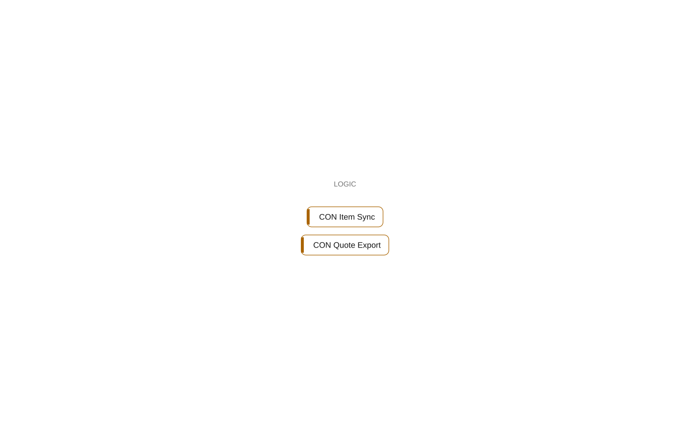

# Namespace Contoso.Integration

[System](../README.md) › Layer 3: namespaces

The namespace Contoso.Integration holds 2 objects (2 codeunits). It depends on 2 other namespaces, and none depends on it.

| Fact | Value |
| --- | --- |
| App | Contoso Integration |
| Objects | 2 |

## Depends on

- depends on [Contoso.Sales.Quotes](contoso-sales-quotes.md)
- depends on [Contoso.Core.Items](contoso-core-items.md)

## What to change here

- 3. CON Item Sync: declare the dependency; it points inward (small)
- 4. Let Core own the writes to table 50000 CON Item (medium)
- 5. Let Sales own the writes to table 50100 CON Sales Quote (medium)
- 7. Make 2 objects of Integration internal (small)

Why and how: [What to change, and how](../changes.md).

## Objects

| Object | Type | ID | Component | Lines | Uses | Used by | Findings |
| --- | --- | --- | --- | ---: | ---: | ---: | --- |
| [CON Quote Export](../objects/codeunit-50200-con-quote-export.md) | codeunit | 50200 | Integration | 15 | 3 | 0 | 1 (info) |
| [CON Item Sync](../objects/codeunit-50201-con-item-sync.md) | codeunit | 50201 | Integration | 10 | 1 | 0 | 2 (error) |

## Findings

- **error** `architecture-violation`: codeunit CON Item Sync (Integration) depends on 1 object(s) in Core; declare the dependency; it points inward (declare-dependency)
  - On: [CON Item Sync](../objects/codeunit-50201-con-item-sync.md)
  - Source: `integration/ItemSync.al:10`
- **info** `undocumented-public-api`: codeunit 50200 CON Quote Export: 1 public procedure(s) without a /// summary: Export
  - On: [CON Quote Export](../objects/codeunit-50200-con-quote-export.md)
  - Source: `integration/Export.al:7`
- **info** `undocumented-public-api`: codeunit 50201 CON Item Sync: 1 public procedure(s) without a /// summary: Sync
  - On: [CON Item Sync](../objects/codeunit-50201-con-item-sync.md)
  - Source: `integration/ItemSync.al:8`

_Generated by BC Atlas from the AL source. Do not edit; run `bca layers` again._
