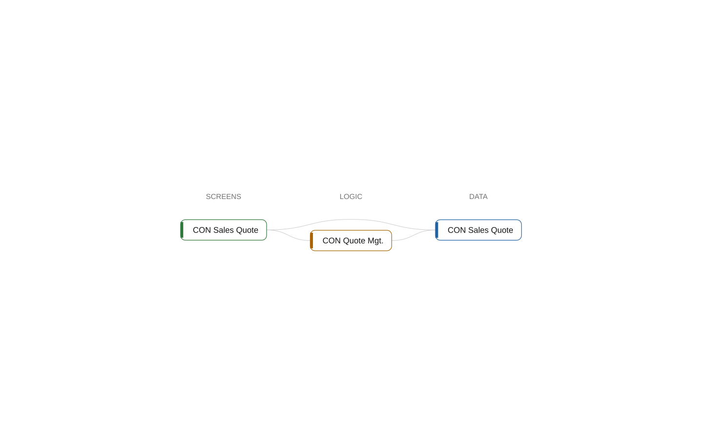

# Namespace Contoso.Sales.Quotes

[System](../README.md) › Layer 2: namespaces

The namespace Contoso.Sales.Quotes holds 4 objects (1 codeunit, 1 page, 1 permissionset, 1 table). It depends on 2 other namespaces, and 1 other namespace depends on it.

| Fact | Value |
| --- | --- |
| App | Contoso Sales |
| Objects | 4 |

## Depends on

- depends on [Contoso.Core.Items](contoso-core-items.md)
- depends on [Contoso.Core.Pricing](contoso-core-pricing.md)

## Used by

- depends on [Contoso.Integration](contoso-integration.md)

## Objects

| Object | Type | ID | Lines | Uses | Used by | Findings |
| --- | --- | --- | ---: | ---: | ---: | --- |
| [CON Quote Mgt.](../objects/codeunit-50100-con-quote-mgt.md) | codeunit | 50100 | 16 | 2 | 3 | 1 (info) |
| [CON Sales Quote](../objects/page-50100-con-sales-quote.md) | page | 50100 | 32 | 2 | 1 |  |
| [CON Sales](../objects/permissionset-50100-con-sales.md) | permissionset | 50100 | 7 | 3 | 0 |  |
| [CON Sales Quote](../objects/table-50100-con-sales-quote.md) | table | 50100 | 17 | 1 | 4 |  |

## Findings

- **info** `undocumented-public-api`: codeunit 50100 CON Quote Mgt.: 1 public procedure(s) without a /// summary: Recalculate
  - On: [CON Quote Mgt.](../objects/codeunit-50100-con-quote-mgt.md)
  - Source: `sales/Quotes.al:26`

_Generated by BC Atlas from the AL source. Do not edit; run `bca layers` again._
