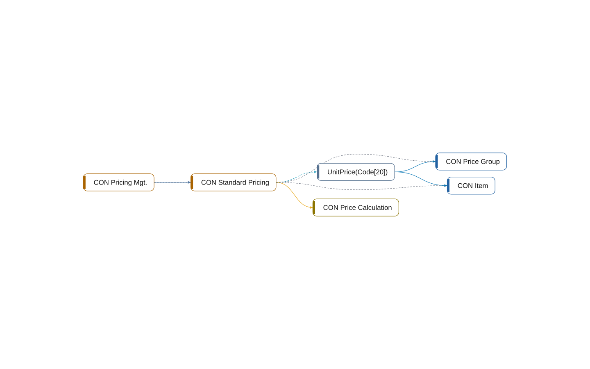

# codeunit 50010 CON Standard Pricing

[System](../README.md) › [Contoso Core](../apps/contoso-core.md) › [Core](../components/core.md) › [Contoso.Core.Pricing](../namespaces/contoso-core-pricing.md)

The codeunit CON Standard Pricing of the app Contoso Core, in the component Core, has 1 member in 13 lines. It implements, reads, uses 3 other objects, and 1 object uses it.

| Fact | Value |
| --- | --- |
| Type | codeunit |
| ID | 50010 |
| App | Contoso Core |
| Component | Core |
| Namespace | Contoso.Core.Pricing |
| Visibility | public; can be internal |
| Lines | 13 |
| Procedures | 1 |
| Complexity | 2 |
| Uses | 3 |
| Used by | 1 |
| Source | `core/Pricing.al:10` |

## Inside

Layer 5: its procedures, triggers, and events, and what each of them does.

| Member | Kind | Lines | Complexity | Does |
| --- | --- | ---: | ---: | --- |
| `procedure UnitPrice(ItemNo: Code[20]): Decimal` | procedure | 10 | 2 | reads [CON Item](table-50000-con-item.md); reads [CON Price Group](table-50001-con-price-group.md) |

## Uses

- **implements** [interface CON Price Calculation](interface-con-price-calculation.md)
- **reads** [table 50000 CON Item](table-50000-con-item.md), [table 50001 CON Price Group](table-50001-con-price-group.md)
- **uses** [table 50000 CON Item](table-50000-con-item.md), [table 50001 CON Price Group](table-50001-con-price-group.md)

## Used by

- **calls** [codeunit 50011 CON Pricing Mgt.](codeunit-50011-con-pricing-mgt.md)
- **uses** [codeunit 50011 CON Pricing Mgt.](codeunit-50011-con-pricing-mgt.md)

## What to change here

- 6. Make 1 object of Core internal (small)

Why and how: [What to change, and how](../changes.md).

## Findings

- **info** `undocumented-public-api`: codeunit 50010 CON Standard Pricing: 1 public procedure(s) without a /// summary: UnitPrice
  - On: [CON Standard Pricing](codeunit-50010-con-standard-pricing.md)
  - Source: `core/Pricing.al:12`

_Generated by BC Atlas from the AL source. Do not edit; run `bca layers` again._
