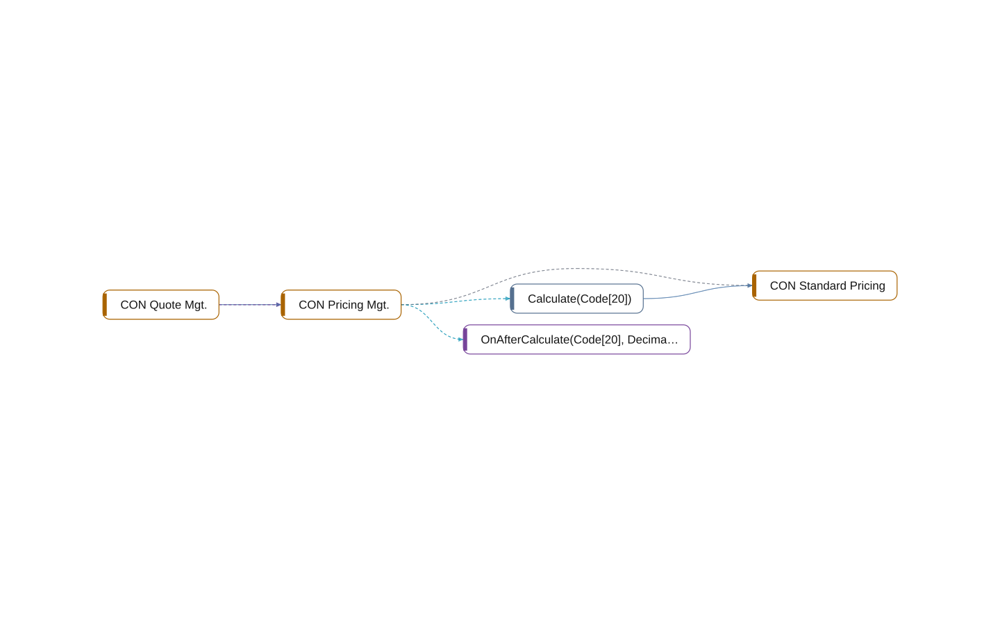

# codeunit 50011 CON Pricing Mgt.

[System](../README.md) › [Contoso Core](../apps/contoso-core.md) › [Core](../components/core.md) › [Contoso.Core.Pricing](../namespaces/contoso-core-pricing.md)

The codeunit CON Pricing Mgt. of the app Contoso Core, in the component Core, has 2 members in 17 lines. It calls, uses 1 other object, and 1 object uses it.

| Fact | Value |
| --- | --- |
| Type | codeunit |
| ID | 50011 |
| App | Contoso Core |
| Component | Core |
| Namespace | Contoso.Core.Pricing |
| Visibility | public |
| Lines | 17 |
| Procedures | 1 |
| Complexity | 2 |
| Uses | 1 |
| Used by | 1 |
| Source | `core/Pricing.al:24` |

## Inside

Layer 5: its procedures, triggers, and events, and what each of them does.

| Member | Kind | Lines | Complexity | Does |
| --- | --- | ---: | ---: | --- |
| `procedure Calculate(ItemNo: Code[20]): Decimal` | procedure | 9 | 1 | calls [CON Standard Pricing](codeunit-50010-con-standard-pricing.md) |
| `procedure OnAfterCalculate(ItemNo: Code[20]; var Price: Decimal)` | event | 3 | 1 |  |

## Uses

- **calls** [codeunit 50010 CON Standard Pricing](codeunit-50010-con-standard-pricing.md)
- **uses** [codeunit 50010 CON Standard Pricing](codeunit-50010-con-standard-pricing.md)

## Used by

- **calls** [codeunit 50100 CON Quote Mgt.](codeunit-50100-con-quote-mgt.md)
- **subscribes** [codeunit 50100 CON Quote Mgt.](codeunit-50100-con-quote-mgt.md)
- **uses** [codeunit 50100 CON Quote Mgt.](codeunit-50100-con-quote-mgt.md)

## Findings

- **info** `undocumented-public-api`: codeunit 50011 CON Pricing Mgt.: 1 public procedure(s) without a /// summary: Calculate
  - On: [CON Pricing Mgt.](codeunit-50011-con-pricing-mgt.md)
  - Source: `core/Pricing.al:26`

_Generated by BC Atlas from the AL source. Do not edit; run `bca layers` again._
