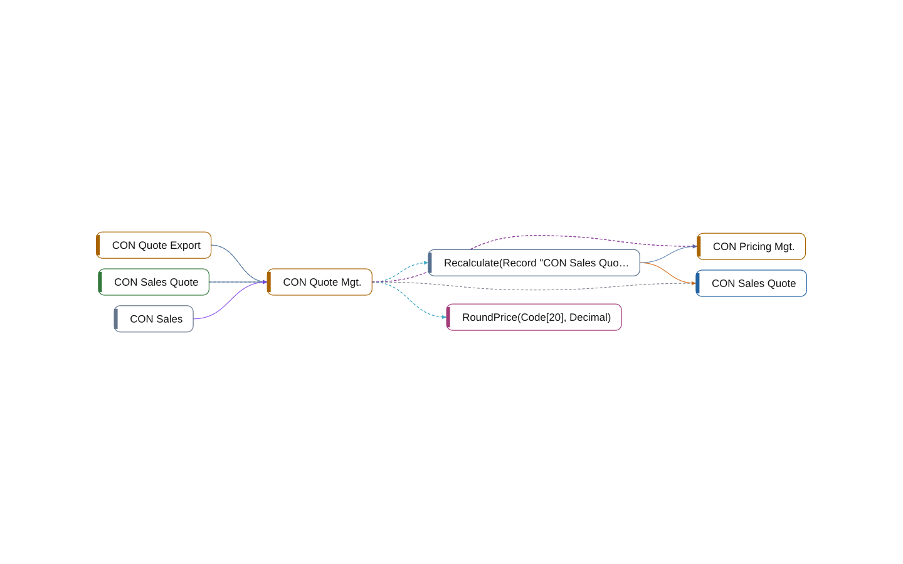

# codeunit 50100 CON Quote Mgt.

[System](../README.md) › [Contoso Sales](../apps/contoso-sales.md) › [Sales](../components/sales.md) › [Contoso.Sales.Quotes](../namespaces/contoso-sales-quotes.md)

The codeunit CON Quote Mgt. of the app Contoso Sales, in the component Sales, has 2 members in 16 lines. It calls, subscribes, uses, writes 2 other objects, and 3 objects use it.

| Fact | Value |
| --- | --- |
| Type | codeunit |
| ID | 50100 |
| App | Contoso Sales |
| Component | Sales |
| Namespace | Contoso.Sales.Quotes |
| Visibility | public |
| Lines | 16 |
| Procedures | 2 |
| Complexity | 2 |
| Uses | 2 |
| Used by | 3 |
| Source | `sales/Quotes.al:24` |

## Inside

Layer 5: its procedures, triggers, and events, and what each of them does.

| Member | Kind | Lines | Complexity | Does |
| --- | --- | ---: | ---: | --- |
| `procedure Recalculate(var Quote: Record "CON Sales Quote")` | procedure | 7 | 1 | writes [CON Sales Quote](table-50100-con-sales-quote.md); calls [CON Pricing Mgt.](codeunit-50011-con-pricing-mgt.md) |
| `local procedure RoundPrice(ItemNo: Code[20]; var Price: Decimal)` | subscriber | 4 | 1 |  |

## Uses

- **calls** [codeunit 50011 CON Pricing Mgt.](codeunit-50011-con-pricing-mgt.md)
- **subscribes** [codeunit 50011 CON Pricing Mgt.](codeunit-50011-con-pricing-mgt.md)
- **uses** [codeunit 50011 CON Pricing Mgt.](codeunit-50011-con-pricing-mgt.md), [table 50100 CON Sales Quote](table-50100-con-sales-quote.md)
- **writes** [table 50100 CON Sales Quote](table-50100-con-sales-quote.md)

## Used by

- **calls** [codeunit 50200 CON Quote Export](codeunit-50200-con-quote-export.md), [page 50100 CON Sales Quote](page-50100-con-sales-quote.md)
- **permits** [permissionset 50100 CON Sales](permissionset-50100-con-sales.md)
- **uses** [codeunit 50200 CON Quote Export](codeunit-50200-con-quote-export.md), [page 50100 CON Sales Quote](page-50100-con-sales-quote.md)

## Findings

- **info** `undocumented-public-api`: codeunit 50100 CON Quote Mgt.: 1 public procedure(s) without a /// summary: Recalculate
  - On: [CON Quote Mgt.](codeunit-50100-con-quote-mgt.md)
  - Source: `sales/Quotes.al:26`

_Generated by BC Atlas from the AL source. Do not edit; run `bca layers` again._
