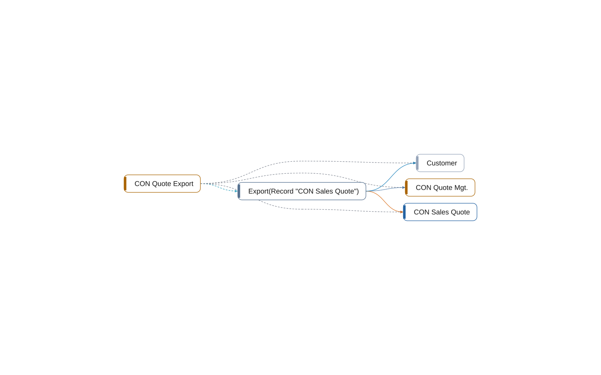

# codeunit 50200 CON Quote Export

[System](../README.md) › [Contoso Integration](../apps/contoso-integration.md) › [Integration](../components/integration.md) › [Contoso.Integration](../namespaces/contoso-integration.md)

The codeunit CON Quote Export of the app Contoso Integration, in the component Integration, has 1 member in 15 lines. It calls, reads, uses, writes 3 other objects, and nothing in this workspace uses it.

| Fact | Value |
| --- | --- |
| Type | codeunit |
| ID | 50200 |
| App | Contoso Integration |
| Component | Integration |
| Namespace | Contoso.Integration |
| Visibility | public; can be internal |
| Lines | 15 |
| Procedures | 1 |
| Complexity | 2 |
| Uses | 3 |
| Used by | 0 |
| Source | `integration/Export.al:5` |

## Inside

Layer 5: its procedures, triggers, and events, and what each of them does.

| Member | Kind | Lines | Complexity | Does |
| --- | --- | ---: | ---: | --- |
| `procedure Export(var Quote: Record "CON Sales Quote")` | procedure | 9 | 2 | writes [CON Sales Quote](table-50100-con-sales-quote.md); calls [CON Quote Mgt.](codeunit-50100-con-quote-mgt.md); reads Customer (other app) |

## Uses

- **calls** [codeunit 50100 CON Quote Mgt.](codeunit-50100-con-quote-mgt.md)
- **reads** table Customer (other app)
- **uses** [codeunit 50100 CON Quote Mgt.](codeunit-50100-con-quote-mgt.md), [table 50100 CON Sales Quote](table-50100-con-sales-quote.md), table Customer (other app)
- **writes** [table 50100 CON Sales Quote](table-50100-con-sales-quote.md)

## What to change here

- 5. Let Sales own the writes to table 50100 CON Sales Quote (medium)
- 7. Make 2 objects of Integration internal (small)

Why and how: [What to change, and how](../changes.md).

## Findings

- **info** `undocumented-public-api`: codeunit 50200 CON Quote Export: 1 public procedure(s) without a /// summary: Export
  - On: [CON Quote Export](codeunit-50200-con-quote-export.md)
  - Source: `integration/Export.al:7`

_Generated by BC Atlas from the AL source. Do not edit; run `bca layers` again._
