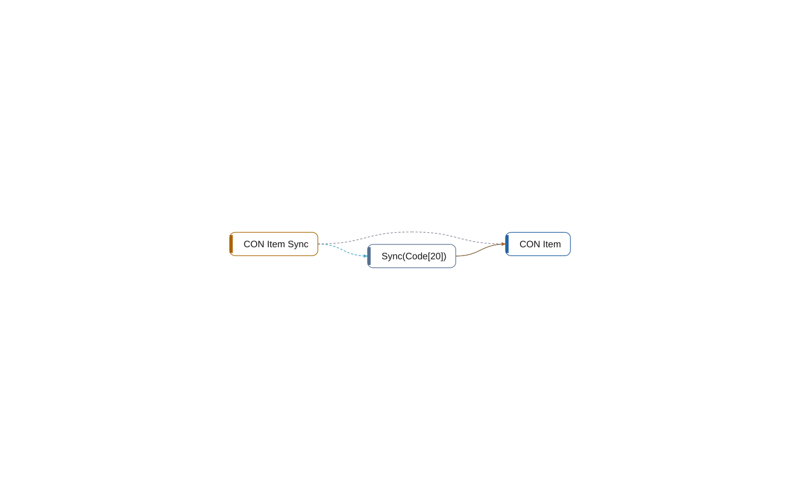

# codeunit 50201 CON Item Sync

[System](../README.md) › [Contoso Integration](../apps/contoso-integration.md) › [Integration](../components/integration.md) › [Contoso.Integration](../namespaces/contoso-integration.md)

The codeunit CON Item Sync of the app Contoso Integration, in the component Integration, has 1 member in 10 lines. It reads, uses, writes 1 other object, and nothing in this workspace uses it.

| Fact | Value |
| --- | --- |
| Type | codeunit |
| ID | 50201 |
| App | Contoso Integration |
| Component | Integration |
| Namespace | Contoso.Integration |
| Visibility | public; can be internal |
| Lines | 10 |
| Procedures | 1 |
| Complexity | 2 |
| Uses | 1 |
| Used by | 0 |
| Source | `integration/ItemSync.al:6` |

## Inside

Layer 5: its procedures, triggers, and events, and what each of them does.

| Member | Kind | Lines | Complexity | Does |
| --- | --- | ---: | ---: | --- |
| `procedure Sync(ItemNo: Code[20])` | procedure | 7 | 2 | reads [CON Item](table-50000-con-item.md); writes [CON Item](table-50000-con-item.md) |

## Uses

- **reads** [table 50000 CON Item](table-50000-con-item.md)
- **uses** [table 50000 CON Item](table-50000-con-item.md)
- **writes** [table 50000 CON Item](table-50000-con-item.md)

## Findings

- **error** `architecture-violation`: codeunit CON Item Sync (Integration) depends on 1 object(s) in Core; declare the dependency; it points inward (declare-dependency)
  - On: [CON Item Sync](codeunit-50201-con-item-sync.md)
  - Source: `integration/ItemSync.al:10`
- **info** `undocumented-public-api`: codeunit 50201 CON Item Sync: 1 public procedure(s) without a /// summary: Sync
  - On: [CON Item Sync](codeunit-50201-con-item-sync.md)
  - Source: `integration/ItemSync.al:8`

_Generated by BC Atlas from the AL source. Do not edit; run `bca layers` again._
