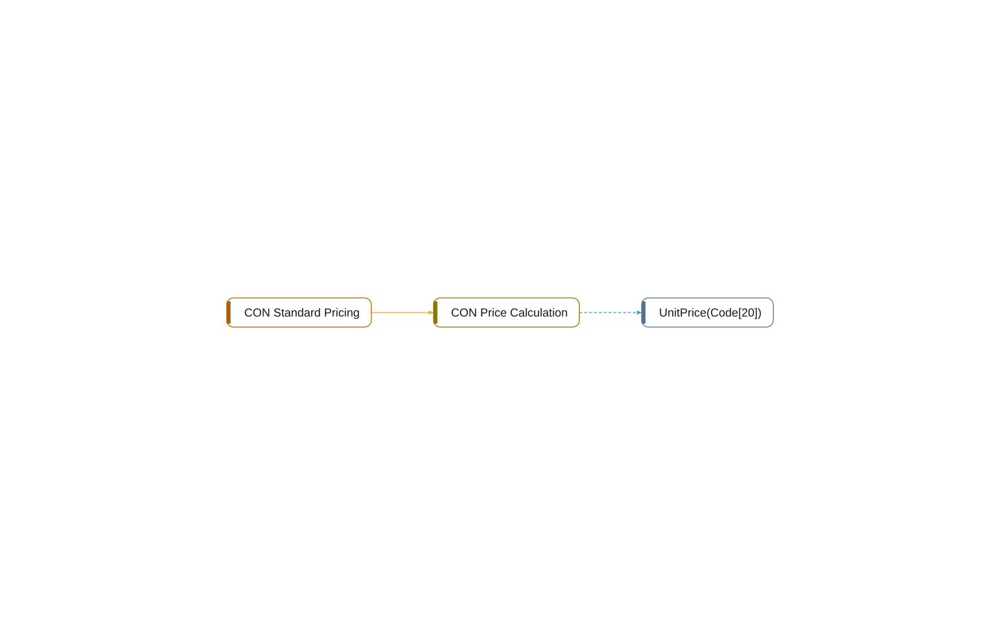

# interface CON Price Calculation

[System](../README.md) › [Contoso Core](../apps/contoso-core.md) › [Core](../components/core.md) › [Contoso.Core.Pricing](../namespaces/contoso-core-pricing.md)

The interface CON Price Calculation of the app Contoso Core, in the component Core, has 1 member in 4 lines. It uses no other object, and 1 object uses it.

| Fact | Value |
| --- | --- |
| Type | interface |
| App | Contoso Core |
| Component | Core |
| Namespace | Contoso.Core.Pricing |
| Visibility | public |
| Lines | 4 |
| Procedures | 1 |
| Uses | 0 |
| Used by | 1 |
| Source | `core/Pricing.al:5` |

## Inside

Layer 5: its procedures, triggers, and events, and what each of them does.

| Member | Kind | Lines | Complexity | Does |
| --- | --- | ---: | ---: | --- |
| `procedure UnitPrice(ItemNo: Code[20]): Decimal` | procedure | 1 |  |  |

## Used by

- **implements** [codeunit 50010 CON Standard Pricing](codeunit-50010-con-standard-pricing.md)

## Findings

- **info** `undocumented-public-api`: interface CON Price Calculation: 1 public procedure(s) without a /// summary: UnitPrice
  - On: [CON Price Calculation](interface-con-price-calculation.md)
  - Source: `core/Pricing.al:7`

_Generated by BC Atlas from the AL source. Do not edit; run `bca layers` again._
