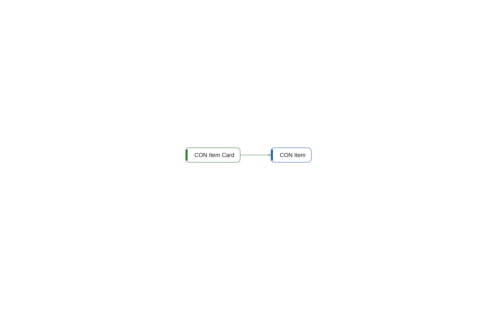

# page 50000 CON Item Card

[System](../README.md) › [Contoso Core](../apps/contoso-core.md) › [Core](../components/core.md) › [Contoso.Core.Items](../namespaces/contoso-core-items.md)

The page CON Item Card of the app Contoso Core, in the component Core, has 14 lines. It source 1 other object, and nothing in this workspace uses it.

| Fact | Value |
| --- | --- |
| Type | page |
| ID | 50000 |
| App | Contoso Core |
| Component | Core |
| Namespace | Contoso.Core.Items |
| Visibility | public |
| Lines | 14 |
| Uses | 1 |
| Used by | 0 |
| Source | `core/Items.al:37` |

## Uses

- **source** [table 50000 CON Item](table-50000-con-item.md)

_Generated by BC Atlas from the AL source. Do not edit; run `bca layers` again._
