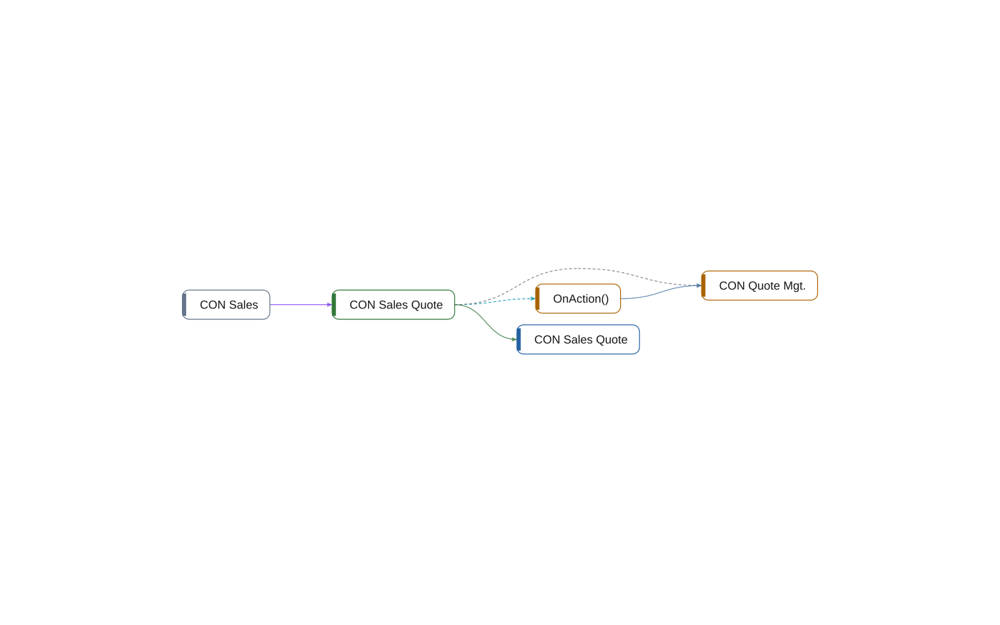

# page 50100 CON Sales Quote

[System](../README.md) › [Contoso Sales](../apps/contoso-sales.md) › [Sales](../components/sales.md) › [Contoso.Sales.Quotes](../namespaces/contoso-sales-quotes.md)

The page CON Sales Quote of the app Contoso Sales, in the component Sales, has 1 member in 32 lines. It calls, source, uses 2 other objects, and 1 object uses it.

| Fact | Value |
| --- | --- |
| Type | page |
| ID | 50100 |
| App | Contoso Sales |
| Component | Sales |
| Namespace | Contoso.Sales.Quotes |
| Visibility | public |
| Lines | 32 |
| Complexity | 1 |
| Uses | 2 |
| Used by | 1 |
| Source | `sales/Quotes.al:41` |

## Inside

Layer 5: its procedures, triggers, and events, and what each of them does.

| Member | Kind | Lines | Complexity | Does |
| --- | --- | ---: | ---: | --- |
| `trigger OnAction()` | trigger | 6 | 1 | calls [CON Quote Mgt.](codeunit-50100-con-quote-mgt.md) |

## Uses

- **calls** [codeunit 50100 CON Quote Mgt.](codeunit-50100-con-quote-mgt.md)
- **source** [table 50100 CON Sales Quote](table-50100-con-sales-quote.md)
- **uses** [codeunit 50100 CON Quote Mgt.](codeunit-50100-con-quote-mgt.md)

## Used by

- **permits** [permissionset 50100 CON Sales](permissionset-50100-con-sales.md)

_Generated by BC Atlas from the AL source. Do not edit; run `bca layers` again._
