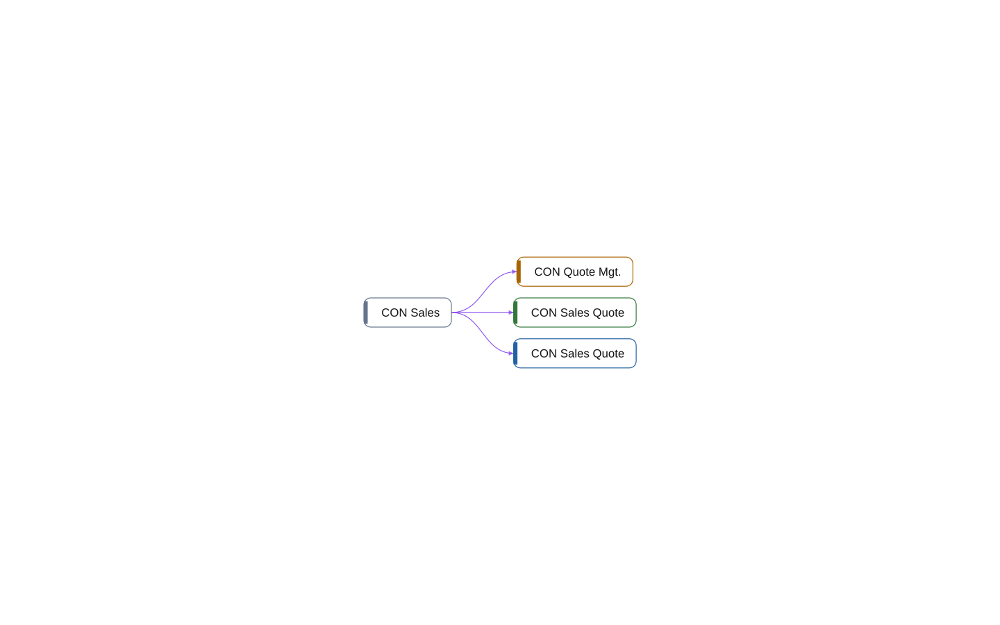

# permissionset 50100 CON Sales

[System](../README.md) › [Contoso Sales](../apps/contoso-sales.md) › [Sales](../components/sales.md) › [Contoso.Sales.Quotes](../namespaces/contoso-sales-quotes.md)

The permissionset CON Sales of the app Contoso Sales, in the component Sales, has 7 lines. It permits 3 other objects, and nothing in this workspace uses it.

| Fact | Value |
| --- | --- |
| Type | permissionset |
| ID | 50100 |
| App | Contoso Sales |
| Component | Sales |
| Namespace | Contoso.Sales.Quotes |
| Visibility | public |
| Lines | 7 |
| Uses | 3 |
| Used by | 0 |
| Source | `sales/Quotes.al:74` |

## Uses

- **permits** [codeunit 50100 CON Quote Mgt.](codeunit-50100-con-quote-mgt.md), [page 50100 CON Sales Quote](page-50100-con-sales-quote.md), [table 50100 CON Sales Quote](table-50100-con-sales-quote.md)

_Generated by BC Atlas from the AL source. Do not edit; run `bca layers` again._
