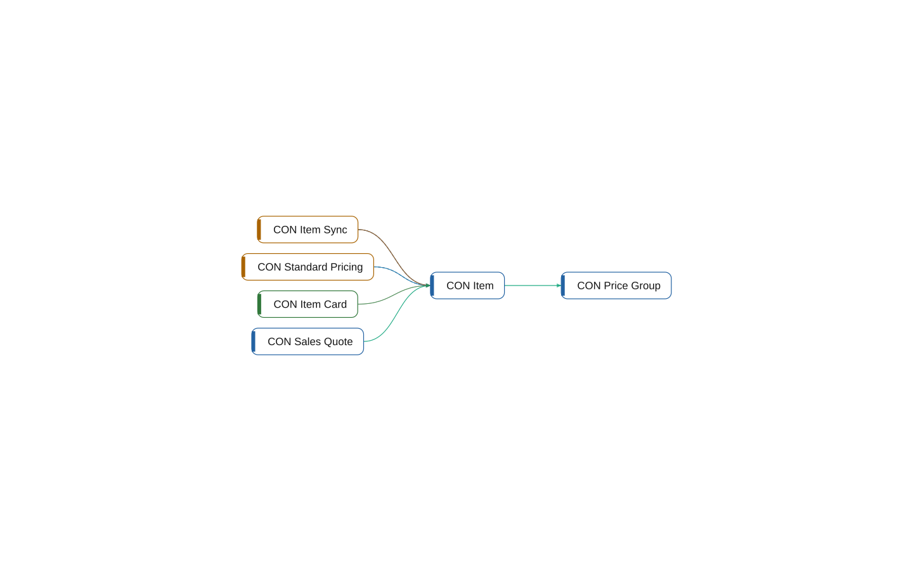

# table 50000 CON Item

[System](../README.md) › [Contoso Core](../apps/contoso-core.md) › [Core](../components/core.md) › [Contoso.Core.Items](../namespaces/contoso-core-items.md)

The table CON Item of the app Contoso Core, in the component Core, has 17 lines. It relates 1 other object, and 4 objects use it.

| Fact | Value |
| --- | --- |
| Type | table |
| ID | 50000 |
| App | Contoso Core |
| Component | Core |
| Namespace | Contoso.Core.Items |
| Visibility | public |
| Lines | 17 |
| Uses | 1 |
| Used by | 4 |
| Source | `core/Items.al:3` |

## Uses

- **relates** [table 50001 CON Price Group](table-50001-con-price-group.md)

## Used by

- **reads** [codeunit 50010 CON Standard Pricing](codeunit-50010-con-standard-pricing.md), [codeunit 50201 CON Item Sync](codeunit-50201-con-item-sync.md)
- **relates** [table 50100 CON Sales Quote](table-50100-con-sales-quote.md)
- **source** [page 50000 CON Item Card](page-50000-con-item-card.md)
- **uses** [codeunit 50010 CON Standard Pricing](codeunit-50010-con-standard-pricing.md), [codeunit 50201 CON Item Sync](codeunit-50201-con-item-sync.md)
- **writes** [codeunit 50201 CON Item Sync](codeunit-50201-con-item-sync.md)

## What to change here

- 3. CON Item Sync: declare the dependency; it points inward (small)
- 4. Let Core own the writes to table 50000 CON Item (medium)

Why and how: [What to change, and how](../changes.md).

## Findings

- **info** `foreign-table-write`: table 50000 CON Item of Core is written by Integration (1 object); let Core own the writes behind a codeunit, or move the table
  - On: [CON Item](table-50000-con-item.md)
  - Source: `core/Items.al:3`

_Generated by BC Atlas from the AL source. Do not edit; run `bca layers` again._
