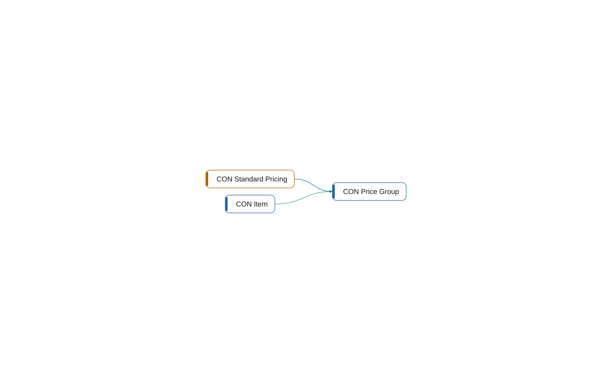

# table 50001 CON Price Group

[System](../README.md) › [Contoso Core](../apps/contoso-core.md) › [Core](../components/core.md) › [Contoso.Core.Items](../namespaces/contoso-core-items.md)

The table CON Price Group of the app Contoso Core, in the component Core, has 15 lines. It uses no other object, and 2 objects use it.

| Fact | Value |
| --- | --- |
| Type | table |
| ID | 50001 |
| App | Contoso Core |
| Component | Core |
| Namespace | Contoso.Core.Items |
| Visibility | public |
| Lines | 15 |
| Uses | 0 |
| Used by | 2 |
| Source | `core/Items.al:21` |

## Used by

- **reads** [codeunit 50010 CON Standard Pricing](codeunit-50010-con-standard-pricing.md)
- **relates** [table 50000 CON Item](table-50000-con-item.md)
- **uses** [codeunit 50010 CON Standard Pricing](codeunit-50010-con-standard-pricing.md)

_Generated by BC Atlas from the AL source. Do not edit; run `bca layers` again._
