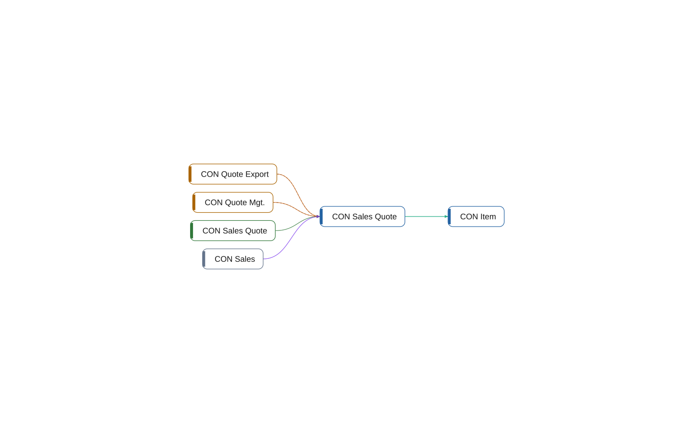

# table 50100 CON Sales Quote

[System](../README.md) › [Contoso Sales](../apps/contoso-sales.md) › [Sales](../components/sales.md) › [Contoso.Sales.Quotes](../namespaces/contoso-sales-quotes.md)

The table CON Sales Quote of the app Contoso Sales, in the component Sales, has 17 lines. It relates 1 other object, and 4 objects use it.

| Fact | Value |
| --- | --- |
| Type | table |
| ID | 50100 |
| App | Contoso Sales |
| Component | Sales |
| Namespace | Contoso.Sales.Quotes |
| Visibility | public |
| Lines | 17 |
| Uses | 1 |
| Used by | 4 |
| Source | `sales/Quotes.al:6` |

## Uses

- **relates** [table 50000 CON Item](table-50000-con-item.md)

## Used by

- **permits** [permissionset 50100 CON Sales](permissionset-50100-con-sales.md)
- **source** [page 50100 CON Sales Quote](page-50100-con-sales-quote.md)
- **uses** [codeunit 50100 CON Quote Mgt.](codeunit-50100-con-quote-mgt.md), [codeunit 50200 CON Quote Export](codeunit-50200-con-quote-export.md)
- **writes** [codeunit 50100 CON Quote Mgt.](codeunit-50100-con-quote-mgt.md), [codeunit 50200 CON Quote Export](codeunit-50200-con-quote-export.md)

## Findings

- **info** `foreign-table-write`: table 50100 CON Sales Quote of Sales is written by Integration (1 object); let Sales own the writes behind a codeunit, or move the table
  - On: [CON Sales Quote](table-50100-con-sales-quote.md)
  - Source: `sales/Quotes.al:6`

_Generated by BC Atlas from the AL source. Do not edit; run `bca layers` again._
