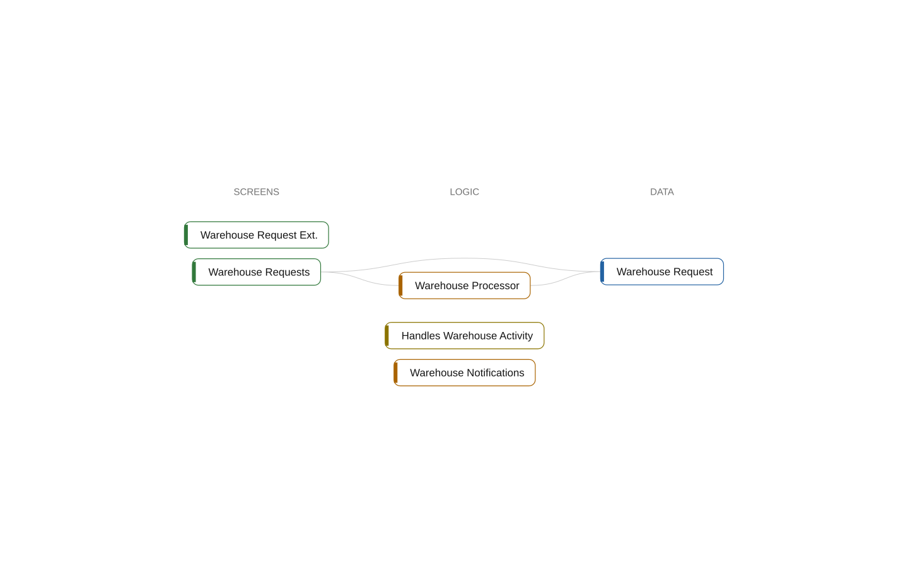
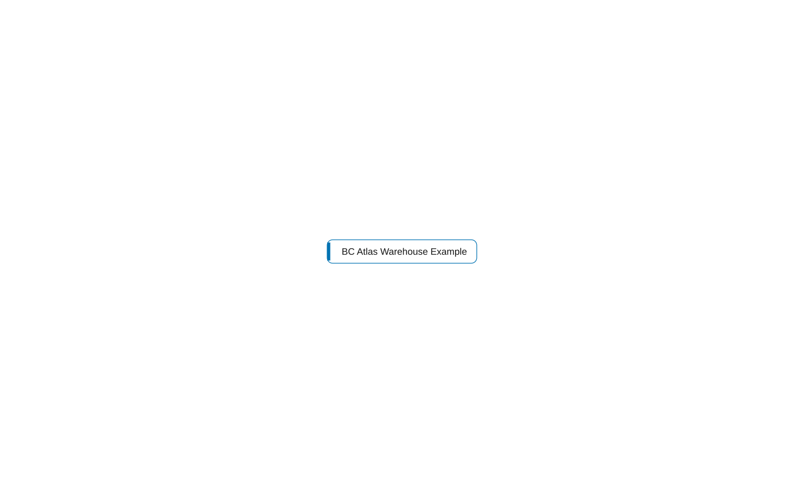
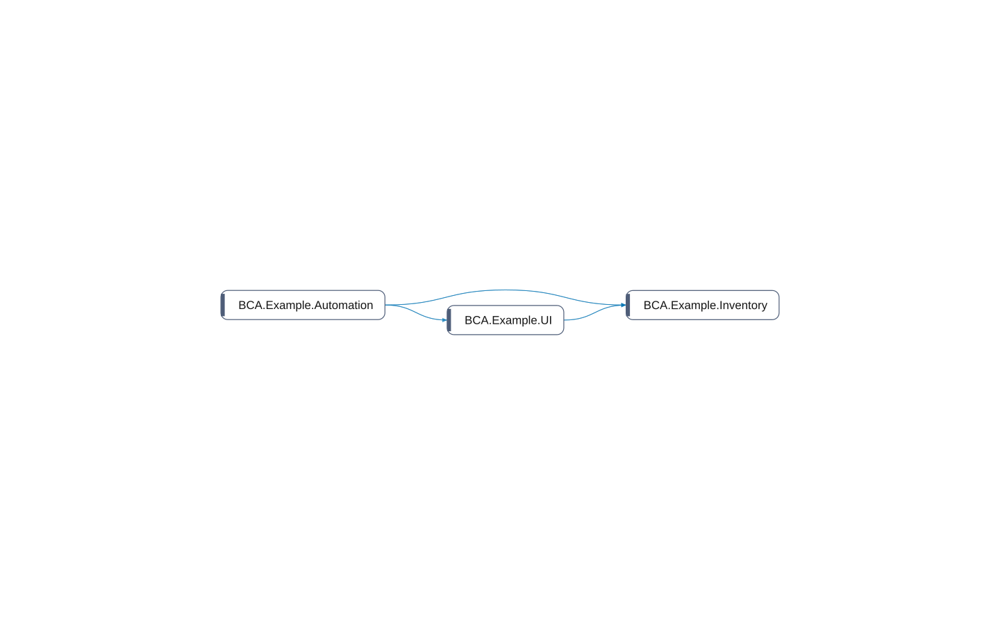
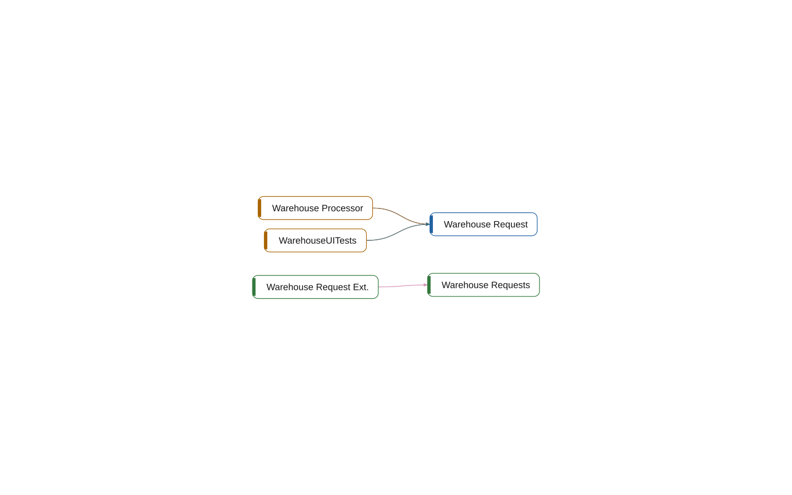
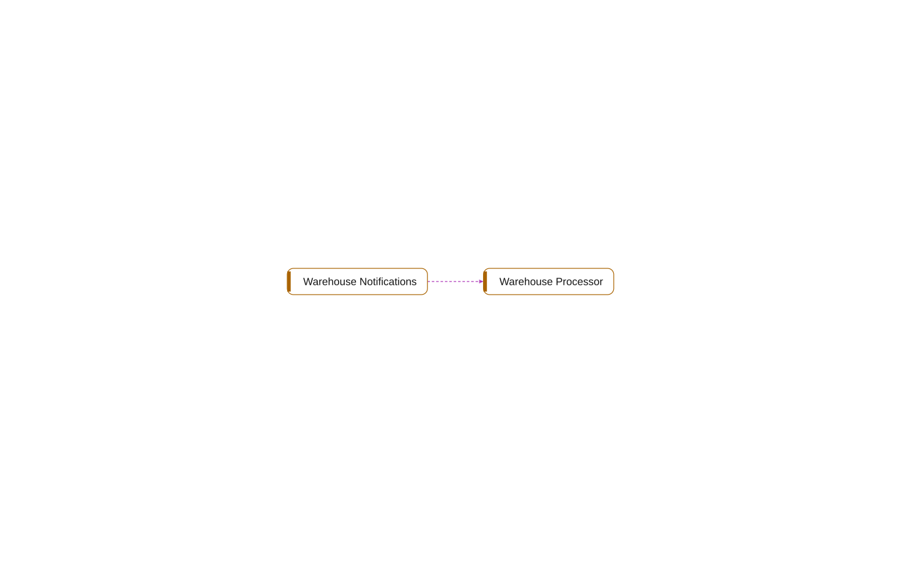
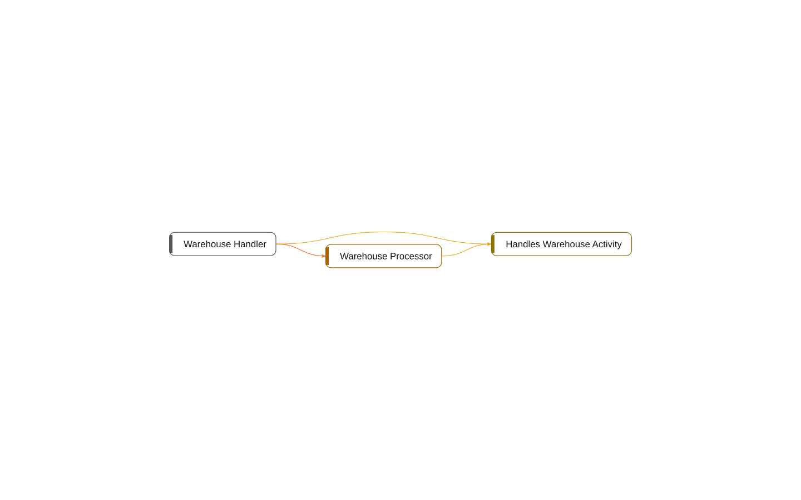
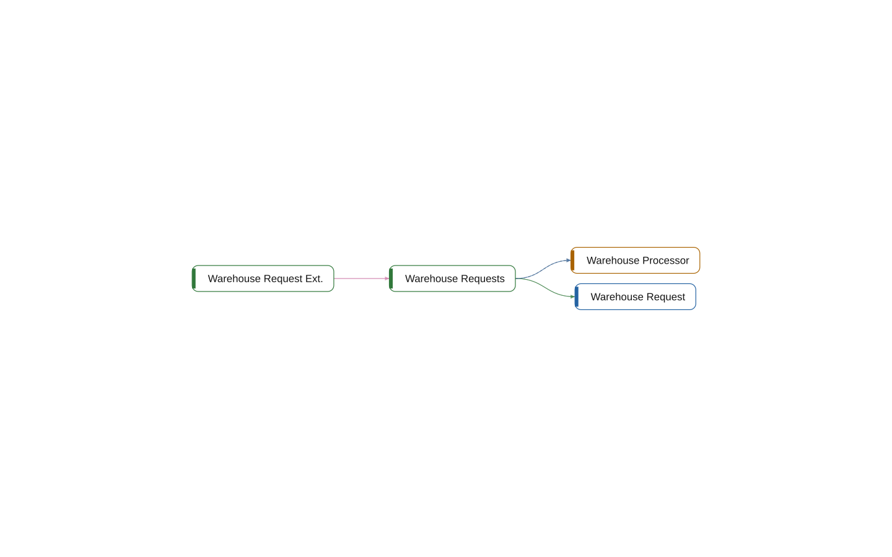

<!-- Generated by BC Atlas. Do not edit; rerun the command below instead. -->

# BC Atlas Warehouse Example architecture

**BC Atlas Warehouse Example** 1.0.0.0 by BC Atlas contributors

## At a glance

| Files | Objects | Relationships | Unresolved | Cycles | Health |
| --- | --- | --- | --- | --- | --- |
| 4 | 9 | 28 | 0 | 0 | Passed (0 errors, 0 warnings) |

## Contents

- [Overview](#overview)
- [Apps](#apps)
- [Modules](#modules)
- [Data](#data)
- [Events](#events)
- [Contracts](#contracts)
- [Pages](#pages)
- [Architecture health](#architecture-health)

## Overview

How it works, from left to right: the screens, the logic behind them, and the data.



6 nodes, 3 relations.

## Apps

The apps of the workspace, the apps they depend on, and what they use of each other.



1 nodes, 0 relations.

## Modules

Namespaces and what they use of each other.



3 nodes, 3 relations.

## Data

Tables and the code that reads, writes, relates, and extends them.



5 nodes, 5 relations.

## Events

Event publishers and their subscribers.



2 nodes, 1 relations.

## Contracts

Interfaces and what implements them.



3 nodes, 3 relations.

## Pages

Pages and reports, and what they show, run, and contain.



4 nodes, 4 relations.

## Architecture health

**Passed** - 0 error(s), 0 warning(s), 2 info. Fails on: `error`.

| Metric | Value |
| --- | --- |
| Apps | BC Atlas Warehouse Example 1.0.0.0 |
| Files | 4 |
| Objects | 9 |
| Relationships | 28 |
| Unresolved references | 0 |
| Dependency cycles | 0 |

| Object type | Count |
| --- | --- |
| codeunit | 3 |
| enum | 1 |
| interface | 1 |
| page | 1 |
| pageextension | 1 |
| permissionset | 1 |
| table | 1 |

**Most connected objects**

| Object | Used by | Depends on |
| --- | --- | --- |
| codeunit 50101 Warehouse Processor | 4 | 2 |
| page 50110 Warehouse Requests | 3 | 2 |
| permissionset 50121 WAREHOUSE PROCESS | 0 | 4 |
| table 50100 Warehouse Request | 4 | 0 |
| codeunit 50120 Warehouse Notifications | 1 | 1 |
| codeunit 50122 WarehouseUITests | 0 | 2 |
| enum 50102 Warehouse Handler | 0 | 2 |
| interface Handles Warehouse Activity | 2 | 0 |
| pageextension 50111 Warehouse Request Ext. | 0 | 1 |

| Severity | Rule | Finding | Evidence |
| --- | --- | --- | --- |
| Info | `undocumented-public-api` | codeunit 50101 Warehouse Processor: 2 public procedure(s) without a /// summary: Process, Process (`Inventory.al:35`) |  |
| Info | `undocumented-public-api` | interface Handles Warehouse Activity: 1 public procedure(s) without a /// summary: Process (`Inventory.al:5`) |  |

## Regenerate

```sh
bca export examples/warehouse-app --view report -o examples/report
```

_4 AL file(s) analyzed. Result: PASSED - 0 error(s), 0 warning(s), 2 info (fail on: error)._
