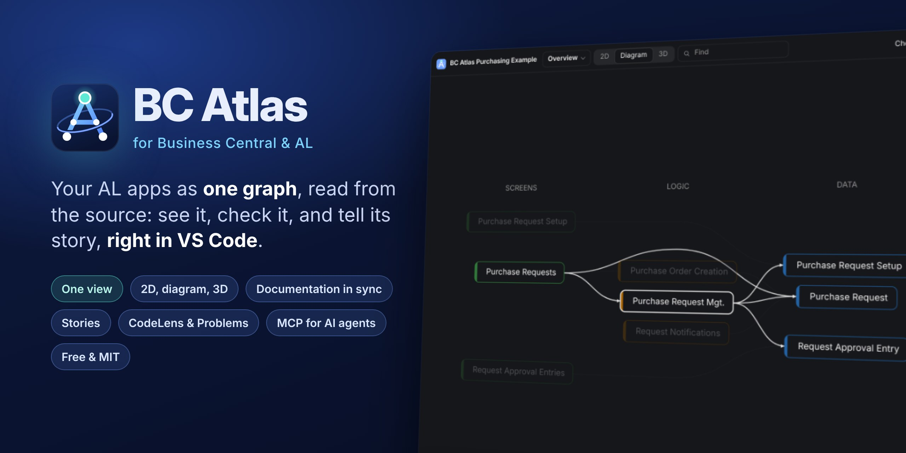
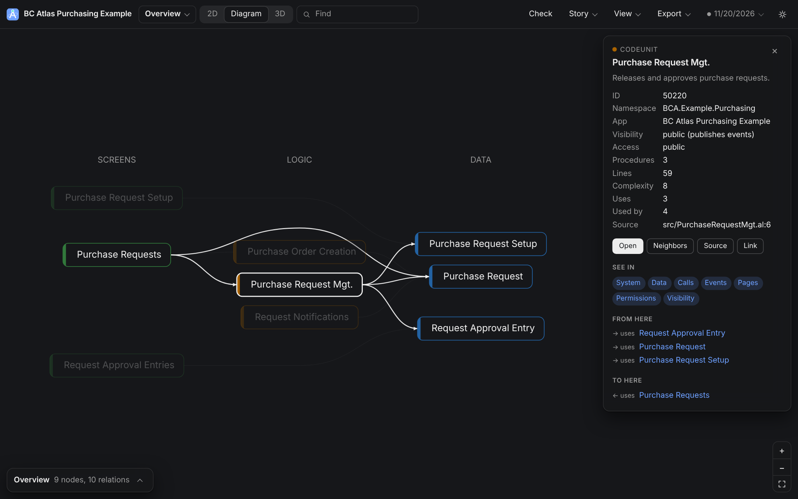
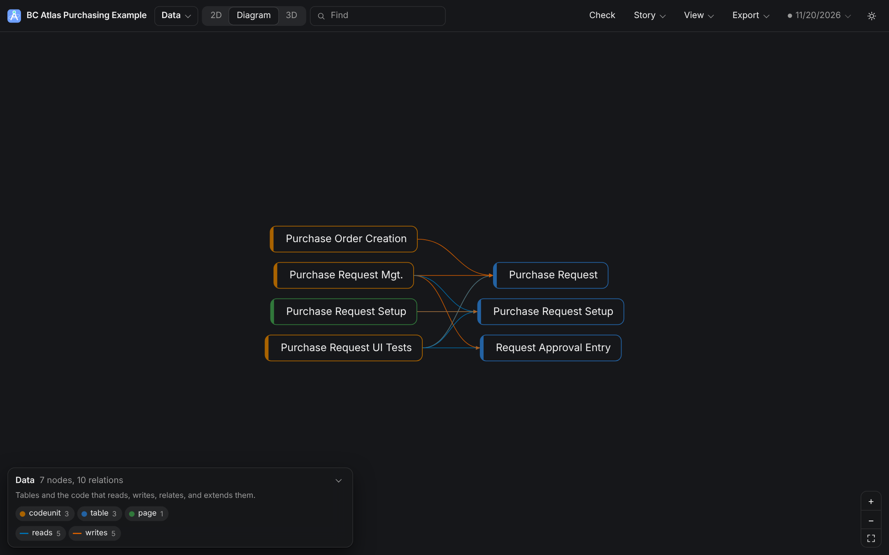
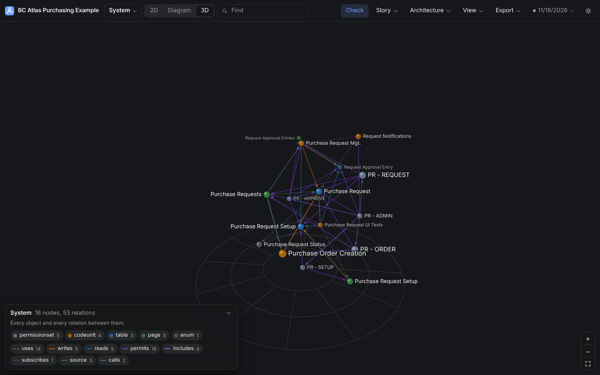
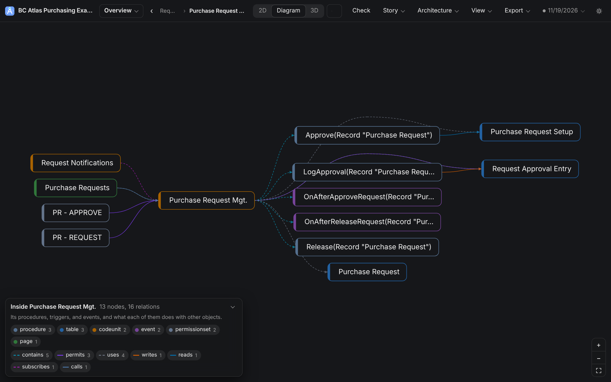

# BC Atlas for VS Code

**See your Business Central AL apps as one graph, read from the source:
every object, what it does with the others, what is wrong with it, and the
story of how it works.** One view, a toolbar and the graph, right next to
your code.

Open a folder with an `app.json`, and BC Atlas analyzes it. There is nothing
else to install: the extension brings its engine along and runs it on the
editor's own Node.js runtime. Everything stays on your machine.

## First: how it works

The view opens on the **Overview**: how the app works, from left to right.
The screens, the logic behind them, and the data. Lines stay quiet until you
click something; then its way lights up, from the screen to the tables it
ends in. A large project
shows areas in place of single objects, and an area opens with a double
click.

## One view: a toolbar and the graph

The source code is the only fact. Everything BC Atlas reads from it is one
graph, and the toolbar decides what you see of it:

- a **lens** shows a part: how it works, the system, the apps, the
  namespaces, the data, the calls, the events, the contracts, the pages, the permissions, what is
  public or internal, the findings;
- **2D**, **Diagram**, or **3D** is the form, for any lens;
- **Find** lights up what you look for, **Check** puts the findings on the
  nodes they are about;
- click a node for what it is, its findings with the fix, and its
  relations; **Go to source** opens its line;
- double-click to go into it: an app or a namespace opens to its objects, an object to its procedures. A trail next to the lens says
  where you are, and every part of it is one click back. Nothing jumps:
  what stays in the picture stays where it is.

There are no pages, no tabs, and no lists to learn.

## The same graph as a diagram, and in space

A diagram puts the same nodes in layers, in the direction of their
relations: who uses whom reads from left to right. In 3D, drag to turn the
graph. The selection, the search, and what you hid in the legend stay when
you switch.

## Open an object

Double-click an object and it opens: its procedures, triggers, and events
become nodes, with what each of them does to other objects. Double-click a
procedure and the editor is at its line.

## Stories: documentation and demonstration

A story is generated from the source, like everything else. It walks through
the graph step by step, with a text for each step and the nodes it is about:

- **what the system is**, from the outside in, to explain it to someone new;
- **what to fix**, one finding at a time, with the fix.

Press **Play** to demonstrate, **Markdown** to keep the story as a document.

## Right where you code

- **The graph follows the source**: save a file and it is read again.
- **The graph follows the editor**: the object of the file in front is the
  selected node.
- **CodeLens** above every object: how often it is used and how much it
  uses.
- **Problems panel**: health findings at their file and line,
  with the fix in the message.
- **Right-click in an AL file**: Show This Object, Show This Object in 3D,
  Show This Object from the Inside.
- **Status bar**: health at a glance.

## Everything you see, you can keep

**Export** saves the picture (PNG, SVG), the graph (JSON), the nodes and
relations (CSV), the lens and every story (Markdown), and a link to the view
as it is. **BC Atlas: Export…** writes the whole view as one offline HTML
file for people without VS Code: a few hundred kilobytes for thousands of
objects.

## For AI agents

The extension registers the **BC Atlas MCP server**, so agents in VS Code, for
example GitHub Copilot in agent mode, can check the health, read any lens or
story of the view, fix a finding, and check again.

## Get started

1. Install BC Atlas and open a folder with an `app.json` (or a folder above
   several apps).
2. Click the BC Atlas icon in the activity bar, or run **BC Atlas: Open**.
3. Choose **Story › What … is** for a first walk through the system.
4. Turn on **Check** to see the findings on the graph. The Problems panel
   shows the same findings, and `bca check` gates on them in CI.

## Commands

All commands are in the Command Palette under `BC Atlas: ...`.

| Command | Does |
| --- | --- |
| Open, Open a Lens… | Shows the view, or the view with one lens. |
| Run Health Check | Analyzes again and fills the Problems panel; the same rules as `bca check` in CI. |
| Export… | Writes the view as one offline HTML file to share. |
| Generate Documentation from UI Tests… | Markdown, HTML, DITA, Azure DevOps CSV, or BPMN from AL UI tests. |
| Select Project… | Chooses the app, or a folder above several apps, to analyze. |
| Analyze Again, Show Output | |

## Settings

| Setting | Default | Description |
| --- | --- | --- |
| `bcAtlas.project` | empty | Folder to analyze, relative to the workspace. Empty: the first app, or the workspace folder when it holds several apps. |
| `bcAtlas.paths` | `[]` | Only analyze these folders or globs (like `--paths`); speeds up large repositories such as BCApps. |
| `bcAtlas.problems` | `true` | Findings in the Problems panel. |
| `bcAtlas.codeLens` | `true` | CodeLens above AL objects. |
| `bcAtlas.followEditor` | `true` | Select the object of the active editor in the graph. |
| `bcAtlas.nodePath` | empty | Node.js 22 or later for the engine; empty uses the runtime built into VS Code. |

## CI, pipelines, and the command line

The same engine is the `bc-atlas` npm package: `bca check` gates pull
requests, `bca export` writes reports and the view as one file, and
`bca layers --check` keeps the generated documentation in sync. See the [documentation](https://schulzoli.github.io/BC-Atlas/).

## Privacy

The analysis runs locally, inside VS Code. BC Atlas sends no telemetry and
makes no network requests.

## Requirements

VS Code 1.101 or later. No AL symbols needed; with `.alpackages`, references
into Microsoft's apps resolve too. Large projects take a while on the first
analysis (the Base Application with the System Application and Business
Foundation: about two minutes); afterwards the view opens in about a second.

The screenshots show the example apps of the
[BC Atlas repository](https://github.com/SchulzOli/BC-Atlas/tree/main/examples)
(`purchasing-app` and `multi-app`); `vscode/marketing/screenshots.mjs` takes
them.

## License

MIT. BC Atlas bundles `tree-sitter-al` and `web-tree-sitter` (MIT), elkjs
(EPL-2.0), resvg (MPL-2.0), and Liberation Sans (OFL-1.1).
