# BC Atlas for VS Code

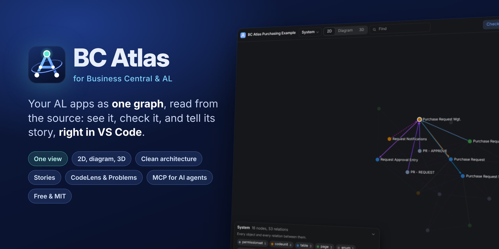

**See your Business Central AL apps as one graph, read from the source:
every object, what it does with the others, what is wrong with it, and the
story of how it works.** One view, a toolbar and the graph, right next to
your code.

Open a folder with an `app.json`, and BC Atlas analyzes it. There is nothing
else to install: the extension brings its engine along and runs it on the
editor's own Node.js runtime. Everything stays on your machine.

## First: how it works

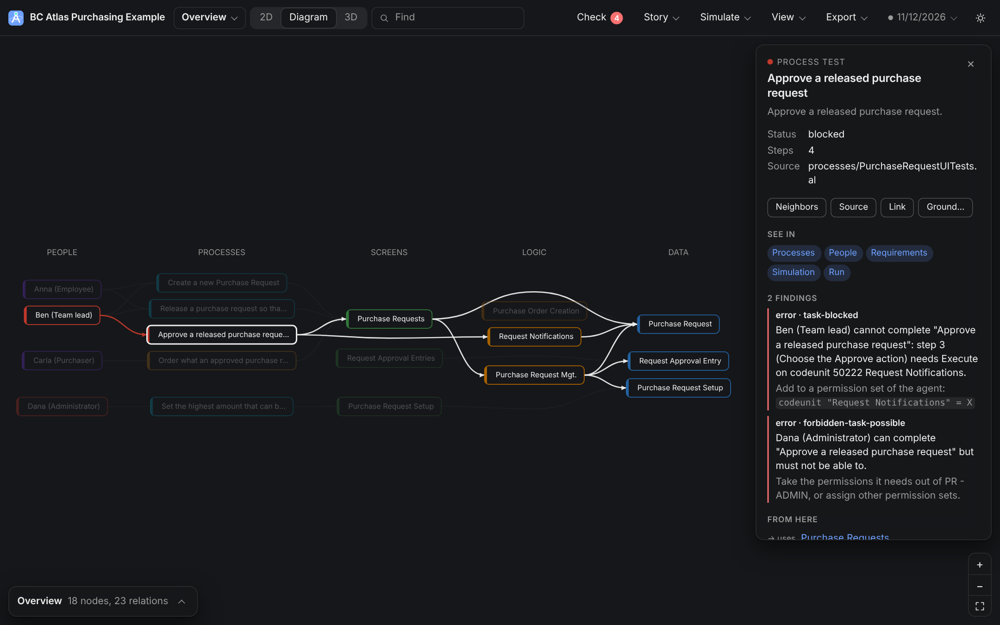

The view opens on the **Overview**: how the app works, from left to right.
Who uses it, what they do, on which screens, with which logic, in which
data. Lines stay quiet until you click something; then its way lights up,
from the person who starts it to the tables it ends in. A large project
shows areas in place of single objects, and an area opens with a double
click.

## One view: a toolbar and the graph

The source code is the only fact. Everything BC Atlas reads from it is one
graph, and the toolbar decides what you see of it:

- a **lens** shows a part: how it works, the system, the components, the apps, the data,
  the calls, the events, the contracts, the pages, the permissions, what is
  public or internal, the findings, the processes, the people;
- **2D**, **Diagram**, or **3D** is the form, for any lens;
- **Find** lights up what you look for, **Check** puts the findings on the
  nodes they are about;
- click a node for what it is, its findings with the fix, and its
  relations; **Go to source** opens its line;
- double-click to go into it: an app, a component, or a namespace opens to
  its objects, an object to its procedures. A trail next to the lens says
  where you are, and every part of it is one click back. Nothing jumps:
  what stays in the picture stays where it is.

There are no pages, no tabs, and no lists to learn.

## The same graph as a diagram, and in space

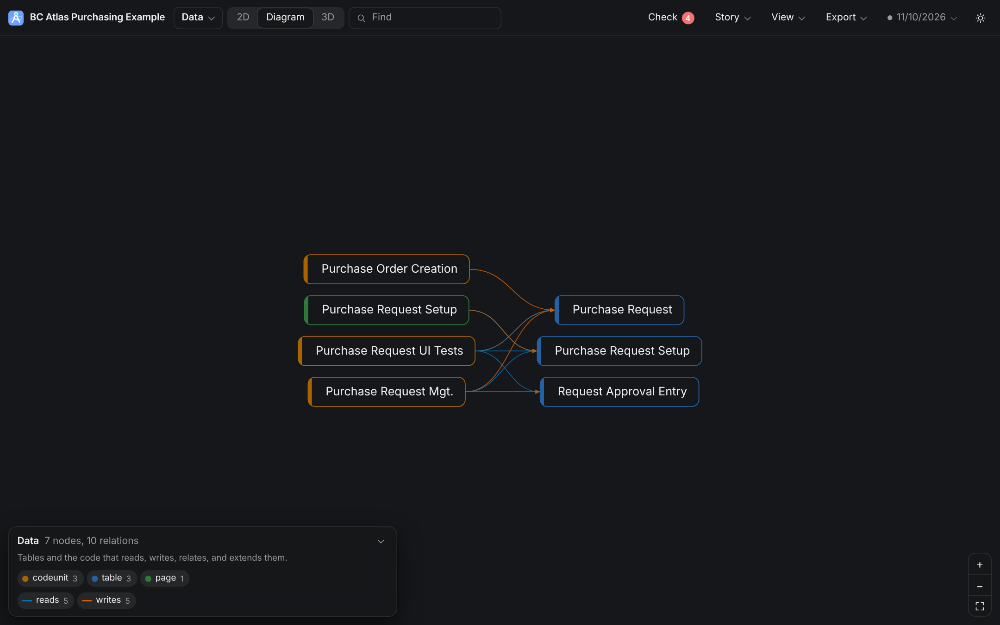

A diagram puts the same nodes in layers, in the direction of their
relations: who uses whom reads from left to right. In 3D, drag to turn the
graph. The selection, the search, and what you hid in the legend stay when
you switch.

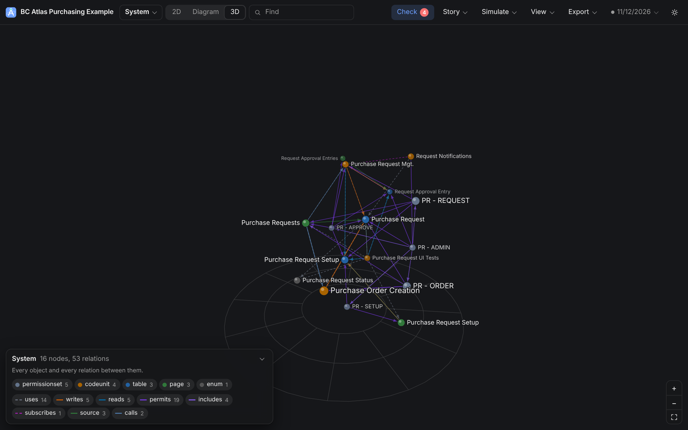

## Open an object

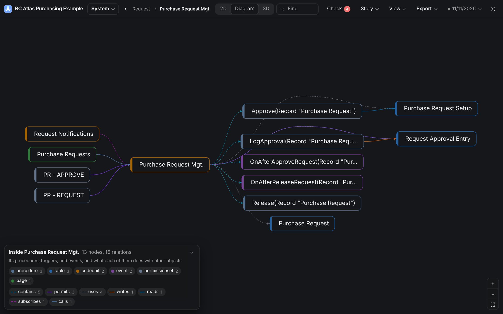

Double-click an object and it opens: its procedures, triggers, and events
become nodes, with what each of them does to other objects. Double-click a
procedure and the editor is at its line.

## Stories: documentation, test, and demonstration

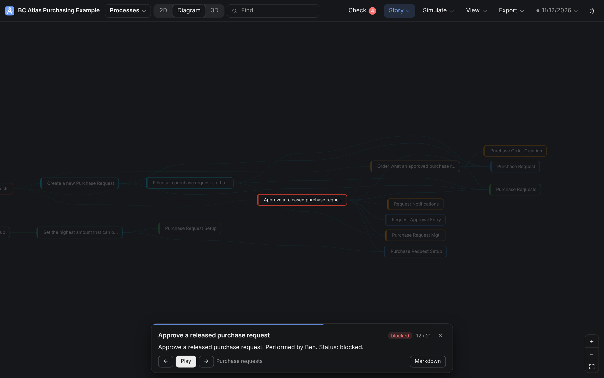

A story is generated from the source, like everything else. It walks through
the graph step by step, with a text for each step and the nodes it is about:

- **what the system is**, from the outside in, to explain it to someone new;
- **one story per process** from your AL UI tests: the tests in order, every
  step on the objects it touches and with the permissions it needs;
- **what to fix**, one finding at a time, with the fix;
- **the dependencies that point the wrong way**, with the steps to resolve
  each.

Press **Play** to demonstrate, **Markdown** to keep the story as a document.

## Find an architecture, then keep it

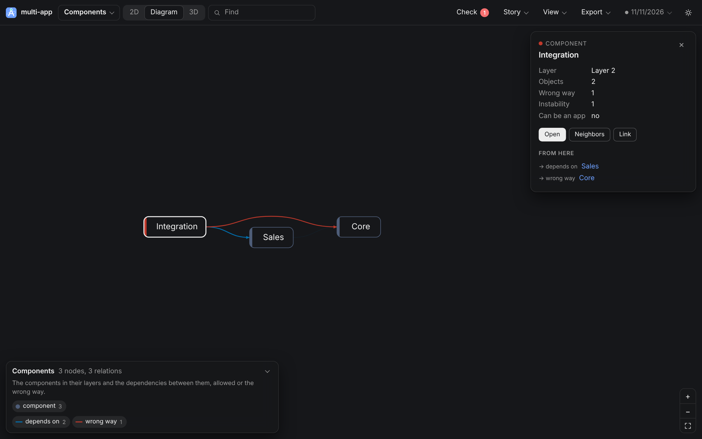

BC Atlas proposes a layered architecture from today's dependencies, or checks
the one you define in `.bca.json`. Every dependency that points the wrong way
is red, and a **work item that says what to do in AL terms**: move a
subscriber, move a field into a table extension, extract an interface.
**Keep these components** writes the proposal down; **Accept the wrong-way
dependencies** records a baseline, so from then on only new violations fail,
and the baseline can only shrink.

It answers the question behind splitting a large app: *which parts could
become apps of their own today, and what is in the way for the rest?*

## Who can do what

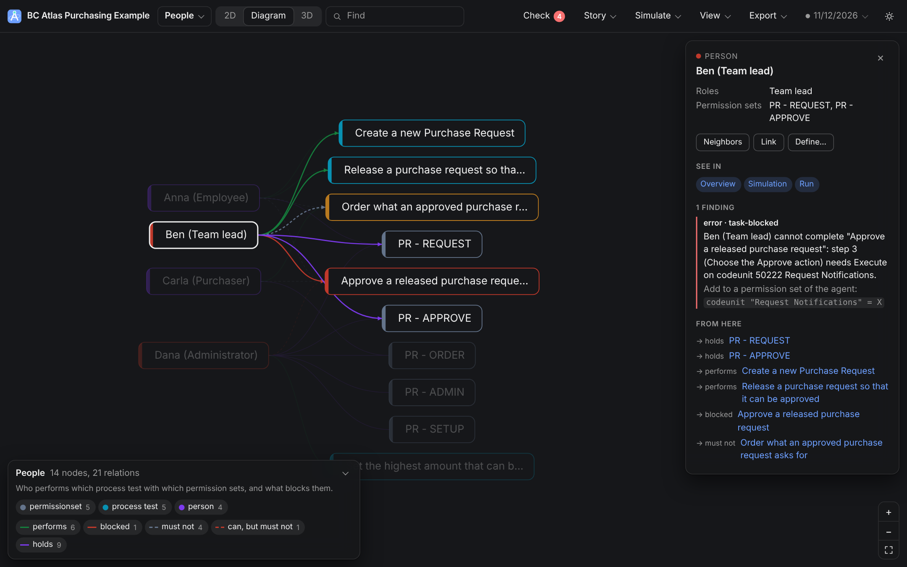

With process tests in the project, BC Atlas lets agents with the roles and
permission sets of your company perform them, step by step, from the source.
The graph shows who performs what, who is blocked and by which missing
permission, and who can do what they must not.

## What really runs in Business Central

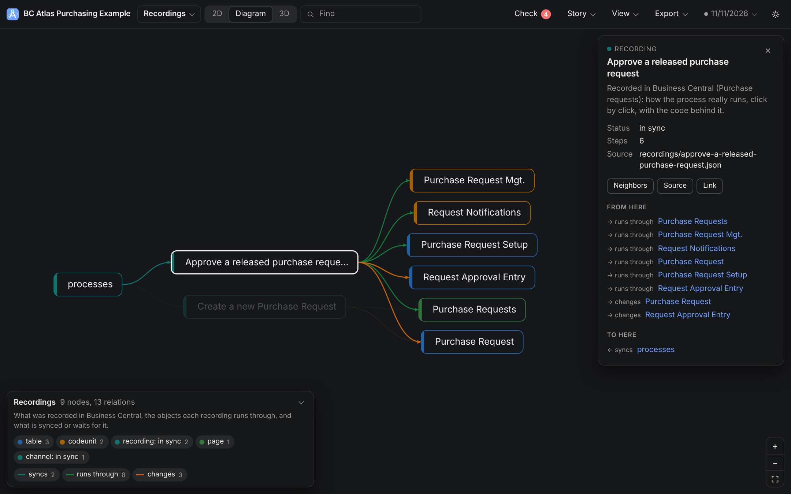

The source says what can happen; a recording says what does. With
[BC Atlas Sync](https://github.com/SchulzOli/BC-Atlas/blob/main/plugins/sync/README.md)
set up, every process recorded in Business Central is a node of the same
graph: the objects it runs through, the tables it changes, and whether it is
synced into the project or waits for it. Plugins add lenses, findings, and
stories of their own in the same way.

## Simulate: define who uses the app

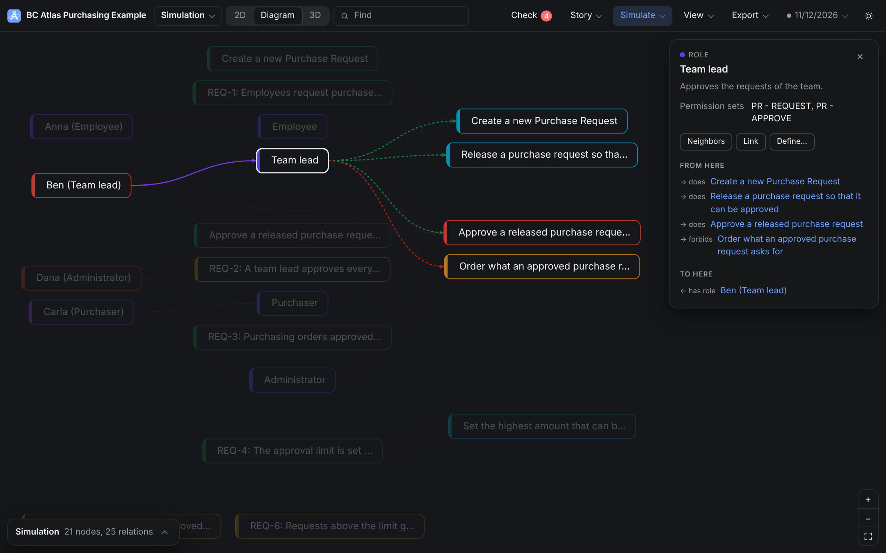

**Simulate**, next to Story, is where the company is defined: add an agent,
give a role its permission sets and task groups, say what a role must not be
able to do. Every change is written to `.bca.json` and the simulation runs
again, so the graph shows at once who gets through and who is stopped. The
same works from a terminal (`bca simulate define`) and for AI agents (the
MCP tool `bc_atlas_simulation_define`).

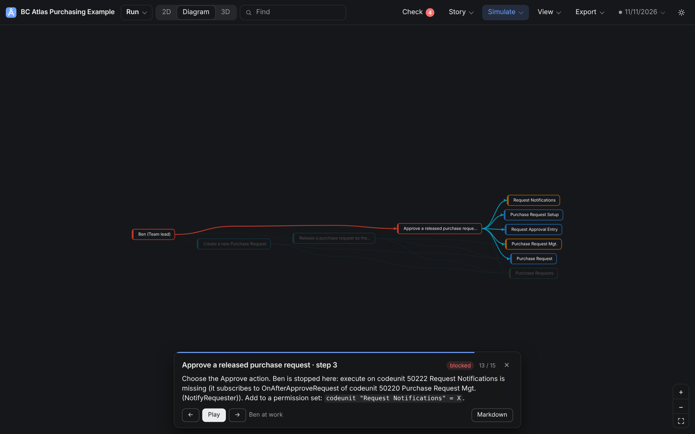

**Run, step by step**, in the same menu, plays the simulation of one person
on the graph. It starts with the person alone; every step adds the process
test and the objects it needs, and says whether the person can do it. Where
the person is stopped, the step names the missing permission and what to
add. **Build the bundle** then writes validation, the simulation with its
runs, the documentation, and the view as one folder and one ZIP file.

## Right where you code

- **The graph follows the source**: save a file and it is read again.
- **The graph follows the editor**: the object of the file in front is the
  selected node.
- **CodeLens** above every object: how often it is used, what it uses, its
  component, and its dependencies against the architecture.
- **Problems panel**: health and architecture findings at their file and line,
  with the fix in the message.
- **Right-click in an AL file**: Show This Object, Show This Object in 3D,
  Show This Object from the Inside.
- **Status bar**: health at a glance.

## Everything you see, you can keep

**Export** saves the picture (PNG, SVG), the graph (JSON), the nodes and
relations (CSV), the lens and every story (Markdown), and a link to the view
as it is. **BC Atlas: Export…** writes the whole view as one offline HTML
file for people without VS Code: a few hundred kilobytes for thousands of
objects.

## For AI agents

The extension registers the **BC Atlas MCP server**, so agents in VS Code, for
example GitHub Copilot in agent mode, can check the architecture, propose
one, pick a work item, apply it, and check again. Work items come with stable
strategy IDs, made for exactly that loop.

## Get started

1. Install BC Atlas and open a folder with an `app.json` (or a folder above
   several apps).
2. Click the BC Atlas icon in the activity bar, or run **BC Atlas: Open**.
3. Choose **Story › What … is** for a first walk through the system.
4. Choose the **Components** lens, review the proposal, and under **Live**
   choose **Keep these components**. From now on, the Problems panel and
   `bca check` keep the architecture.

## Commands

All commands are in the Command Palette under `BC Atlas: ...`.

| Command | Does |
| --- | --- |
| Open, Open a Lens… | Shows the view, or the view with one lens. |
| Run Health Check | Analyzes again and fills the Problems panel; the same rules as `bca check` in CI. |
| Show the Components, Accept Current Violations in the Baseline | Find and enforce a target architecture. |
| Export… | Writes the view as one offline HTML file to share, the Markdown report, the 3D explorer, the object catalog, the system handbook, or a diagram. |
| Generate Documentation from UI Tests… | Markdown, HTML, DITA, Azure DevOps CSV, or BPMN from AL UI tests. |
| Set Up Automation | `.bca.json`, Git hooks, a GitHub or Azure DevOps pipeline, and a schedule, in a guided terminal session. |
| Run Tasks of a Trigger… | Runs what a hook, the pipeline, or the schedule runs. |
| Select Project… | Chooses the app, or a folder above several apps, to analyze. |
| Analyze Again, Show Output | |

## Settings

| Setting | Default | Description |
| --- | --- | --- |
| `bcAtlas.project` | empty | Folder to analyze, relative to the workspace. Empty: the first app, or the workspace folder when it holds several apps. |
| `bcAtlas.paths` | `[]` | Only analyze these folders or globs (like `--paths`); speeds up large repositories such as BCApps. |
| `bcAtlas.problems` | `true` | Findings in the Problems panel. |
| `bcAtlas.codeLens` | `true` | CodeLens above AL objects. |
| `bcAtlas.followEditor` | `true` | Select the object of the active editor in the graph. |
| `bcAtlas.nodePath` | empty | Node.js 22 or later for the engine; empty uses the runtime built into VS Code. |

## CI, pipelines, and the command line

The same engine is the `bc-atlas` npm package: `bca check` gates pull
requests, `bca export` writes reports and the view as one file, and `bca run`
runs from Git hooks and pipelines. **Set Up Automation** configures all of it.
See the [documentation](https://schulzoli.github.io/BC-Atlas/).

## Privacy

The analysis runs locally, inside VS Code. BC Atlas sends no telemetry and
makes no network requests.

## Requirements

VS Code 1.101 or later. No AL symbols needed; with `.alpackages`, references
into Microsoft's apps resolve too. Large projects take a while on the first
analysis (the Base Application with the System Application and Business
Foundation: about two minutes); afterwards the view opens in about a second.

The screenshots show the example apps of the
[BC Atlas repository](https://github.com/SchulzOli/BC-Atlas/tree/main/examples)
(`purchasing-app` and `multi-app`); `vscode/marketing/screenshots.mjs` takes
them.

## License

MIT. BC Atlas bundles `tree-sitter-al` and `web-tree-sitter` (MIT), elkjs
(EPL-2.0), resvg (MPL-2.0), Liberation Sans (OFL-1.1), and, for the exported
3D explorer, 3d-force-graph with three.js (MIT).
