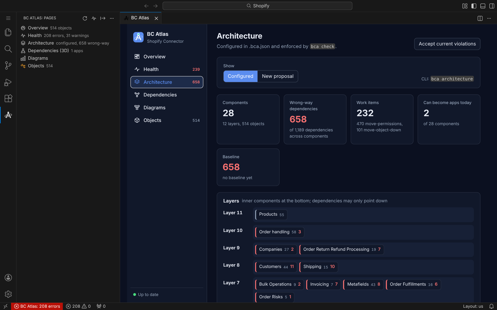
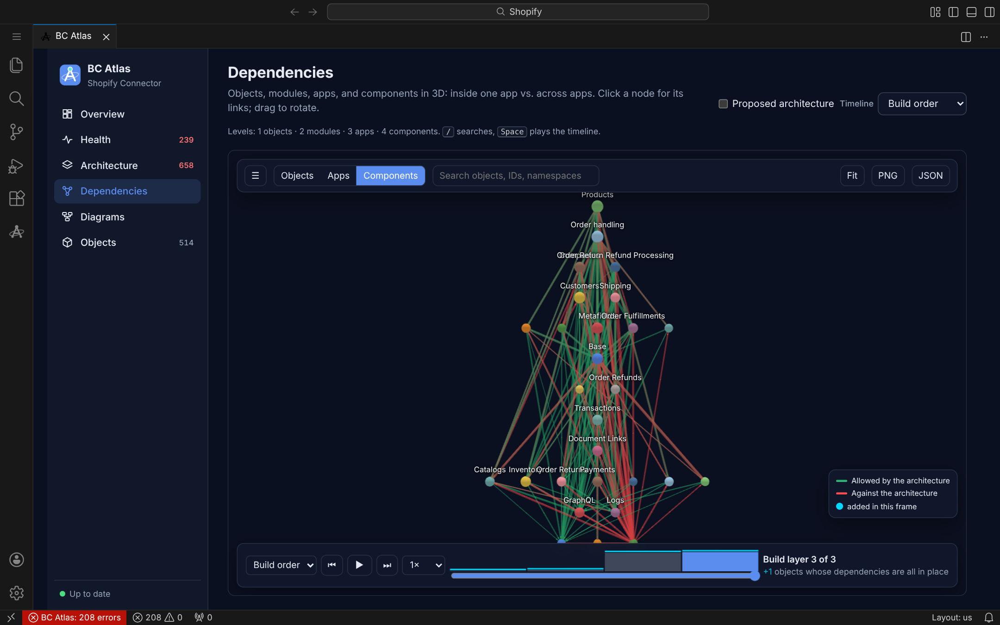
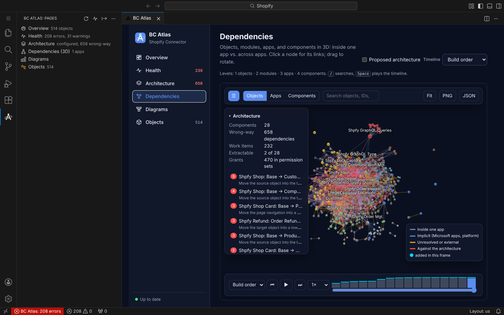
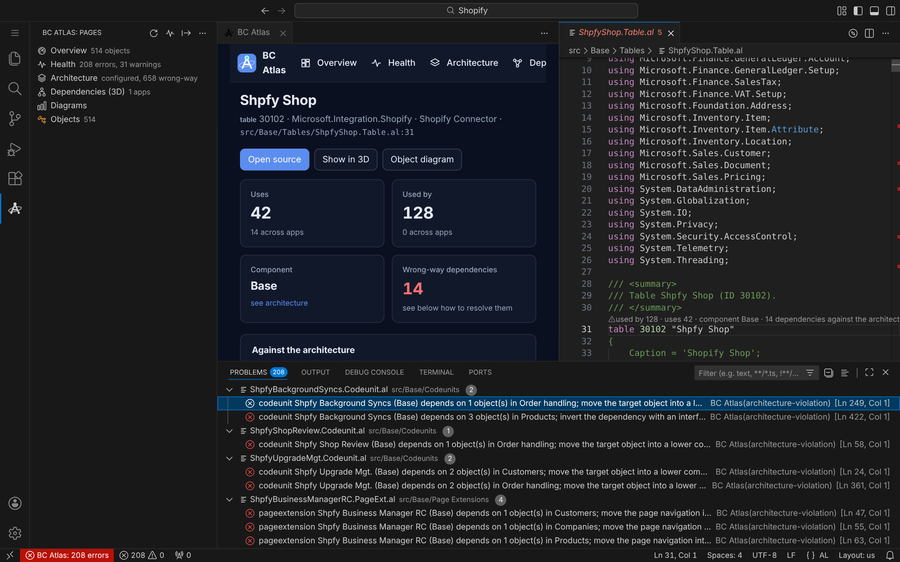
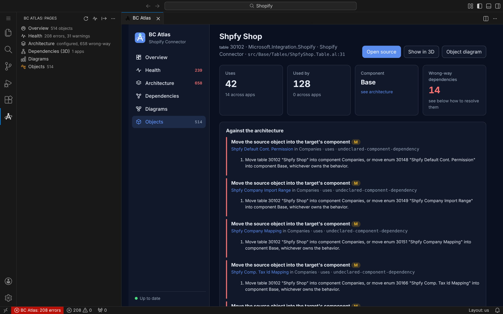
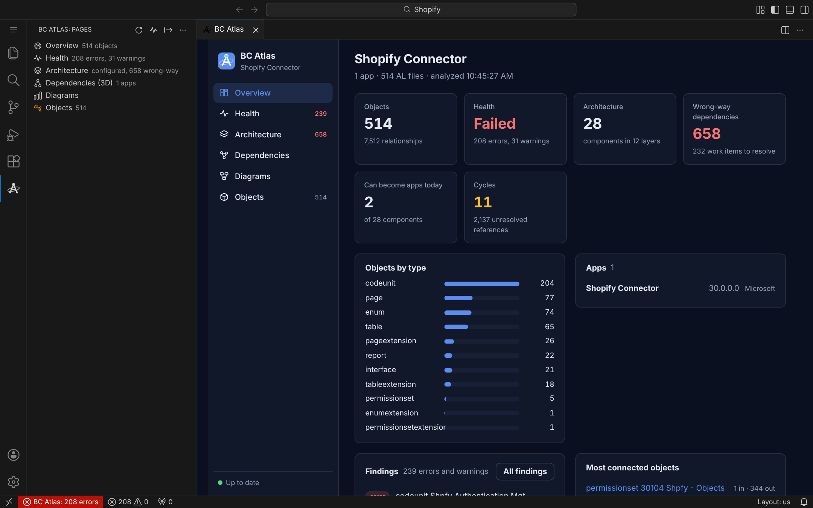

# BC Atlas for VS Code

**See the architecture of your Business Central AL apps, find every dependency
that stands in its way, and keep it clean as the code changes.** Dependencies
in 3D, clean-architecture checks with concrete fixes, health findings in the
Problems panel, diagrams, and documentation: one panel, right next to your
code.

Open a folder with an `app.json`, and BC Atlas analyzes it. There is nothing
else to install: the extension brings its engine along and runs it on the
editor's own Node.js runtime. Everything stays on your machine.

## Find an architecture, then keep it

BC Atlas proposes a layered architecture from today's dependencies, or checks
the one you define in `.bca.json`. Every dependency that points the wrong way
becomes a **work item that says what to do in AL terms**: move a subscriber,
move a field into a table extension, extract an interface. One click on
**Adopt this architecture** writes it down; **Accept current violations**
records a baseline, so from then on only new violations fail, and the baseline
can only shrink.

It answers the question behind splitting a large app: *which parts could
become apps of their own today, and what is in the way for the rest?*

## Dependencies in 3D, and in 4D

Fly through objects, modules, apps, and architecture components. Green links
follow the architecture, red ones break it. Filter, search, and click any node
for its links. Replay how the dependencies grew **commit by commit, per pull
request, or per release** on the timeline.

## Right where you code

- **CodeLens** above every object: how often it is used, what it uses, its
  component, and its dependencies against the architecture.
- **Problems panel**: health and architecture findings at their file and line,
  with the fix in the message.
- **Right-click in an AL file**: Show This Object, Show This Object in 3D,
  Diagram of This Object.
- **Status bar**: health at a glance; click it for the overview.

## Every object, one click away

Search all objects. Each one gets a page with what it uses and what uses it,
across apps, its fields, procedures, and actions, and every one of its
architecture violations with the steps to resolve it. **Open source** jumps to
the line.

## Health at a glance

The same rules as `bca check` in your pipeline: dependency cycles, forbidden
dependencies, architecture violations, hot spots with too many incoming or
outgoing dependencies, and parser diagnostics.

## All pages

| Page | What it shows |
| --- | --- |
| Overview | Objects, apps, health, the architecture at a glance, the most connected objects, and next steps. |
| Health | Every finding of `bca check`: cycles, forbidden dependencies, architecture violations, hot spots, diagnostics. |
| Architecture | The configured architecture or a proposal: components in layers, wrong-way dependencies as work items, metrics per component. |
| Dependencies | The 3D explorer: objects, modules, apps, and components; inside one app vs. across apps; replayed by commit, pull request, or release. |
| Diagrams | Ten diagram views (project, module, object, data, call, boundary, contracts, events, ui, workflow) with zoom and pan; save as SVG or D2. |
| Objects | Every AL object, searchable, with a page per object. |
| Docs | User guides from your AL UI tests, when the project has them. |

The pages are listed in the BC Atlas side bar, which marks the one the panel
shows; the panel itself shows only the page. It takes its colors, accents, and
fonts from your color theme,
including high contrast and custom themes, and updates when AL files,
`app.json`, `.bca.json`, or the baseline change.

## For AI agents

The extension registers the **BC Atlas MCP server**, so agents in VS Code, for
example GitHub Copilot in agent mode, can check the architecture, propose
one, pick a work item, apply it, and check again. Work items come with stable
strategy IDs, made for exactly that loop.

## Get started

1. Install BC Atlas and open a folder with an `app.json` (or a folder above
   several apps).
2. Click the BC Atlas icon in the activity bar, or run **BC Atlas: Open**.
3. On the Architecture page, review the proposal and choose **Adopt this
   architecture**. From now on, the Problems panel and `bca check` keep it.

## Commands

All commands are in the Command Palette under `BC Atlas: ...`.

| Command | Does |
| --- | --- |
| Open, Open Page… | Shows the panel. |
| Run Health Check | Analyzes again and fills the Problems panel; the same rules as `bca check` in CI. |
| Propose an Architecture, Accept Current Violations in the Baseline | Find and enforce a target architecture. |
| Export… | Writes the BC Atlas pages as one offline HTML file to share, the Markdown report, the 3D explorer, the object catalog, or a diagram. |
| Generate Documentation from UI Tests… | Markdown, HTML, DITA, Azure DevOps CSV, or BPMN from AL UI tests. |
| Set Up Automation | `.bca.json`, Git hooks, a GitHub or Azure DevOps pipeline, and a schedule, in a guided terminal session. |
| Run Tasks of a Trigger… | Runs what a hook, the pipeline, or the schedule runs. |
| Select Project… | Chooses the app, or a folder above several apps, to analyze. |
| Analyze Again, Show Output | |

## Settings

| Setting | Default | Description |
| --- | --- | --- |
| `bcAtlas.project` | empty | Folder to analyze, relative to the workspace. Empty: the first app, or the workspace folder when it holds several apps. |
| `bcAtlas.paths` | `[]` | Only analyze these folders or globs (like `--paths`); speeds up large repositories such as BCApps. |
| `bcAtlas.problems` | `true` | Findings in the Problems panel. |
| `bcAtlas.codeLens` | `true` | CodeLens above AL objects. |
| `bcAtlas.nodePath` | empty | Node.js 22 or later for the engine; empty uses the runtime built into VS Code. |

## CI, pipelines, and the command line

The same engine is the `bc-atlas` npm package: `bca check` gates pull
requests, `bca export` writes reports and the offline pages, and `bca run`
runs from Git hooks and pipelines. **Set Up Automation** configures all of it.
See the [documentation](https://schulzoli.github.io/BC-Atlas/).

## Privacy

The analysis runs locally, inside VS Code. BC Atlas sends no telemetry and
makes no network requests.

## Requirements

VS Code 1.101 or later. No AL symbols needed; with `.alpackages`, references
into Microsoft's apps resolve too. Large projects take a while on the first
analysis (the Base Application with the System Application and Business
Foundation: about two minutes); afterwards every page opens in under a second.

The screenshots show Microsoft's open-source
[Shopify Connector](https://github.com/microsoft/BCApps/tree/main/src/Apps/W1/Shopify)
from BCApps, with an architecture proposed by folder.

## License

MIT. BC Atlas bundles `tree-sitter-al` and `web-tree-sitter` (MIT), D2
(MPL-2.0), and 3d-force-graph with three.js (MIT).
